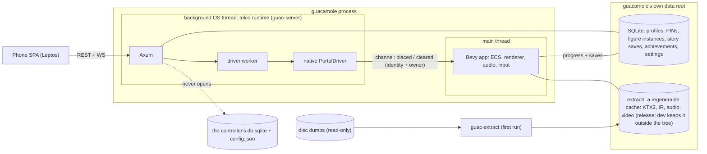

# Guacamole design

Status: DESIGN, started 2026-10-17 and revised the same day for chotchki's second, third and fourth rounds of
decisions.
This file owns the Guacamole track ([`openspec/config.yaml`](../../openspec/config.yaml) points here). Open
changes under `openspec/changes/`: [`aa-guacamole-shell/`](../../openspec/changes/aa-guacamole-shell/proposal.md),
[`ac-giants-decode-gate/`](../../openspec/changes/ac-giants-decode-gate/proposal.md),
[`ae-animated-turntable/`](../../openspec/changes/ae-animated-turntable/proposal.md),
[`ag-walk-one-level/`](../../openspec/changes/ag-walk-one-level/proposal.md),
[`ah-first-fight/`](../../openspec/changes/ah-first-fight/proposal.md) and
[`ap-tv-ui-on-bevy-widgets/`](../../openspec/changes/ap-tv-ui-on-bevy-widgets/proposal.md). Archived: AB
([`2026-10-18-ab-giants-extract-and-intros/`](../../openspec/changes/archive/2026-10-18-ab-giants-extract-and-intros/proposal.md)),
whose specs now live in [`openspec/specs/guacamole/`](../../openspec/specs/guacamole/), and AF
([`2026-10-19-af-oracle-foundation/`](../../openspec/changes/archive/2026-10-19-af-oracle-foundation/proposal.md)),
which carried no spec deltas (dev tooling). The later rungs of the
ladder are lines in the Guacamole section of [`openspec/backlog.md`](../../openspec/backlog.md). Until G1 the
product ([CLAUDE.md](../../CLAUDE.md), [SPEC.md](../../SPEC.md), `docs/dev/*`) is owned where it always was,
and it's frozen: the controller installed on the HTPC keeps playing the games and chotchki doesn't have to
touch it until Guacamole is ready.

## What Guacamole is

A from-scratch Rust/Bevy reimplementation of the PS3 Skylanders games WITH the original gameplay,
Skylanders Giants (BLUS30968) first, so the art can be upscaled and relit (on the Mac first, the HTPC
later). Users supply their own disc dumps, `guac-extract` pulls the assets out on first run and nothing
read from a disc ever ships or lands in this repo. The phone stays the portal, and a figure is just an
identity out of the disc's own roster, so nobody dumps a toy and nothing reads a `.sky`. It runs as a
second binary, `guacamole`, beside the product launcher until it can play a whole game.

The bar is parity: what the original game observably does, as seen through the patched RPCS3 (the
oracle), at the original logic tick, EXCEPT the deliberate departures listed below. The look is one of
them: ONE renderer, a remaster (the game's own models, materials and shading in linear light, tonemapped),
and the Enhanced line (modern lighting, upscaled textures) grows out of it (Decisions, fifth batch). The
oracle checks decoding and gameplay, not the look (and an upscaled game that plays wrong isn't the
goal).

The why is chotchki's: exploring what's even possible and bringing joy to his kids. There's no time or
cost pressure and the scale is not up for re-argument. What the motivation DOES set is ordering: every
rung of the ladder ends in something the kids can see on the TV, early and often, ahead of
plumbing-only phases.

Out of scope: the product's eframe launcher and patched-RPCS3 window management (left alone until G1), a
USB/HID portal (never), anything online and reading a `.sky` file in any form.

## Decisions

All chotchki's: the first four batches 2026-10-17, the fifth 2026-10-18. Quotes are his words (spelling
fixed). The second, third and fourth batches came later that day and a later batch wins wherever two
touched. What the second superseded (a one-way `.sky` import, sky-parser in the Guacamole path, stats
read from `.sky`, finding dumps through RPCS3's `games.yml`, the product's wizard as a prerequisite,
importing RPCS3 saves, trophies cut, PvP undecided), the open questions the third answered and the HTPC
as the gate every early rung checked against (the fourth) are gone from this doc, not kept beside it. A
proposal that needs one reversed says so and asks, it doesn't relitigate quietly.

First batch:

- Option C, a full native rewrite with original-gameplay parity, chosen knowingly over the smaller
  options. Declined as the main track: a native sandbox on extracted assets with non-faithful gameplay
  (A), original logic in a hidden RPCS3 driving a Bevy renderer (B), an RPCS3 texture-replacement/post-FX
  patch and static recompilation. Those survive only as supporting tools (texture dumps to check the
  extractor, the patched RPCS3 as the oracle).
- Codename Guacamole, in his words: Engine codename "Guacamole". Binary `guacamole`, crates `guac-*`
  (`guac-formats` pure fuzzed parsers, `guac-ir` versioned serde IR, `guac-extract` the CLI, `guac-server`
  the shared server lib). Never "Skylanders..." in a crate or binary name.
- Giants first: "I'm fine with doing Giants first especially since it will probably be easier to do the
  later games too." Scoring is in Why Giants first.
- Two binaries for the transition: "I'm fine with keeping the existing window management structure (or
  even delivering two different binaries if that makes it easier)." The product binary's behavior and
  window management stay as they are until G1; `guacamole` is a separate Bevy app embedding the same
  server. How much of the product's SOURCE moves for that is the third batch's server split.
- One app at the end: "there's no need for the multiple windows if I own the whole thing." G1 makes
  `guacamole` the only thing this repo builds and ships; G2 retires the oracle.
- Planning is pure OpenSpec in this repo: "I recommend we nuke the hooks for this repo and just go pure
  openspec." The plan-bridge hooks and state are gone, PLAN.md's open phases became
  `openspec/changes/<id>-<slug>/` with their ids kept, PLAN_ARCHIVE.md is frozen.
- Wiki data is temporary: "those were scraped out of a fandom wiki and I'd argue that once we are parsing
  the game assets directly they are not needed (and neither is the reconstructed lookup tables since
  we'll be owning all that data)." `guacamole` stops reading it once the disc roster lands; the files go
  at G1 with the product code that still reads them (Figures).
- The phone is the portal. No USB/HID portal driver, ever.
- Target hardware: "The HTPC has a 2080 Ti GPU." The HTPC (Windows, Steam Big Picture, 86" 4K TV, the
  kids' machine) is the eventual performance and feature floor. Until its bring-up the M3 Max Mac is the
  target as well as the dev box (fourth batch).
- Tooling: the rea MCP isn't used (measured, see RE toolchain). Ghidra plus RPCS3's own tools.
- Hard rule: no game bytes in the repo, ever (last section).
- Method: observe in the oracle, write the behavior down in our own words as an OpenSpec spec, implement
  from the spec, run the original script data instead of rewriting it.

Second batch:

- Figures get a FULL reset. Figure crypto was already moot ("once we own the engine none of that matters
  anymore"), and then: "On the figure crypto point, I'm fine with a full reset. The web UI already allows
  figure editing but it's buggy due to the complexity of the sky format. Bypassing it entirely saves us a
  lot of reverse engineering, also people don't have to dump all their figures (we would drop the ACR122
  support too)." Guacamole never reads a `.sky`, so there's no import, no figure crypto and no firmware
  pack or figure dumps to collect. A figure is an identity (toy type + variant) from the disc's own
  roster and its progression starts fresh in Guacamole's own store.
- Per-profile figure instances stay: "I still want to keep the separation by user of figure instances
  like we do today." One instance per profile per figure. No per-kid shelf though: "every character on
  the disc is basically what's already seen since my kids had such a vast collection", so the phone shows
  the whole disc roster.
- The ACR122 reader leaves the product "as soon as it's convenient", as its own product-track removal
  (`crates/nfc-reader`, `scanned/<uid>.sky`, `FigureScanned`), not tied to G1: change AD
  (`ad-remove-acr122`), which lands before AA and takes `GameOfOrigin::Unknown` with it (fourth batch).
  `crates/sky-parser` stays only as long as the product binary does.
- Persistence and setup: "what has to be persisted on disk for saves/progression should be way easier /
  simpler no files to copy around. the setup screens get way easier too." One SQLite database holds
  everything worth keeping, the extract dir is a regenerable cache and setup is pointing Guacamole at the
  disc dumps. Story saves start fresh too, no import of RPCS3 saves.
- Story saves belong to profiles: "Tying story progression to a kid's profile would be a great quality of
  life improvement, right now they fight over whose slot is whose. I would say the profile that starts
  the game uses its slot." One save per profile per game, no slot picker. Co-op rules are in Deliberate
  departures.
- Online out, trophies in as achievements: "anything online should be dropped, I think we could bring in
  the trophies / achievements to the save profile."
- Local PvP is in: "keep local PvP, the kids love couch battles it's part of the core game(s)". It's part
  of parity for every game, and the first couch battle is its own rung right after the first fight.
- Controllers: prompts match the physical pad in use, and on Steam Input: "we should be able to tell Steam
  to pass through the native game controls, other games do it". The hardware checks behind that: "I'd
  say this is all non-urgent testing" (Controllers).
- The product is frozen: "I have a fully functioning portal controller on the HTPC and do not have to do
  anything to it until this is ready." G1 makes `guacamole` the only thing this repo builds and ships, and
  the controller already installed on the HTPC keeps playing the other five games until Guacamole covers
  them.
- No time estimates: "I disregard any/all time estimates in the face of AI development ... any/all
  estimates are completely hallucinated" and "I will accept estimates when they are based on evidence ...
  take the agile approach and try/iterate/measure. For this project none of that matters I'll decide based
  on our progress what I want to do." This doc sequences by conditions and evidence and carries no hour,
  week or year figures.

Third batch:

- Guacamole gets its OWN database: one SQLite file under its own data root from AA on (Persistence and
  setup). Sharing the controller's `db.sqlite` would brick the frozen controller (its migrator refuses a
  migration it doesn't know), and the profiles don't come across: "set them up again, it's super simple."
  `guacamole` never opens the controller's `db.sqlite` or `config.json`, so its pairing key is its own too
  and a phone switching apps scans the TV's join code once.
- Distribution: "Eventually this will be MSI based, this is where dual binaries is a good starting point."
  The Windows MSI carries both binaries until G1, starting with the Windows/HTPC bring-up (fourth batch).
  A `v*` tag (only on chotchki's word, like every release) installs the product rebuilt from current
  source beside `guacamole`, so the controller the kids use for the other five games gets replaced on
  install and its behavior has to survive AA's split (Architecture says how that's proven).
- The server split: "I'm good with it." `crates/guac-server` takes only what `guacamole` runs. `.sky`
  editing and stats, working copies and the eframe UI stay in `crates/server` and leave with it at G1.
  NFC isn't there to split: AD (the ACR122 removal) lands before AA and takes it out first.
- Achievements in co-op, for a counter both kids feed: each profile earns it from its own share, "I'm good
  with that if we can detect it." Where Guacamole can't tell whose share it was, only the host earns it
  (the question's other option). The co-op rules in Deliberate departures carry the whole set.
- The parity target is Giants' 1.00 disc: "HTPC's Giants doesn't have the title updates I couldn't figure
  out how to install them." The extractor reads the disc alone, and a dump a title update changed is an
  unknown dump (The extractor).
- Git: "Commit freely on a branch, we'll use a 2.0 branch as our 'main' until we've gotten through some
  milestones." Guacamole and all OpenSpec work land on `2.0`; `main` holds the frozen product line
  (CLAUDE.md, Git workflow).
- Physics: Avian replaces Havok, "probably avian if I had to guess." Avian 0.7.0 and its main branch were
  still on Bevy 0.19 on 2026-10-17, so until its 0.20 release Guacamole takes the branch the developer
  recommends, avianphysics/avian#1070 (Bevy 0.20 + Parry 0.31), as a git dependency pinned by rev
  (`34c9b008d2f4` today; it was written against 0.20.0-rc.1, so the first compile against 0.20.0 is the
  check). Physics sits behind a thin internal seam either way. Nothing needs it before AG, and a
  read-only census of what Giants uses from Havok (character proxy or its own controller, rigid bodies,
  constraints, ragdolls, collision shapes) comes first, since that decides what feel parity means.
  That pin is stale (2026-10-18): #1070 closed unmerged, and #1084, built on it, merged to Avian's
  `main` as `1070759b2145`, so AG takes avian3d 0.8 from crates.io, or that `main` commit pinned by rev
  until 0.8 publishes
  ([`ag-walk-one-level`](../../openspec/changes/ag-walk-one-level/design.md) decision 3). AG.4 (2026-10-19)
  took the `main` commit: crates.io still tops out at 0.7.0 (Bevy 0.19), so `guacamole` pins avian3d
  `0.8.0-dev` by rev `1070759b2145dc078abedace91dc7fe78013a45c`, features `3d` and `parry-f32` only, and
  moves to 0.8 when it publishes. The seam is `guac-motion`'s `PhysicsSeam`, with a parry3d twin; the
  TV adds Avian's schedule, collider hierarchy, backend and trees, and none of its solver. The census ran
  (ag-levels and ag-motion in the research dir): Havok is query-only in the tutorial, and the hero moves
  by Toys for Bob's own kinematic model over their copy of Havok's character proxy.

Fourth batch:

- Mac first: "Meh doesn't matter, we're focused on mac for now, windows will come much later." That was
  his answer to whether AD needed a Windows build before a tag, and it sets the whole track's order:
  Guacamole is built, run and validated on the M3 Max Mac, which drives the TV, and no rung's exit depends
  on Windows or the HTPC. The HTPC stays the eventual target (first batch) and gets ONE later bring-up, a
  line beside the ladder in `openspec/backlog.md` that collects everything Windows the rungs used to gate
  on: the MSI carrying both binaries (and the installed-product check that comes with it), Windows CI, the
  firewall prompt, Steam Big Picture with Steam Input passthrough, DLSS and the 4K floor on the 2080 Ti,
  the pad checks on Windows, the HTPC's own Giants dump and `guacamole.exe` running there. It starts on his
  call, not on a rung. What Mac first costs the renderer is in Renderer (no temporal upscaler, synchronous
  pipeline compiles).
- The Mac's checks are by hand plus `.githooks/pre-push` ("Enable the hook": it's on in the dev clone,
  `core.hooksPath=.githooks`). Push CI fires only on `main` (`ci.yml:3-5`) and the macOS lane has been off
  since 2026-05-30 (`:150-155`), so on `2.0` the hook is the only automatic gate.
- AD's open calls: `GameOfOrigin::Unknown` goes with the scanner ("Remove it."), the wizard copy AD
  proposed stands ("Don't care, we're going to touch it again later.") and AD needs no Windows build
  before a tag (the Mac-first quote above).

Fifth batch (2026-10-18, AE's open questions and the ids):

- One look, the remaster: "remastered is all I want to support, if I wanted faithful I'd do the
  emulator." It reverses this doc's Faithful default with an Enhanced toggle. guacamole has no
  original-look mode, setting or key, and the Enhanced line grows out of the remaster (Renderer). The
  oracle checks decoding and gameplay, not the look (Deliberate departures).
- The remaster's colour: linear light, Bevy's HDR pipeline and TonyMcMapface, "let's do the modern bevy
  look, I'll decide later if there are lighting issues with it." No exposure lift until he's looked at it
  (AE.18).
- Models, skeletons, materials and clips go into the IR, not glTF, by his rule for it: "whatever is
  easiest to load by bevy" (The extractor;
  [`ae-animated-turntable`](../../openspec/changes/ae-animated-turntable/design.md) decision 6 has the
  evidence).
- Ids: "I don't care, the two letter id is just a holdover from claude-plan-bridge." So the rule is ours,
  not his: the ladder's ids are reserved (Milestone ladder,
  [`openspec/config.yaml`](../../openspec/config.yaml)), replacing the third batch's floating ids, a
  working assumption that was never his either.

## Deliberate departures from the original

Parity means matching the original EXCEPT this list. Each item is chotchki's call (Decisions); the oracle
checks everything else.

- No toy and no portal hardware. The phone is the portal and offers every character on the disc, where
  the original needs the physical figure on a USB portal.
- Figure progression lives in Guacamole's store, keyed by profile + figure, never on a toy or in a `.sky`.
  Two kids with the SAME figure each have their own instance (today's working-copy rule, minus the file).
  Nothing flows back to the original games or to RPCS3.
- The phone can edit a figure's progress (level and gold, plus reset to fresh), which the original never
  offered. It edits rows in the store, not a file.
- At the cap a figure's experience stays at 96,500 and wherever the phone or the TV shows its level or
  experience it reads MAX, as the later games show it (chotchki, 2026-10-21: "show 'MAX' when the cap is
  reached"). Giants keeps counting past the cap on the toy and never takes it back (a Restart Chapter, the
  save loaded again and the figure taken off and put back all kept 96,506-96,508, AH.52), and shows MAX
  only on its HUD's experience bar beside "Level 15".
- Story saves belong to profiles: one save per profile per game and no slot picker. The profile that
  starts the game plays on its own save.
- Trophies become per-profile achievements stored with the profile instead of PSN trophies. Names and
  icons come from the disc's `PS3_GAME/TROPDIR` if its container reads (unverified); if not, we define our
  own from the unlock conditions the oracle shows. Who earns one in co-op is in the co-op rules below.
- Online is gone: DemonWare, PSN and anything else networked beyond the LAN link to the phone. The
  DemonWare evidence comes from SSA's EBOOT (103 matching strings, `cellHttp` and `sceNp` imports);
  Giants' online surface isn't measured, and the cut covers whatever is there.
- Button prompts show the label printed on the pad in the player's hands, not the PS3's glyphs
  (Controllers).
- The look is a remaster, not the original's: the game's own models, materials and shading model worked
  in linear light at high dynamic range and tonemapped, where the original works on gamma-encoded values
  and clips each channel at 8 bits (Eruptor's orange lava flattens to yellow). There's no original-look
  mode (Decisions, fifth batch), and the Enhanced line grows out of the remaster (Renderer).
- Rendering runs above the original frame rate by interpolating between logic ticks; the logic stays at
  the original tick (Renderer).

Co-op, spelled out:

- The host is the profile whose phone started the game. Its story save loads and only that save advances;
  the second player plays along on the host's story and their own save for that game doesn't move.
- Figure progress (XP, gold, upgrades) goes to the profile that placed the figure, today's ownership rule
  (`placed_by` on each loaded slot), so both kids' characters advance.
- In PvP no story save is in play; whatever figure progress a battle awards (the oracle will say) follows
  the same placed-by rule.
- Achievements follow the same split. One tied to the story follows the host's save and one tied to a
  figure follows the profile that placed it. A counter both kids feed counts each kid's own share toward
  their own profile wherever Guacamole can tell whose share it was ("I'm good with that if we can detect
  it"); where it can't, only the host earns it. Which counters can be attributed gets settled per
  achievement when AM builds them.

Not a departure: local PvP (Battle Mode, `pvp_maincontrol.arc` in Giants) is part of parity for every
game.

## Architecture

### Two binaries until G1

Verdict: the product binary (`crates/server`'s `skylander-portal-controller`: eframe launcher, patched
RPCS3, P7/P8 window management) stays frozen in behavior and window management, and `guacamole` is a
separate Bevy app that embeds the SAME server in-process, with a data root and database of its own. On
the Mac `guacamole` runs from `cargo` beside the product. From the Windows/HTPC bring-up on, both reach
the HTPC in one Windows MSI: a `v*` tag, on chotchki's word, installs the product rebuilt from current
source beside `guacamole` (Decisions, third and fourth batches).



- Bevy owns the main thread (winit wants it, macOS insists). Axum, the phone SPA, SQLite and the driver
  worker run on a tokio multi-thread runtime on a background OS thread that `guac_server::boot` starts,
  the same split the product has with eframe on main
  ([`crates/guac-server/src/boot.rs`](../../crates/guac-server/src/boot.rs)).
- The native PortalDriver backs the existing driver worker and places by identity: the server's figure
  ids already are the tag form `<toy type>-<variant>` (`0007d6-0000`), and a placement carries that plus
  the profile that placed it (the placement seam, below). No file is involved. Of the trait's RPCS3-shaped
  methods ([`crates/rpcs3-control/src/lib.rs`](../../crates/rpcs3-control/src/lib.rs)), `open_dialog` is
  required and is a no-op, and the IPC-only ones (`ipc_socket_path`, `emu_state`, `game_window_handle`,
  `game_surface`, `window_set`, `reconnect`) keep the trait's "not applicable" defaults, as
  `MockPortalDriver` does. Trimming the trait waits for G1, when its RPCS3 implementations leave.
- The portal protocol doesn't change (REST commands return 202, WS carries the snapshot then
  `SlotChanged`). The visible differences: the figure list is the disc roster (AA's interim catalogue
  until it lands), the game list offers what `guacamole` can play from the dumps it was pointed at
  (Giants), a figure's details and edits read and write Guacamole's store (from AH; before that every
  figure is fresh, so STATS and RESET TO FRESH are disabled with a "not available yet" note) and the
  grown-ups toggles that rewrite the product's RPCS3 and window settings answer 409. The phone says the
  window-mode and 2× toggles aren't available in guacamole and its menu leaves out HOLD FOR GAME SETTINGS
  (AA.19). It knows which app it's talking to from `/api/status`'s `app` (`product` or `guacamole`, keyed
  on the driver kind), which also sets whose placements block a figure: the product refuses one already on
  the portal whoever placed it, guacamole only when the viewer's own profile did, so two kids can each put
  their own Eruptor on (AA.18).
- One binary at a time. Both bind the same HTTP port (8765, the default the controller's setup writes)
  and advertise the same mDNS name, so the join address is the same for either. The listener binds
  before anything with a side effect (the boot call, below), so the second one to start sees the port
  taken, stops there and says so on the TV instead of fighting (`guacamole` shows its already-running
  screen for 8 s and exits). The pairing key is each app's own, so a phone that last joined the other
  app gets the phone's existing pairing screen and scans the TV's join code once. On the HTPC (the
  bring-up) Steam Big Picture gets two non-Steam shortcuts, with Steam Input off on `guacamole`'s
  (Controllers).
- Data lives in `guacamole`'s own SQLite plus the extract dir, both under its own data root (Persistence
  and setup). No working copies, no scanned figures and no RPCS3 config, and the extract dir sits outside
  the tree in dev (the hard rule says why).

The crate cut (AA.1). Only what `guacamole` runs moved, into `crates/guac-server` (lib `guac_server`): the
router (`http`), the driver worker and watchdogs (`state`), the profile store, Kaos, mDNS, the round QR,
`paths`, `logging`, the embedded phone bundle, the config types both loaders fill and the `BUILD_TOKEN`
half of the build script. `firewall` went too, because `LauncherStatus` carries its result and the
connectivity watchdog calls it (leaving it would have cost a fifth hook). AA then added `boot`, `setup`,
`dumps` and `native_catalogue` there. `crates/server` kept `.sky` editing and stats (`sky_edit`,
`sky_stats`, still behind its `sky-stats` feature), `working_copies`, `display_mode`, `rpcs3_config`, its
`config` loader and first-launch wizard (never ported: Guacamole's setup is one question), its three
migrations, the eframe launcher (`ui/`, the badge and vortex rigs, `compositor`, `gl_fallback`) and the
Windows resource stamping, and re-exports the moved modules so its own code reads as before. `cargo tree
-p guac-server -e normal --no-default-features` has no eframe, egui, glow, winresource or sky-parser in it.

Where moved code needs something that stayed, it calls one of four hook traits
([`crates/guac-server/src/hooks.rs`](../../crates/guac-server/src/hooks.rs)), each implemented in
[`crates/server/src/product_hooks.rs`](../../crates/server/src/product_hooks.rs) with the code that used to
sit at the call site. The product passes all four to `boot`; `guacamole` passes none, and the missing hook
IS its Native arm at that site.

| Hook | Covers |
|---|---|
| `FigureFiles` | the figure stats, edit and reset routes; the working-copy fork on a load, Kaos swap or auto-restart restore; the rewrite on a slot reset |
| `DisplayModes` | pre-setting and capturing the per-game Windows display mode around a launch |
| `Rpcs3Config` | RPCS3's Net config at boot and the transient savestate settings |
| `SettingsWriter` | the product's settings file behind the window-mode and 2× toggles |

No behavior change for the product, and that matters more than it did: the next tag ships this source's
product, and the bring-up's MSI puts it on the HTPC. `cargo test --workspace` ran 392 tests (350 passed +
42 ignored) at the pre-AA base (46866ce) and after the cut, and the product's phone e2e suite on the Mac
passes every test that passed at the base (AA.2, again at AA.10; what still fails failed there too, and
the HTPC's check is the bring-up's).

The boot call (AA.2). `guac_server::boot(BootOptions) -> Result<ServerHandles>` is everything between
"config loaded" and the binary's UI; the product's entry point went from 825 lines at the base to 249 (GL
bootstrap, config, logging, boot, eframe). The options: the loaded config (each binary has its own loader),
the runtime root (`db.sqlite` sits directly under it), the migration set, a driver factory run ON the
tokio thread (UIA initializes COM as MTA there), the hooks, extra routes merged into the router
(`guacamole`'s `/api/_test/tv`, under `test-hooks` only) and the catalogue: `FirmwarePack { scan }` for the
product (it hands `skylander_indexer::scan` in, since the indexer links sky-parser) or `Native { games }`
for `guacamole`. Inside the thread the listener binds FIRST, then the RPCS3 Net config write (real
emulators only), the driver, the database and the rest. An `AddrInUse` sets
`LauncherStatus::port_in_use`, and the second app stops before it builds a driver, writes RPCS3's config
or opens the profile store (a boot test checks all three; `guacamole`'s own loader has already read an
existing `db.sqlite` by then, and writes nothing). With no `bind_ip` it listens on 0.0.0.0, so the lock
holds across a route change, and the QR carries `<hostname>.local` when the OS hostname reads, else the
first non-loopback IPv4 (the raw-IP URL always carries the IP). Back come the
launcher status, the client counter, the phone and raw-IP URLs, the join-QR PNG, the event sender, the
game list (shared, so `guacamole`'s setup replaces it after boot), the worker's job sender and the server
thread.

The Native table (AA.3). `DriverKind::Native` gets an explicit arm at every site that assumed RPCS3 or a
figure file, keyed on the driver kind or on the hook being absent, never on `cfg(windows)`:

| Site | Product | `guacamole` (Native) |
|---|---|---|
| catalogue at boot | indexes the firmware pack, decorates vehicle terrain | the interim catalogue (Figures); a missing [`figures.json`](../../data/figures.json) fails boot before the bind |
| RPCS3 Net config at boot | written for UIA and IPC | skipped |
| IPC STATE poller | IPC only | not spawned |
| tracked RPCS3 process | Mock installs a fake | none, ever |
| game list | RPCS3's `games.yml` (Mock: every game) | the dump scan: Giants alone when a BLUS30968 dump was found, else empty |
| load, Kaos swap, auto-restart restore | fork or rewrite the profile's `.sky` working copy, then `load(slot, path)` | no file: the job's path is `None` and the worker calls `place` |
| slot reset; figure stats, edit and reset routes | rewrite or read the working copy | guacamole's figure rows ([`editor.rs`](../../crates/guac-server/src/editor.rs), openspec AH.3): stats from the row with the game's caps (409 until the extract holds the table, 404 never placed); edit and reset 403 unless the path's profile is the session's, 409 while its own placement holds the figure; the slot reset makes the figure fresh where it stands, 409 for the hero in a level |
| launch | EBOOT lookup in `games.yml` (not for Mock); display mode pre-set, then captured after the first load | neither |
| `BootDirect` | IPC spawn, else a UIA spawn on Windows | returns before any spawn arm, on any OS (the job carries the driver kind) |
| window-mode and 2× toggles, RPCS3 settings | rewrite the settings file; open RPCS3's settings (409 for Mock) | 409 |
| quit | kills RPCS3 under a cover | `DriverJob::ResetPortal` empties the driver's slots (the TV gets `Cleared`) and keeps the saved layout for "resume last setup?" |
| "resume last setup?" offer; a load onto a filled slot, or of a figure already on the portal | the whole saved layout; loads over anything, anywhere (a Kaos swap too) | only the slots the resumer placed; 409 on a slot another profile's figure holds (AB.22), and on any other slot while the loader's own placement of the figure stands or loads (AH.37: one row, so one slot earning over it), its body naming that slot so the phone says it's already on the portal; a Kaos swap whose replacement the profile placed after the pick is dropped, checked under the same lock |

`BootDirect` was the dangerous one: its non-IPC arm was gated on `cfg(windows)`, so anything without an
IPC socket would have launched RPCS3 on the HTPC. The unit test hands it a driver that advertises an IPC
socket, so a missed arm would try `launch_no_gui`. A catalogue record has no file under Native (its path
stays empty); making the path optional in the shared figure type waits for G1 with the rest of the
file-shaped API.

The placement seam (AA.3, AA.7). `DriverJob::LoadFigure.path` is `Option<PathBuf>`: `Some` for the RPCS3
drivers and the mock exactly as before, `None` under Native. For `None` the worker builds one `Placement`
([`crates/rpcs3-control/src/lib.rs`](../../crates/rpcs3-control/src/lib.rs)) and calls
`PortalDriver::place(slot, &placement)`, which defaults to an error ("this driver loads figure files"), so
a driver that loads files never quietly accepts one. A `Placement` is the figure id, its toy type and
identity-masked variant parsed from the id (AB keys the intro on the toy type, not the id string), the
name and element, the portrait path (server-private) and the owner (profile id, initial and colour; none
when no profile is unlocked). `NativePortalDriver`
([`crates/guacamole/src/driver.rs`](../../crates/guacamole/src/driver.rs)) errors on `load`, keeps its own
8 slots for `read_slots` and sends `PortalChange::Placed` or `Cleared` over a bounded (64)
`crossbeam-channel` with `try_send`: a full or closed channel drops the change, counts it and logs a warn,
which costs a stale card, never a hung load. Placing the figure a slot already holds for the same owner
sends nothing (AB.21: RESUME on "resume last setup?" re-sends the whole layout, and the TV replayed the
intro of every figure still on the portal); a slot whose last change was dropped isn't skipped, so placing
it again repairs the card. The RPCS3 drivers still reload. The saved layout is the whole portal with each
slot's owner, saved for every unlocked profile, so a second kid's RESUME used to re-send the first kid's
figures as theirs: the pip moved and the intro replayed. AB.22 stops that in the server, gated on the
driver kind (`ServingApp` in [`http.rs`](../../crates/guac-server/src/http.rs)): guacamole's offer lists
only the resumer's own slots, and its load answers 409 on a slot another profile's figure holds. The
offer comes from the saved layout, not the live portal, and a kid's layout is re-saved only while they're
unlocked, so the 409 covers a saved slot another kid filled since (usually while the resumer was locked,
before the prompt), plus two phones' PLACEs racing for the same empty slot. A resumed figure refused that
way stays off, and the phone's toast says so in a kid's words, composed from its own portal view and
profile list (AB.23): "Bash stayed off the portal: Alice's Gill Grunt is in that spot." ("another
player's" when it can't name them). The product keeps both as they were: its resume reloads every slot
from the resumer's working copy, and SPEC Q105 leaves co-op resume open there.
A `PreUpdate` system
([`crates/guacamole/src/cards.rs`](../../crates/guacamole/src/cards.rs)) drains the channel into `PortalCards`
through a pure reducer, and the TV reconciles its cards from that: the portal keeps eight cells and
respawns only the one whose slot changed (The TV's UI). Failure injection works against either
app: the mock and the native driver both implement `LoadInjector` (`skylander-rpcs3-control`'s `inject`),
so `/api/_test/inject_load` drives both.

### Running guacamole on the Mac

Verdict: from `cargo`, never while the product runs (the port lock). The dmg stays product-only, and
the Windows MSI that carries `guacamole` is the bring-up's (AA.13).

Dev, from the repo root:

```sh
(cd phone && trunk build)    # same tree as the server, or the phone's stale-version overlay fires
cargo run -p guacamole       # add --features test-hooks for the /api/_test/* endpoints
```

- A dev build is Bevy's dev profile (AG.65, the root [`Cargo.toml`](../../Cargo.toml)): the workspace's
  crates at opt-level 1, every dependency at 3 (its build scripts and proc macros too), debug assertions
  on. Against 0a55f0e's opt-level 0 at 4 jobs, a cold target dir costs 3.9 times as long (660 s for
  `cargo build --workspace --all-targets`) and each feature set's first build 2-5 times; a one-line
  rebuild costs about the same (0.4-1.8 s more in `guacamole`, 2.7 s less after a change in
  `guac-script`); the runs take a half to a sixth (`cargo test --workspace` 61 to 32 s, the guacamole
  e2e 596 to 277 s, AH.16's disc tests 526 to 84 s, bit for bit the same numbers). So keep a target dir
  warm rather than starting another.
- Test runs take `TMPDIR` on a RAM disk (AQ.35):
  [`.githooks/ram-tmpdir.sh`](../../.githooks/ram-tmpdir.sh) makes a 2 GiB APFS RAM disk, runs the
  command it's given with `TMPDIR` on it and detaches it after, an interrupted run included.
  guac-extract's `write_file` flushes every file it saves (`F_FULLFSYNC`, about 4 ms each on the SSD),
  and every test that extracts into a temp dir paid that; on the disk each flush is still called and
  answered at once. `.githooks/pre-push` runs `cargo test --workspace` through it, and the guacamole
  e2e goes the same way
  (`E2E_APP=guacamole .githooks/ram-tmpdir.sh cargo test -p skylander-e2e-tests --no-fail-fast -- --ignored --test-threads=1 --skip ios_`,
  [`crates/e2e-tests/README.md`](../../crates/e2e-tests/README.md)). Measured on the Mac, the disk's
  making (2.1-3.4 s) and detaching (0.3-0.4 s) included, alternated with the SSD under a 1-minute load of
  3-30: `cargo test --workspace` 34.5-39.6 s → 16.6-19.8 s, [`stages.rs`](../../crates/guac-extract/tests/stages.rs)
  20.7-22.8 s → 1.0 s (4.0 s at a load of 30), the e2e 277.4 and 280.9 s → 263.3 and 233.0 s; the
  disk's peak use 20.8 MiB of its 2 GiB. APFS only: an HFS+ disk's
  whole-second times fail guac-extract's
  [`identity.rs`](../../crates/guac-extract/tests/identity.rs) every run, so the script refuses one, and a disk
  it can't make or refuses runs the command on the usual `TMPDIR`. The disc tests don't take it: the ones that
  write make their throwaway extracts under `GUAC_EXTRACT_DIR`, not `TMPDIR`, and the rest read the dump
  in memory, so their command stays as it is. Mac only; every command works without it.
- It reads the dev env file the product reads (the keys are in
  [`.env.dev.example`](../../.env.dev.example)), and only these matter: `GUAC_DUMP_DIRS` (folders in the
  OS's path-list form; set, it overrides the stored folders and the TV skips setup), `GUAC_EXTRACT_DIR`,
  `GUAC_FFMPEG` and `GUAC_OUTPUT_LATENCY_MS` (The extractor; the first is required for any intro),
  `BIND_PORT` (default 8765), `DATA_ROOT` (default `data`, the interim catalogue's source) and
  `WINDOW_MODE` (`desktop` is a resizable 1280x720 window, anything else is borderless full screen on the
  primary display). A `test-hooks` build also reads `GUAC_TEST_KNOWN_DUMP` (`<TITLE_ID> <APP_VER>
  <manifest hash>`, the synthetic dump the e2e harness writes into its own scratch `.env.dev`, trusted
  beside the known table and logged as a warning). Never `RPCS3_EXE` or `FIRMWARE_PACK_ROOT`.
- State goes under `./dev-data/guacamole/` (`db.sqlite`); logs go to `./logs/`, the same daily
  `server.log` the product's dev build writes. `GUAC_MUTE` (process env, not the file, dev builds only)
  plays intros muted; the e2e harness sets it. `GUAC_TEST_POSTED_PADS_ONLY` (process env, `test-hooks`
  builds only) builds the TV without gilrs and without GameController's pads (AG.53), so only
  `/api/_test/tv/pad`'s pads connect and a pad paired with the Mac can't walk the hero ahead of them
  (AG.52); the e2e harness sets it too.
- `GUAC_SHOT_DIR=<dir>` (process env, dev builds only) renders the TV offscreen at `GUAC_SHOT_SIZE`
  (default 1920x1080) and saves a PNG each time it settles, with motion held still (`ReducedMotion`, The
  TV's UI). AA.8 checked its screens that way, because
  window captures on the locked Mac came back black. Since AB.10 a shot lands in each intro, a frame of
  the disc's own FMV, so the folder has to be outside any git checkout like the extract root; one inside
  is refused with an error and nothing is shot. `GUAC_SHOT_YAW=<degrees>` (default 0, facing the camera)
  is where on its turn each card's model holds still in a shot (AE.13), so a walk shoots a turn one run
  per angle.

Release, the build AA.11 runs on the TV:

```sh
(cd phone && trunk build --release)    # rust-embed bakes phone/dist into the binary
cargo build --release -p guacamole --no-default-features
SKYLANDER_APP_DIR="$PWD" target/release/guacamole
```

- No dev env file and no dev shortcuts: the window is always borderless full screen on the primary
  display, the data root is `~/Library/Application Support/guacamole/` (`db.sqlite`, `logs/` and, from
  the first Giants pick, `extract/`) and a first start asks for the dumps folder (Persistence and setup).
  Homebrew's ffmpeg is found without PATH (The extractor). Deleting the data root goes back to first run.
- The catalogue's `data/` resolves next to the executable (`paths::app_data_root`) and `target/release/`
  has none, so `SKYLANDER_APP_DIR` points it at the checkout. Without it there's no
  [`figures.json`](../../data/figures.json) and the TV shows the server-error screen.
- Measured 2026-10-18 (AA.6): 1 min 44 s cold on the M3 Max, 111 MB unstripped. Its first run on the TV
  is AA.11.

### G1: one app

At G1 (`guacamole` plays one game end to end) `guacamole` becomes the only thing this repo builds and
ships. The product binary leaves, and with it everything RPCS3 in what ships: `rpcs3-patches/` P1-P8 as a
product series, `rpcs3-control`'s product drivers (IPC and UIA), the nested-app bundling and signing, the
Win32 `SetWindowPos` tiling, the macOS CALayerHost embed (`crates/server/src/compositor.rs`),
`crates/sky-parser` and the wiki data the product's phone UI still reads. (`crates/nfc-reader` is gone
before AA, with AD on the product track.) The TV launcher surface (the QR badge, `BadgeRig` in
`crates/server/src/badge.rs`) is rebuilt as Bevy meshes and materials before then.

It leaves what SHIPS, not the repo. The RPCS3 submodule plus a dev-only patch series stay as the oracle,
built on dev machines and never shipped, until G2 (parity) retires them.

Nothing is lost on the HTPC. G1 stops BUILDING the product, it doesn't uninstall it: the controller
already installed there is frozen and keeps playing Spyro's Adventure, Swap Force, Trap Team,
SuperChargers and Imaginators until Guacamole covers them. One catch the MSI brings: the installer
upgrades in place (`MajorUpgrade` under one `UpgradeCode` in `wix/main.wxs`), so a G1 MSI that carries
only `guacamole` under that code would remove the controller. AN's packaging has to keep it installed;
how is AN's call when it's proposed.

## Persistence and setup

Verdict: `guacamole`'s own SQLite database, under its own data root, holds everything worth keeping, and
nothing else on disk is precious. Backing up the family's progress is copying one file.

- In it: profiles and PINs, per-profile figure instances (Figures), per-profile story saves (one per
  profile per game), achievements and settings (the dumps folders, the port, the pairing key). It starts
  in AA with the profiles and settings and grows a table set per rung (the figure store at AH).
- Its own file, never the controller's (Decisions, third batch). The controller installed on the HTPC
  opens its `db.sqlite` through `sqlx::migrate!` at its defaults, which refuses a database carrying a
  migration the binary doesn't know, so one Guacamole table in that file would stop the controller the
  kids still use for the other five games from starting. `guacamole` never opens the controller's
  `db.sqlite` or `config.json`, and its migrations are a set of its own, so nothing it adds can reach the
  controller's file even through the product binary it ships beside.
- Two migration sets (AA.1, AA.5). `ProfileStore::open` runs whichever `Migrator` the caller passes to
  `boot`. The product passes its own three (`crates/server/migrations/`, frozen), `guacamole` passes
  `setup::MIGRATOR` (`crates/guac-server/migrations/`): the product's three folded into one file, same
  tables (`game_display_modes` included, because the store queries it), plus a `settings` table. A test
  runs the store's queries against a database migrated by each set, so the two can't drift apart unseen.
- Settings live in that table: the dumps folders, the port (8765; only the dev `BIND_PORT` changes it,
  since nothing writes the stored one yet) and the pairing key, 32 random bytes made on the first start
  and stored only once the server came up, so a second copy that lost the port never writes one. AB
  added `ffmpeg_path` and `output_latency_ms` (0 to 1,000 ms), which nothing in a release build writes
  yet (The extractor). Its loader
  ([`crates/guac-server/src/setup.rs`](../../crates/guac-server/src/setup.rs)) writes nothing: it
  opens an existing `db.sqlite` read-write only so SQLite can roll back a crash's hot journal, and a
  database with no `settings` table reads as never set.
- Profiles aren't copied over. The kids set theirs up again in `guacamole` (name, colour, PIN, through the
  phone's existing create-profile flow), and each app keeps its own from then on.
- Where: `~/Library/Application Support/guacamole/` on macOS (the target until the bring-up) and
  `%LOCALAPPDATA%\guacamole\` on Windows (machine-local, because the gigabyte extract dir lives under it
  and doesn't belong in a roaming profile), a root separate from the controller's on either OS (its
  `%APPDATA%\skylander-portal-controller\` on Windows). Dev uses `./dev-data/guacamole/`, gitignored with
  the rest of `./dev-data/`. `paths::guac_data_root` picks it and `boot` takes it as the runtime root,
  so the product's root doesn't move.
- Not in it, and not needed anywhere: `.sky` working copies, `scanned/`, RPCS3 savedata, PS3 firmware or
  RPCS3's config. No files to copy around.
- The extract dir is a regenerable CACHE, `extract/` under the data root in release and a path outside
  the working tree in dev (the hard rule says why). Delete it and `guac-extract` rebuilds it from the
  dumps, as it already does after a layout or IR change (The extractor), so nothing in it gets backed
  up. The local Enhanced pack is the same kind of cache.
- Story saves start fresh, like figures. The kids' RPCS3 Giants saves aren't imported.
- Setup asks one thing: where the disc dumps are. No RPCS3 path, no PS3 firmware, no figure pack and no
  `games.yml` scan. Guacamole identifies each dump itself and offers the games it can play. AA reads
  TITLE_ID from `PARAM.SFO` and nothing else; the extractor's identity key (The extractor) is AB's.
- The scan (AA.5, `dumps::scan`) looks in each chosen folder and up to two levels below it for
  `PS3_GAME/PARAM.SFO`, reads at most 64 KiB of each and reports a chosen folder it couldn't list or an
  SFO it couldn't read instead of skipping it. A subfolder it can't list is skipped without a word (a
  volume root holds system folders nobody can list), so a dump behind one goes missing silently; choosing
  the folder that holds the dumps, not a drive above it, keeps every listing failure on screen. Every
  dump it finds is listed by title; only Giants is offered (the Native table).
- The setup flow (AA.15). With no folder stored, the TV's Setup screen opens a native folder picker by
  itself after 1 s (`rfd` 0.17.2, a sheet on the window awaited from a Bevy task, so frames keep running),
  and its "Choose the folder" button, focused as the screen appears, opens it again: a pad's bottom face
  button, Enter, Space or a click on the button, never a click beside it (The TV's UI). A pick stores the
  folder whether it holds Giants or not and replaces the server's game list in place (the phone sees
  Giants without a restart). With Giants the TV shows Found, every dump by title, for 8 s or until its
  focused "Continue" is pressed, then the join code. Without it, NoGiants lists what it found plus any
  `Couldn't list` / `Couldn't read` lines and offers the picker again through its own "Choose the folder"
  button. Later starts skip Setup and rescan the stored folders: the join code while they still hold
  Giants, NoGiants when they don't (a no-Giants pick, an unmounted drive).
- The fallbacks, for a picker that won't show (whether it opens above the fullscreen window is AA.11's
  question). `guacamole --setup` asks with a plain dialog on the main thread before the window exists,
  stores the pick and starts on Found, or NoGiants when the pick has no Giants (a cancel keeps the stored
  folder). `guacamole --setup <folder>...` stores without any picker, prints each dump by title, whether
  Giants is ready and whether the dev `GUAC_DUMP_DIRS` overrides it, then exits (1 when a folder can't be
  stored, nothing stored). That report goes to stdout only; the log gets the dump count and whether
  Giants is there. A Windows release build has no console, so there the per-dump lines go nowhere (the
  bring-up decides whether to attach the parent console).
  Nobody has looked at either dialog yet (the display was locked through AA.15); that's AA.17.

## The six games

Three engine families. The surprise is Spyro's Adventure: the PS3 build is XPEC's port on their own
engine, not Toys for Bob's Alchemy. Measured by reading the discs (archive and IGZ headers, magic bytes,
PARAM.SFO), not taken from the wiki.

| Game | Engine | Container | Logic | Meshes | Physics / SPU | Audio | Video |
|---|---|---|---|---|---|---|---|
| Spyro's Adventure BLUS30779 | XPEC "Lux" port | loose `.lxb/.str/.apk/.lsa/.fnt` | Lua 5.1 (138 plaintext files) + native + `.lxb` trigger graphs | `.str`, encoding unknown | no Havok; SPURS jobs of unknown purpose | Wwise | Bink 1 |
| Giants BLUS30968 | Alchemy + TfbTool | IGA v0x08 (LE header, LZMA), IGZ v6 | native + tfbScript op graphs | `igPS3EdgeGeometry` | Havok 2011.2, probably on PPU; 20 SPU ELF images, all FMOD, plus Sony Edge's SPURS jobs inside the EBOOT | FSB5 MPEG | Bink 1 `.mov` |
| Trap Team BLUS31442 | Alchemy + TfbTool | IGA 0x0B LE, IGZ v8 | native + tfbScript | Edge | Havok 2013.1; FMOD on SPU | FSB5 | Bink 2 |
| Swap Force BLUS31076 | Alchemy + VV Laboratory | IGA 0x0A BE `.pak` (zlib), IGZ v7 | VVL (VV's .NET-like IL) | Edge | Havok 2012.1 + `.hkb` behavior graphs; 33 SPU images incl. Havok | FSB5 | Bink 2 (+ a few Bink 1) |
| SuperChargers BLUS31545 | Alchemy + VV Laboratory | IGA 0x0B BE `.pak` (LZMA), IGZ v9 | VVL | Edge | Havok 2014.1; 31 SPU images | FSB5 | Bink 2 |
| Imaginators BLUS31600 | Alchemy + VV Laboratory | IGA 0x0B BE `.pak` (LZMA), IGZ v9 | VVL | Edge | Havok 2014.1; 31 SPU images | FSB5 | Bink 2 |

### Giants in detail

- Disc: 964 files, 18 GiB. 294 `.arc` (11.2 GiB) and 599 `.bld` (3.7 GiB), all IGA; 61 `.mov`.
- IGA v0x08: a 0x34-byte header that is LITTLE-endian even on PS3, 12-byte file records
  `{offset, size, blockWord}`. `blockWord` 0xFFFFFFFF means stored, otherwise the top nibble is the codec
  (2 = LZMA) and the rest is the first slot in one of three block tables, picked by entry size: u8 small up
  to 0x7F sectors, u16 medium up to 0x7FFF, u32 large past that. Data comes in 0x8000-byte chunks and an
  entry of n chunks uses n+1 slots: slot j is chunk j's start in sectors from the entry's offset, with the
  table's top bit set when the chunk is compressed, and slot j+1 is its end. A compressed chunk is a u16
  packed length + 5 bytes of LZMA props + raw LZMA1; a chunk LZMA would grow is stored raw (1,384 on
  Giants), so NOT every chunk of an LZMA entry is LZMA. Header flags are 0 on all 893 archives. `.arc` entries are stored, `.bld` entries are LZMA. A ~150-line reader opened every archive
  on all five Alchemy discs (16,310 of 16,310, 0 errors) and 522 random compressed entries decompressed to
  exactly their declared size. Cross-checked against [igArchiveLib](https://github.com/LG-RZ/igArchiveLib)
  and [igArchiveExtractor](https://github.com/NefariousTechSupport/igArchiveExtractor). Landed as
  `guac_formats::iga` (AB.3), which reads v0x08 only and refuses every other version by name: all 893
  Giants archives open, 81,051 stored entries in the `.arc`s and 4,259 LZMA entries in the `.bld`s
  (214,944 chunks, no other codec), and every LZMA entry unpacks to its declared size (144 s release with
  `GUAC_IGA_SAMPLE=all`; the default run samples 200).
- Inner content: 85,310 entries, 17.56 GiB decompressed, of which 9.8 GiB is duplicate by name (every
  level and character bundle is self-contained). 79,509 FSB5 voice lines, 599 `level.bld` (one IGZ each),
  1,542 texture IGZ, 3,660 language packs.
- tfbScript: character behavior (attacks, upgrades, projectiles) is serialized as op graphs inside IGZ
  (`ScriptSet`, `OpCodeList`, `OpUseMacro`, `OpMacroInterface`, `OpMacroParameter`, `OpCheckValue`,
  `OpDefineMacro`, `OpFlowMacro`, `OpFlowBuiltInBehavior`, `RHSValueStack`). The structure is documented
  for the Wii build by
  [Skylanders Giants in Spyro's Adventure (Wii)](https://github.com/xirba13/Skylanders-Giants-in-SSA)
  (`xirba13`, one commit, 2026-10-06), a tools-only Python project that ports the
  eight Giants plus four variants into Wii SSA by rewriting Giants' IGZ v6 files into SSA's v5. Its
  `docs/FORMATS.md` ("Character scripts") is the write-up. What it documents: a script is an `OpCodeList`
  whose ops carry a control word counting the ops in their block; op objects are SHARED across positions
  (one `OpFlowBuiltInBehavior` serves 326 positions in Tree Rex's script); a macro call is `OpUseMacro` →
  `OpMacroInterface` → one `OpMacroParameter` per argument → `OpFlowMacro`; expressions are binary nodes
  (+ - * /); comparisons are codes 0-5; an else is an `OpAbstractFlow` jump; engine members are named by
  FNV-1a hashes. Every offset it gives is for the PAL Wii discs it pins by `main.dol` hash (SSA `SSPP52`
  revision 2, Giants `SKYZ52` and `SKYP52`; other regions and revisions untried, by its own account), so
  nothing about BLUS30968's layout is verified. Some of its helpers read a Wii SSA decompilation nobody
  could find (Open question 2). Other tfbScript reading aids, none checked against Giants:
  SkydraHeavy's C# class stubs (`OpUseMacro.cs` and kin) and two write-ups for Madagascar 2, an older Toys
  for Bob game ([mad2projects](https://github.com/unix-supremacist/mad2projects) `docs/SCRIPT_FORMAT.md`,
  [madagascar-game-asset-tools](https://github.com/MaxStache/madagascar-game-asset-tools)
  `packages/tfbscript/FORMAT.md`). The VM is the documented half; the native built-ins and engine members
  behind it aren't, and they're where the reverse engineering is.
  MEASURED on BLUS30968 (2026-10-18, a read-only census over all 5,801 IGZ through `guac-formats`, 0
  errors; tool and tables in the research dir, outside the repo): every script offset the Wii project
  gives holds on PS3, and the EBOOT's registry names the fields behind them (`_branchPC` is its control
  word). 14,207 scripts (one `tfbScriptInfo` → one `OpCodeList` each, named by its `.ai` source path),
  4,617,339 op positions over 2,596,478 shared op objects, 44 of the 61 registered op classes on disc
  (the debug ones, `OpPrint`/`OpComment`/`OpBlock`/`OpIfElse`/`OpFlow`, never appear). Every script runs
  on at least one actor through `Placement._script` (34,781 actors). `OpFlowBuiltInBehavior` turned out to
  be the `flow continue` block terminator, one object per scripted file, so counting it measures nothing
  native. The real built-in surface is the ENGINE MEMBERS: named get/set/reset properties the EBOOT
  registers (592 across 67 classes, each with a measurement type, units and a min/max), imported by
  (FNV-1a of the lowercased member name, FNV-1a of the namespace); the disc uses 414 of them in 66
  namespaces, 553,024 references, UI sprites alone 18%. Most game logic is script macros
  (`global.bld` carries 1,080 `OpDefineMacro`, the disc 212,525 `OpUseMacro` calls), not native code.
  Control flow is a program counter over the op array with relative forward skips, and 21,774 else-if
  skips cross the end of their enclosing block, so the VM steps a PC rather than walking a tree. The phone
  portal plugs in at the `redoctane*` members.
- Audio: FSB5 v1, one sample per bank, MPEG, 44.1 kHz for 97% of them. There are no FMOD event files on
  disc, so triggering lives in engine objects (`tfbSoundDataInfo`) and script macros ("Sound - VO
  Request").
- Video: 61 Bink 1 `.mov` at 1280×720: 48 per-character intros named by character (`eruptor.mov`), one
  per playable character; 11 FMV (`fmv01`-`fmv12`, no `fmv05`); 2 logos. FFmpeg decodes Bink 1 (probed on
  a Giants file). Tracks, from AB.5's census: fmv01-fmv04 and fmv06-fmv11 carry 13 44.1 kHz
  `binkaudio_dct` tracks each, 12 mono (presumably per-language voice) plus one stereo track with Bink id
  0x0 (probably the music and effects bed, unverified); fmv12, both logos and all 48 intros carry one
  stereo track (id 0x0; 2 of those 51 at 48 kHz, the rest 44.1 kHz), so an intro's voice is its only track.
  Frame rates are 2997/100 on 23 files, 30/1 on 14 and odd rationals from 30000/1001 to 32.72 on the other
  24, and the transcode keeps each one.
- Census (AB.5, `guac-extract census`, 3.6 s): 964 files, 19.32 GB (every file under the dump, so
  `PS3_DISC.SFB` and `PS3_UPDATE` too; the identity hashes USRDIR alone). 893 little-endian IGA, 61
  Bink 1, 3 PNG and one each of the EBOOT (SCE), PARAM.SFO, PS3_DISC.SFB, LIC.DAT, TROPHY.TRP,
  PS3UPDAT.PUP and `alchemy.xml`; inside the IGAs 85,310 entries, 79,509 FSB5 and 5,801 IGZ, none
  unknown and none failing to read. No file or entry has an unknown magic and the EBOOT is the only SCE
  container, the evidence behind The extractor's "only the EBOOT is encrypted". The `#[ignore]`d
  [`census_dumps.rs`](../../crates/guac-extract/tests/census_dumps.rs) fails on any file across the dumps
  it's given that's neither flagged nor allowed, and on Giants on any unknown entry or unread archive.
- EBOOT: an encrypted SELF, 5.65 MiB of `.text` (~1.48M PPU instructions), 277 imports from 22 libraries.
  Decrypted, Ghidra counts 20,511 functions (RE toolchain). Stripped, but RTTI typeinfo strings, 115
  `*MetaField` reflection names, engine API names (`igPlatformVisualContext::drawEdgeGeometry`) and the
  reflection registry's static tables (989 types, below) survive. Sony Edge's SPU jobs ride inside it as
  SPURS job binaries, not ELFs: `EdgeGeometry` (its compress and decompress sources named in its strings),
  then `ShaderPatching` and `IntraMeshSorting`.
- Figure → asset: character archives are keyed by DECIMAL toy-type id, `character/009_eruptor.arc` ↔
  toy type 9, with variant suffixes (`_legendary`, `_alt`, `_dark`, `_red`). A placed figure resolves to
  its archive by filename, except where a toy type has no archive of its own number (five on Giants: Dark
  Spyro, toy 28, rides `016_spyro_dark` and four Legendaries ride `NNN_*_legendary`; next bullet).
  `character/` holds 227 files: 68 character `.arc`/`.bld` pairs, the card-game archives and a few UI and
  puzzle bundles.
- Figure → intro (AB.6, AB.15): intros are named by character and archives by toy type, and the bridge is
  the voice-over name in each character archive's entry list. Entry names run
  `…/champion_audio/<folder>/[<language>/]vo_<name>_<line>.wav/…`, and the name is the most common first
  `_` token of the `vo_` stems, extended a token at a time while more than half the stems under it carry
  the same next token short of their line number; underscores stripped, it names the movie. ALL 48 map by
  disc, none by the catalogue-name fallback and none twice; the 13 movies left over are exactly
  fmv01-fmv04, fmv06-fmv12 and the two logos. The read-only probes got 41 and 44, missing every
  folder/name mismatch (`spectrum`/`flashwing`, `whale`/`thumpback`, `djini`/`ninjini`,
  `spark`/`sprocket`), and a stricter every-stem rule got 46, tripped by 031's minion lines
  (`ghost_eater`, 28 of its 268 `ghost_` stems) and 019's misnamed `vo_trigger_character_specific_NN`.
  The five figures on a toy type of their own share their base's intro (`Variant { base }`): 28 Dark
  Spyro and 416 Legendary Spyro → 16, 404 Legendary Bash → 4, 419 Legendary Trigger Happy → 19, 430
  Legendary Chop Chop → 30. The index reads 31,267 voice-over entry names from 68 `.arc`s in 0.3 s;
  an entry name over 1,024 bytes is skipped and a stem over 128 bytes or 16 tokens isn't one, so a crafted
  archive can't blow up memory or the token walk.
- Roster: 48 playable characters by the intro count (one intro each), plus variants. Giants also plays
  SSA-era figures (origin-game-and-later rule, `crates/core/src/compat.rs:48`). The disc's roster is the
  catalogue the phone offers (Figures).

#### IGZ v6 (AC.5)

Verdict: every IGZ on the disc parses with nothing guessed. `guac_formats::igz`
([`crates/guac-formats/src/igz.rs`](../../crates/guac-formats/src/igz.rs)) reads Eruptor's 29 (`009_eruptor.bld`
+ `.arc`), all 158 character `level.bld` (512,595 objects) and `permanent/global.bld`'s 13 with 0 failures,
and the tfbScript census read all 5,801 through it.

- Big-endian, 32-bit pointers. `IGZ\x01` + version 6, then a section table from 0x10: 16-byte entries
  (offset, size, alignment, memory pool) ended by a zero offset, where a placeholder section (size
  0xFFFFFFFF) has no bytes. Section 0 holds the fixups: magic and version again, the first record's offset
  at +0xC, the record count at +0x10, then records of (kind, 0, 0, count, length, data start). v6 numbers
  its kinds where v7+ uses 4CC tags.
- A location is `(data section << 24) | offset`, data section 0 being the one after the fixups. Location
  lists are nibble varints, low nibble first (3 data bits plus a continue bit), each value v stepping
  v × 4 + 4 bytes.
- An object opens with its TMET index (the vtable word, in a file) and its reference count as written (1
  or 2). RVTB lists the objects and MTSZ is the step to the next one.
- A memory ref is 8 bytes, a size word then a pointer. Present: bit 31 set, the size word unmarked and the
  pointer marked kind 6, the byte count in bits 0-26 and the alignment 4 << bits 27-30 (4, 16 and 128
  seen). Null: bit 31 clear and kind 0xF on the size word, which isn't always 0 (`global.bld` has 3,022
  null refs at 0x7 and 324 at 0x10000007). Anything else is refused on read. A probe over every memory-ref
  and vector field the registry declares found 234,179 present refs, all with unmarked size words, and
  86,668 null ones, all marked 0xF. A vector is a count plus a memory ref (12 bytes).
- The runtime rewrites kind-0xF words (AC.14, from the June savestate): an untouched null ref's size word
  reads 0x11 in memory where the file has 0 (0x10000011 for 0x10000000), while present size words keep bit
  31. What the 0x11 means is open, and nothing we read depends on it.
- The loader works IN PLACE: the tutorial's `level.bld` data section (70,834 objects) sits in guest memory
  at the file's RVTB offsets, nothing copied or re-stepped.
- External refs by hash are FNV-1a32 (namespace `metaimages` = 0x843CD0C2, brute-forced).

Every fixup kind on the disc, with AC.5's census as entries in files (blank: not broken out for the
`level.bld` run):

| Kind | Name | What it is | Eruptor's 29 IGZ | 158 character `level.bld` |
|---|---|---|---|---|
| 0 | TMET | type names | 247 in 29 | |
| 1 | TSTR | the names EXNM indexes | 28 in 1 | |
| 2 | EXID | imports by hash, (object, namespace) FNV-1a32 pairs | 175 in 17 | |
| 3 | EXNM | imports by name, (namespace, name) TSTR indexes | 27 in 1 | |
| 5 | RVTB | the objects, a location list | 6,769 in 29 | 512,595 |
| 6 | | pointer words (object refs, memory-ref data) | 14,758 in 29 | 1,237,825 |
| 7 | | import words, `0x80000000 \| EXID index` | 676 in 17 | 54,493 |
| 8 | | unknown, below | 29 in 29 | 158 in 158 |
| 0xA | TMHN | memory handle blocks, (size word, location) | 60 in 17 | |
| 0xB | | memory handle words, a TMHN index | 60 in 17 | |
| 0xC | MTSZ | instance size per TMET entry | 247 in 29 | |
| 0xE | RSTR | string pointer words | 4,960 in 13 | 367,218 |
| 0xF | | size words of NULL memory refs | 922 in 13 | 47,681 |
| 0x10 | | named external refs, `0x80000000 \| EXNM index` | 3,103 in 1 (1,742 unflagged) | 262,747 (146,754 unflagged) |

- Kinds 4, 9 and 0xD never appear.
- Kind 8 stays OPEN. Giants writes it in every IGZ (5,801 of 5,801), always count 1 and one big-endian word,
  0x00000004, which equals the first object's location (always 4), so a location and a constant can't be
  told apart on this disc. It isn't a nibble list either: that reading needs a non-zero padding byte, and
  none of 8,865 real lists has one. Nothing reads it; the parser keeps it raw and counts it.
- Kind 0x10 is named external refs through EXNM: metaobjects (namespace `metaobject`) plus 208 named
  object imports in the character `level.bld` (148 SpriteInfo, 16 StringInfo, 12 ActorInfo, 12 LightInfo,
  10 ScriptStructure, 7 ValueInfo, 3 ParticleInfo). A word without the 0x80000000 flag (script types only)
  stays unresolved (`Ref::UnresolvedMeta`); no gate type uses kind 0x10, so it went no further.
- The parser refuses instead of guessing: a non-zero word no fixup marks, a word two kinds mark, any marker
  on an object's type word, a dangling pointer or one into a placeholder section, an out-of-range import,
  handle or EXNM index, and a null ref with a pointer.

#### Field layouts: the static registry (AC.4, AC.14)

Verdict: the files don't carry field layouts, and recovering them needed neither a memory dump nor
statistics. The EBOOT registers every type from STATIC tables, readable straight out of the decrypted ELF,
and the live registry agrees field for field.

- How a type registers: one call per class with (meta slot, the parent's registration descriptor,
  constructor, name, instance size, a field-registration descriptor). The field function appends a static
  array of field-kind descriptors, then sets names, per-field key slots and u16 offsets from three more
  static arrays. A constant-propagating scanner (RE toolchain) reads every such call in 0.8 s: 989 types,
  609 with fields of their own. The per-field details (an object ref's target type, a memory ref's element
  kind, array counts, bitfields, defaults) were read in Ghidra for the gate's types only.
- Checked against the disc (AC.4): all 163 types the 158 character `level.bld` use are registered, 158 with
  MTSZ equal to the registry size, and 1,346,793 reference fixups over 512,595 objects land on a reference
  field the registry declares, 0 misses.
- Confirmed live (AC.14), off the June savestate's memory read through the reflection system's own
  registered layouts: 980 of 989 types are live (9 register lazily, none a gate type) and all 980 agree on
  name, size, parent, field count and order. Own fields agree on 979 (the odd one,
  `tfbSoundInfo._categoryInfo`, is a static the scanner labelled by its storage kind). The gate's 35
  readers make 272 field reads and 272 of 272 match live offset, size and kind. No Rust constant disagrees.
- AC.4's open question 2 is CLOSED. Five types are 4 bytes bigger in every file's MTSZ than registered
  (`igAlphaStateAttr`, `igBlendStateAttr` and `igDepthWriteStateAttr` 0x14 vs 0x10, `igCullFaceAttr` 0x18 vs
  0x14, `RHSReferenceStack` 0x30 vs 0x2C). Since the loader works in place, the tail sits in memory exactly
  as on disc (3,768 of 3,768 objects), no fixup marks it and nothing reads it: step objects by the file's
  MTSZ, read fields by the registry. None is a gate type.
- In Rust: `guac_formats::igz::layouts`
  ([`crates/guac-formats/src/igz/layouts.rs`](../../crates/guac-formats/src/igz/layouts.rs)), tagged
  `IGZ v6 / BLUS30968 01.00`, for the gate's types only. A reader refuses another type, an MTSZ size off the
  registry and a fixup on a word its layout doesn't read as a reference.
- How a hero hangs together, which is where AE starts: `tfbPhysicsModel` → `_tfbBody` (a `tfbPhysicsBody`
  whose `_data` is the Havok skeleton packfile) → `_node` (the `igActor2` scene graph) →
  `igBlendMatrixSelect` palettes → `tfbRuntimeTechniqueInstance` → `igEdgeGeometryAttr` → the
  `igPS3EdgeGeometry` segments. Beside it `_combinerPrototype` → `igSkeleton2` (the Alchemy skeleton and the
  inverse joints the palette indexes), and `_animationSet` → `AnimationInfo` → `tfbPhysicsAnimation`, whose
  `_data` is a Havok clip or a `0xDEADBEEF` lip-sync block. Eruptor: 34 `igSkeleton2` bones, 33 inverse
  joints, 2 meshes over 3 segments, 44 `igImage2` in `level.bld` (the `.arc` beside it adds 16
  upgrade-screen textures, 60 in all), a 185-slot clip table with 32 filled.

#### Textures (AC.6)

Verdict: `_tile` is RSX's swizzle, all 4,527 character `igImage2` convert to KTX2 with their original
blocks (`guac_formats::texture`, [`crates/guac-formats/src/texture.rs`](../../crates/guac-formats/src/texture.rs):
our own writer, BC1_RGBA_UNORM, BC3_UNORM and R8_UNORM with an `rrr1` swizzle), and every one of Eruptor's
images his captured frames bind is exactly what RSX was given, level for level (AC.15).

- Five metaimages across the character archives: `dxt5_tile_big_ps3` 2,158, `dxt1_tile_big_ps3` 1,283,
  `dxt5_big_ps3` 1,056, `dxt1_big_ps3` 20 and `l8_tile_big_ps3` 10, all depth 1 with one image. DXT maps 1:1
  onto BC1 (RSX honours DXT1's one-bit alpha) and BC3.
- The bytes decided `_tile` (the EBOOT's format table only pairs each canonical format with a `_big_ps3`
  and a `_tile_big_ps3` name). Every tiled image is power-of-two (3,451 of 3,451) with its levels packed and
  no row padding, every linear one is single-level and not power-of-two (1,076 of 1,076, a tight pitch),
  and the pixel block is the mip chain rounded up to 128 bytes on all 4,527. That's RSX's swizzled layout
  vs its pitched one.
- RSX ignores the swizzle for DXT, so tiled DXT blocks still run in rows (smoother as rows than as Morton in
  2,913 of 3,431 images). L8 under the swizzle IS Morton-ordered: all 10 `l8_tile` come out as two
  identical rows after the unswizzle and not as stored.
- Blocks are already in BC byte order, so the endian fix is the identity: read little-endian, 18,101,440
  of 18,101,440 DXT5 colour blocks with distinct endpoints are four-colour.
- Rows are stored bottom up, OpenGL's lower-left origin (AE.31). On every image whose way up shows (the 123
  portraits, the PS3 triangle glyph, the level-up arrow, the level-select shots with their sky under the
  ground) the first stored row is the bottom, and the left and right arrows still point left and right, so
  it's a flip, not a turn. The game's own frame agrees: on an oracle screenshot its HUD draws Eruptor's
  portrait with the last stored row on top (the decode reversed correlates 0.992 with it, as stored 0.668,
  AE.31's review). RSX samples that first row at v = 0 (AC.15 and AC.21 below bind the stored bytes
  unchanged, his portrait among them), so KTX2 keeps the stored order and the disc's UVs read what the
  original does. Only an image file reverses the rows: the portraits' PNGs, whose stored order put every
  figure on the phone upside down until AE.31.
- Confirmed in the June savestate's RSX state: 1,092 resident `igImage2` are byte-identical to their file
  blocks and equal level for level after our untile, and 22 texture-unit states over 18 `_tile` DXT images
  (seen across the ring's draws, on units 0 and 1 only) show the linear bit CLEAR (swizzled) with kind,
  size and mip count matching.
- Confirmed on the hero (AC.15: AC.13's three captures, `eruptor_textures_match_the_captures` in
  [`giants_capture.rs`](../../crates/guac-formats/tests/giants_capture.rs)). Across the 348 unit states of
  his 42 draws, wherever a unit holds one of his images it's exactly the image his material binds there, and
  the surface after the crate's untile equals our KTX2 level for level: `eruptor_c` on u0, `eruptorrim` (body)
  or `specrim_eye6` (eyes and teeth) on u3, `eruptor_n` on u4 and `eruptor_sp` on u6, plus his collection
  portrait in a UI draw, 6 of his 60. `LN` is clear on every one, so `_tile` = swizzled holds on his data
  too. The whole frame agrees: of the 243 distinct surfaces each capture binds, 234 equal a disc image level
  for level (`LN` clear on all 229 `_tile` ones, set on exactly the 5 `_big` ones) and the other 9 are
  all-zero render targets. The 5 `_big` are HUD health-bar pieces (DXT5 16x50, 2x50 and 15x50 at pitch 64,
  16 and 64), packed block rows, which is how the crate reads a linear pitch. Byte-identical blocks decode
  to identical RGBA, so a texture FLIP is 0 by construction.
- Confirmed on his upgrade-menu art (AC.21, `eruptor_upgrade_art_matches_the_captures` in
  [`giants_capture_texels.rs`](../../crates/guac-formats/tests/giants_capture_texels.rs)). The Skylander Info
  page's Upgrades carousel (SELECT in gameplay, no hub needed) binds 14 of the 16 `009_eruptor.arc` images
  over four unattended captures, each on u0 with `LN` SET (the linear `_big` it is on the disc), 512x360 at
  pitch 2048, and RSX's own reading of the unit (`rrc_dump::texels`, RPCS3's level layout in our own code)
  equals our KTX2 byte for byte. RSX never reorders DXT, so that reading is the uploaded rows: the check
  pins the bytes plus the unit's `LN`, pitch, size and level count, and the Morton walk waits on L8. The
  Wow Pow image lists only for a Series 2 figure.
- Not exercised yet: L8 against a bound unit (AC.24) and the two branch images (AC.25). Giants' only L8
  images are two depth-of-field focus mappers (128x2, one pair in each of 66 `level.bld`, bound by no
  material) that the EBOOT's DOF pass binds while a script has DOF on, at turrets or in atmospheric zones.
  None of the 20 frames captured so far binds one, and the oracle can't walk to a turret unattended yet. Our
  L8 untile agrees with RPCS3's own walk on every power-of-two shape up to 512 a side (`cargo test`), so
  what's left is the bound unit: its `LN` bit and RSX's reading of its surface. The branch images (DXT5
  1024x236) show where a path is offered or bought, not on a fresh figure's page. All 44 in `009_eruptor.bld`
  (the 6 above among them) sit in the session's savestate byte-identical to their file blocks, a check only
  research has run (no repo test reads a savestate yet).
- Which unit is which (AC.10): `tfbRuntimeTechniqueInstance._materialPass` lists `tfbAlphaTextureUnitIDAttr`
  binds and `igAttr._cachedUnitID` is the unit. All 2,243 character techniques bind unit 0 exactly once;
  colour sits at 0, `_n`/`_nrm` only at 4 and `_s`/`_sp` only at 6, and Eruptor's rim map at 3.

#### Edge meshes, and where skinning runs (AC.7)

Verdict: the SPU skins the heroes, and Eruptor's captured draws confirm it (AC.13). Edge decompression and
skinning run in the `EdgeGeometry` SPURS job inside the EBOOT (which the 20-image SPU census missed, it
only counted ELFs), whose scratch holds the live skin palettes (below). His draws hold POSED F32 positions
in model space, not bind pose plus bone constants: the main pass's vertex input mask is 0x4105 (slots 0,
2, 8 and 14: position, CMP normal, the F16 UV0 RSX reads in place from his RSX-only stream, CMP tangent),
so no blend weight or index reaches RSX, and the captured positions sit up to 1.351, 1.223 and 1.438 from
bind. A vertex drawn in more than one pass is bit-identical in all of them, so the SPU skins once per
frame. The shader set agrees: `tfbmulti2.fx`, which draws 2,201 of the 2,243 character techniques, sets its
skinning bit on none of its 5,120 compiled vertex-shader variants (per the AE materials research). The
other 42 use `tfbwarp.fx`, whose 2 skinning variants of 4 (like `tfbshadow.fx`'s) take an
`ig_matrix_blending` constant, so RSX skinning does exist in the shader set (whether any of those 42 draw
skinned segments is unchecked; the SPU config of the segments under each technique says). Our decoder
replaces that job; nothing in it needed decompiling. `guac_formats::edge`
([`crates/guac-formats/src/edge.rs`](../../crates/guac-formats/src/edge.rs)).

- Two SPU configs on the characters, unskinned (1,897 segments) and skinned (424); anything else is refused.
  The rest of the disc holds 4 segments on other configs, left for the level reader that needs them.
- Index compression, in our words: an 8-byte header (explicit count, bias, first-use bytes, a bit width
  0-12), one first-use bit per consumed index (the next unseen vertex or the next explicit one), a 2-bit
  code per triangle saying which edge it shares with the previous triangle (or three new indexes), and
  explicit indexes delta-coded across 8 interleaved lanes under the bias. Every explicit index on the
  characters is a back-reference (368,718 of 368,718).
- Streams: an 8-byte header plus 8-byte blocks, where the format code is RSX's own vertex type and the slot
  is the RSX input register, so each descriptor predicts a draw's vertex array. The disc uses F32, F16, U8N
  and X11Y11Z10N (RSX's CMP word, big-endian, two's complement).
- Who reads a CMP word decides its decode. On the streams the SPU reads (the skinned characters' bind
  normals and tangents) a b-bit field s is (2s + 1) / (2^b - 1), the SPU's own rule: AC.16 found it by brute
  force over the captures (with a blend left unnormalized and the encode floor((x (2^b - 1) - 1) / 2), 16,691
  of Eruptor's 16,708 posed words re-encode exactly, every miss 1 LSB at a rounding tie) and AC.23 moved the
  decoder onto it from signed normalize, which sat up to 1.439e-3 rad off on his bind words. The RSX-only
  stream the GPU reads in place stays signed normalized, s / (2^(b-1) - 1): the SPU's rule says nothing about
  the GPU, the real RSX's is unmeasured and RPCS3's is within 0.2% of it.
- Posed normals and tangents get compared as CMP WORDS, not angles (chotchki's ruling on decision 5,
  2026-10-18, "I agree on a"): the captured word against ours re-encoded by the SPU's rule, every component
  within 1 LSB. The old "within 1e-3 rad after normalization" can't hold for any decode, because the SPU
  re-quantizes every posed vector and one CMP z step is 1.96e-3 rad (x and y 9.8e-4).
- Skin: 4 × (u8 weight, u8 local matrix) per vertex, summing to 255 on all 262,899 skinned vertices. Locals
  land in two DMA ranges of 48-byte 3×4 matrices, then palette slot → `_blendMatrixIndices` → the bone with
  that `_blendMatrixIndex`.
- Disc: 2,321 of 2,321 character segments decode (624,950 vertices, 698,924 triangles, 0 degenerate) and
  every bound group's union equals its authored `igAABox` (2,005 of 2,005, gap 0). Eruptor is 3 skinned
  segments, 2,861 vertices and 4,812 triangles, bounds (-1.9696, -0.0017, -0.6243)..(1.9696, 2.1768,
  0.5144) exactly. The whole disc: 50,262 decode, the same 4 refused.
- The June savestate, on non-hero data: 708 indexed draws over 12 unskinned `global.bld` segments, and
  every drawn triangle is in our decode in the same order and vertex rotation (708 of 708). Indexes stay
  segment-local u16, a segment is one draw split into batches of up to 256 indexes, RSX reads unskinned F32
  positions in place from `_spuVertexes0` (difference exactly 0), F16 UVs and U8N colour are exact.
- Edge culling is ON: `igPS3EdgeManager._cullingState` 1 and both `_disableStaticCulling` and
  `_disableSkinnedCulling` 0 in the live state, and 10 of the 12 segments draw fewer triangles than they
  hold (96 → 54, 240 → 202). So a capture holds an ordered SUBSET of the decode, and chotchki took that
  wording over poking the two flags to 1 in guest memory (2026-10-18): decision 5 in
  [`ac-giants-decode-gate/design.md`](../../openspec/changes/ac-giants-decode-gate/design.md) checks each
  draw's triangles as an ordered subset of ours, in our order and with the same vertex rotation. What
  survives follows the pose, and back-face plus small-primitive culling reproduces 4,810 of Eruptor's 4,812
  triangle decisions on the session savestate's main pass.
- Palettes (the savestate's 43 skinned jobs over 8 NPC models): blend-index (`_inverseJointArray`) order,
  48-byte row-major 3×4, MODEL space with a separate local-to-world per job, the two DMA sources at
  `_skinMatricesByteOffsets[0]` and `[1]`, bones mapped by name. Eruptor's own jobs in the session's
  savestate hold to the same layout: all 103 of his job records take their 33 matrices from those two
  offsets, and his 4 surviving idle palettes, read that way, solve to `Eruptor_Idle` (Havok below, Eruptor's
  own). His captures agree on model space: a palette least-squares fitted to his captured vertices alone (33
  joints) leaves a residual of 3.9e-7-4.4e-7.
- Eruptor against the captures (AC.16, `eruptor_segments_match_the_captures` in
  [`giants_capture.rs`](../../crates/guac-formats/tests/giants_capture.rs)). His 3 segments draw 14 times a
  frame over 5 passes, A to E (the 503-vertex one skips C), every draw indexed u16 triangles, segment-local
  (base index 0, no restart), in batches of at most 256 indexes that triangles cross.
  - Indexes: 42 of 42 draws are ordered subsets of our decode, 0 triangles outside it, 0 rotated, 0 out of
    order; a draw keeps 14.0%-47.4% of its segment's triangles.
  - UV0: RSX reads his RSX-only stream in place, byte-identical over every draw's window, at one VRAM base
    per segment.
  - Positions: posed, so checked through the skeleton. Our bind vertices skinned with the palette solved at
    each capture's idle time (Havok model pose × Alchemy inverse joint, Havok section below) miss by 9.70e-7,
    1.24e-6 and 1.56e-6, 2.1e-7-3.4e-7 of the 4.643 `igAABox` diagonal against decision 5's 1e-4.
  - Normals and tangents pass the word check: past the 16,691 exact words above, each of the other 17 is 1
    LSB on one component whose unrounded field sits within 6.1e-4 of a step from the rounding boundary. As
    angles that's 2.40e-3 rad from our float blend (2.92e-3 signed normalized, 2.87e-3 under RPCS3's
    s × 2^(16-b) / 32767).
  - The session's savestate agrees: 50 of 50 intact hero draws in its ring are ordered subsets in the same
    rotation, positions within 8.55e-7 on all 2,861 vertices, UV0 exact, and its frame 4's main-pass words
    re-encode 5,721 of 5,722 exactly (the miss 1 LSB on one component).
  - The output byte doesn't fix the layout. All 3 carry the skinned config (output 1), and the SPU writes
    stride 12 F32x3 for passes A and C and stride 20 (F32x3, CMP normal at +12, CMP tangent at +16) for B,
    D and E. Output 0, the unskinned config, isn't drawn in these frames, and neither are the 19 unskinned
    prop segments in his `level.bld`.
- Model space reaches the vertex program. On the main pass (B), c8..c11 hold the modelview row by row
  (translation in `.w`, c11 = (0, 0, 0, 1)) and c4..c7 its inverse transposed (the inverse's translation,
  the eye in model space, in c7), so c4..c6 = c8..c10 / 2.25 (his local-to-world scales by 1.5); c8..c11's
  translation is the savestate's eye-space Eruptor, 16.76 from the eye. D and E keep that c4..c7 but load
  the view alone (world to eye, the savestate's camera) into c8..c11, C loads the view and its inverse, and
  A leaves c4..c11 zero. Each pass's c4..c11 are identical in all three captures. How the program uses
  them waits for AE; AC.18 needs them to match a frame.
- Reading aids, nothing copied: NoesisPlugins' `fmt_alchemy_igz.py`
  ([NoesisPlugins](https://github.com/NefariousTechSupport/NoesisPlugins)) for field order and the
  attribute tables (its unsigned CMP decode doesn't fit this data), the index layout as SkydraHeavy's port
  of chrrox's decompressor describes it ([SkydraHeavy](https://github.com/spyrosadventure/SkydraHeavy)) and
  RPCS3's own vertex-type tables. igCauldron's `EdgeStuff.cs` wasn't needed.

#### Havok skeletons and clips (AC.8)

Verdict: one compression on the whole disc, decoded. Eruptor's skeleton and idle clip match the oracle with
Alchemy's inverse joints as the bind (AC.17). `guac_formats::havok`
([`crates/guac-formats/src/havok.rs`](../../crates/guac-formats/src/havok.rs)), written from our own notes and
[Kovah](https://github.com/NefariousTechSupport/Kovah)'s Apache-2.0 2011.2 offsets (dumped from Giants on
Wii); [HavokLib](https://github.com/PredatorCZ/HavokLib) is GPL-3.0 and was only read.

- Packfiles ride inside `level.bld` as `tfbBuildDataInfo._data` (271 in one arena file): big-endian,
  `hk_2011.2.0-r1`, file version 9, layout rules 4/0/1/1 (4-byte pointers, big-endian, reuse padding,
  empty base), three sections, local, global and virtual fixups, classes pinned by signature.
- Clips are `hkaSplineCompressedAnimation` only, mask byte 0x45 on all 108,527 tracks (16-bit positions and
  scales, THREECOMP40 rotations), one block per clip (nothing past 256 frames), B-splines of degree 1 or 3
  over u8 knots clamped at both ends.
- THREECOMP40 is a 40-bit LITTLE-endian word: three 12-bit components scaled (v - 2047) / (2047 √2), two
  bits naming the dropped component and one its sign, the dropped one rebuilt as the largest (it is, on all
  1,576,123 quaternions; read big-endian, 102 of the idle's 391 break). The spline data is little-endian
  inside the big-endian packfile (`endian` 0 on all 3,920 clips).
- Census, every character archive: 120 skeletons, 3,920 clips and 12 empty containers parse, 0 failures;
  30 fps on 3,822 clips, 24 fps on 96. 262 clips carry the ADDITIVE blend hint; how the game layers them
  waits for an oracle comparison on one (the hero's idle doesn't use it).
- Eruptor: `Eruptor.ma` is one 33-bone skeleton, named `J_root` after its root bone. `igSkeleton2` has the
  same 33 names and parents plus an `Unnamed bone` root (34), in a different order (so bones map by name;
  the hero has no `_boneMappingTable`). `Eruptor_Idle.ma` is 1.3333 s, 41 frames at 30 fps, 33 tracks. The
  loop closes to 1.12e-8 and the ankles stay within 0.0047 while the root bobs 0.14, which needs the
  hierarchy, the rotations and the root translation right at once.
- On live NPC palettes (the savestate), solving the palette against every clip with our decode lands 12 of
  18 instances on one sharp minimum within 9.4e-7 translation and 4.8e-7 rad (6 Bird_Idle, 2
  BoxTortoise_Idle at 1.1710 s and 1.0225 s, 2 FlyingFlocker_Flying, Butterfly_Fly, Cannon_Idle). The other
  6 are blends or layered poses (4 goats 0.034 off their idle, a tortoise 0.152 off look-right, Mabu 0.275
  off a run).
- Eruptor's own (AC.17, `eruptor_idle_and_bind_match_the_captures` in
  [`giants_capture.rs`](../../crates/guac-formats/tests/giants_capture.rs)): `Eruptor_Idle` solved from each
  capture's posed vertices (worst vertex over the loop on a 2,000-step grid, then refined) lands at 0.23481,
  1.09289 and 0.62158 s, where the worst vertex is the Edge positions check's miss (at most 3.4e-7 of the
  diagonal, against the clip's 1e-3). Each minimum is unique by about five orders of magnitude (the best
  fit more than 0.1 s away is 8.1e-2 or worse), and the three times sit pairwise more than 0.1 s apart.
  Bones map by name (33 of 33), poses are model space and nothing layers over the idle in these frames: he
  stood still and silent with no upgrades (the oracle's `.sky` as the game left it has upgrade flags 0). The
  session's savestate agrees on its own: its 4 idle palettes solve within 6.6e-7 and 6.0e-7 rad on the 28
  joints the binds agree on, its frames 1-4's posed output solves 0.05 s of clip apart (0.8355498 to
  0.9855499 s, within 9.0e-7; why a rendered frame advances the clip 0.05 s is only a hypothesis so far),
  and the game's own posed bone array, found in guest memory, equals our pose within 6.1e-7 and 5.8e-7 rad.
  Open for AE, not the gate: two Spawn02 palettes keep the palms' previous-pose translation where the clip
  has no track, and one palette is a Spawn02-to-Idle crossfade whose blend rule is unsettled.
- None of the 20 SPU ELF images is Havok (all FMOD) and the SPURS jobs found so far are Edge's, so Havok
  PROBABLY runs on the PPU and physics parity needs no SPU decompilation. Not proven: the EBOOT imports
  `cellSpursJq` (12 functions), so other non-ELF jobs could exist; following those imports' callers in
  Ghidra settles it before AG leans on it.

The bind is SETTLED (AC.17): the game skins with Alchemy's `igSkeleton2._inverseJointArray`, so a palette
entry is the Havok model pose × the Alchemy inverse joint. The question was real because the two disagree:
Eruptor's Havok reference pose and Alchemy inverse joints agree on 28 of 33 bones within 1e-4, and
`J_wrist_R` plus its 4 children differ by a 20.80° turn about the wrist's local +Y (107 of the 120 skeletons
agree on every bone, 13 don't). His captures answer it:

- A palette least-squares fitted to the captured vertices alone equals our pose × Alchemy's inverse joints
  within 2.48e-6 rad and 5.5e-6 (1.3e-6 of the 4.162 extent). With Havok's reference pose as the bind
  instead, the same palette misses exactly `J_wrist_R`, `J_palm_R` and `J_hand_B1`/`F1`/`U1`, each by
  0.3631 rad (the 20.80°), and no other joint by more than 1e-4 rad. Solving the clip freely under Havok's
  bind gets no closer than 0.237-0.238, 5.1% of the diagonal. The test gates on decision 5's skeleton
  tolerance alone, which already splits the two: Alchemy's 40x under it, Havok's 3,600x over.
- The savestate rules out the last way around it, Havok's bind with the twist baked in somewhere else: the
  inverse joints the game's own posed bone array implies equal Alchemy's within 1.9e-7, and Havok's are
  off by 0.475 on the subtree.

The mirror argument that favoured Havok was the wrong lead for the game. Its geometry was right (the stored
mesh mirrors itself in x to 1e-4, Havok's joints mirror on all 10 L/R pairs within 3e-6, Alchemy's break
only at the right wrist and palm, and skinned with Alchemy's bind at the reference pose the right hand moves
up to 0.239 and sits up to 0.138 off that mirror), but it measured the asset, not what the game does with
it: the game draws the twist. The savestate's NPC lean pointed the right way (where the two binds differ by
more than 7e-7, Alchemy's fit 9 of 9). `hero_view` skins with that bind alone
(AC.22 dropped `--bind havok`). The other 12 skeletons whose binds disagree
haven't met the oracle, so Alchemy's bind for them is an inference from Eruptor and the NPC lean until one
does.

### What carries past Giants

- Into Trap Team, nearly everything: 147 of 175 sampled Giants IGZ type names also appear in Trap Team,
  79 of them script or `tfb*` types. IGA moves to 0x0B (a u64 name-table offset), IGZ to v8 (4CC
  fixups), Havok to 2013.1 and the tfbScript VM carries. A Trap Team reflection schema (metaobjects) is
  public in [ig-workshop-tests](https://github.com/spyrosadventure/ig-workshop-tests), dumped from TT 1.1.0
  (our disc is 1.00). Bink 2 is new.
- Into Swap Force, SuperChargers and Imaginators: the container, IGZ, `igImage2`, Edge and Havok-reader
  layers only (30, 25 and 18 shared type names). Their logic is VVL, a different VM (igCauldron's
  `VvlToDll` documents VV's non-standard opcodes). [igCauldron](https://github.com/NefariousTechSupport/igRewrite8)
  ships full SC 1.6.x and Imaginators 1.1.0 schemas (8,390 metaobjects for Imaginators), again later
  builds than our 1.00 discs.
- Spyro's Adventure (PS3): nothing at the format level, XPEC's Lux shares no formats with Alchemy. The
  Bevy runtime, the extractor framework, the oracle and the method carry. (TfB's own SSA is the Wii
  Alchemy build with IGZ v5 and tfbScript; it isn't on the shelf.)
- Bink 2, for every later game: FFmpeg can't decode it (probed: "Bink 2 video is not implemented");
  [NihAV](https://nihav.org) and [librempeg](https://github.com/librempeg/librempeg) have decoders, NihAV's
  author says with imperfect reconstruction (no in-loop deblock). That's every later game's M0 and its
  cutscenes.

## Why Giants first

Scored on chotchki's own criterion, risk and leverage, then confirmed by him (quote in Decisions).

| Lens | Spyro's Adventure (PS3, XPEC) | Giants | Winner |
|---|---|---|---|
| Oracle readiness | never registered in RPCS3 on the Mac (not in `games.yml`, no cache, no savedata); compat "Ingame" | in `games.yml`, PPU AOT cache, 155 FP / 62 VP shader cache, savedata; compat "Playable"; ~60 fps SPU-LLVM on the M3 Max on the v1.9.19 build (`09d602fd5`); the product drives it on the HTPC | Giants |
| Mesh and animation decode | `.str`: no public decoder, not plain float32 | public references for v6 Edge and Havok 2011.2 | Giants |
| Logic as data | over 95% native C++; Lua is per-actor glue (~7.6k code lines, 65% of it hub story) | attacks and upgrades are tfbScript data a VM can run | Giants |
| SPU code | SPURS jobs of unknown purpose (solver/dynamics strings) | every SPU ELF image is FMOD; the SPURS jobs inside the EBOOT found so far are Sony Edge's, whose geometry format we decode instead of its code (Giants in detail) | Giants |
| Carry-over | none | strong into Trap Team, readers into the VV games | Giants |
| Closed middleware | none in gameplay | Havok-tuned physics feel, FMOD | SSA |
| Field names | self-describing `.lxb` (CRC32 name tables) | reflection needed | SSA |
| Roster | 32 | 48 | SSA |

Giants wins the three lenses that can sink the project (oracle, decode, logic as data) plus carry-over.
SSA's wins are real, but none of them can sink it the way a missing oracle can. For the kids it's also the
better game one: it plays their SSA-era figures too, ships 48 intros (M0 needs only IGA and Bink 1, both
already read) and already runs here.

What flips it: AC's decoded hero not matching its RSX capture, and it didn't. Everything the oracle drew of
Eruptor PASSED on 2026-10-18 (AC.20): decoded from the disc alone he matches what the original fed RSX, all
four layers inside the tolerances AC fixed before comparing (decision 5 in
[`ac-giants-decode-gate/design.md`](../../openspec/changes/ac-giants-decode-gate/design.md), with
chotchki's two rewordings). The gate itself stays open on what's left of AC.21, which chotchki kept in
it ("I'd rather do them than punt if its easy"): L8 against a bound unit (AC.24) and two of the 16
upgrade-menu images (AC.25), each one attended session away (Giants in detail, Textures); AC.21 matched
the other 14 on the Upgrades page. `#[ignore]`d tests check the rest on
three RSX captures from one attended session on the oracle, and research cross-checked it on the savestate
taken in the same session (The oracle; the detail is in Giants in detail):

| Layer | Tolerance | Measured on Eruptor |
|---|---|---|
| Textures | BC blocks byte-identical after the same untile | every unit of his 42 draws that holds one of his images holds the one his material binds, level for level (5 of his 60 in those draws, his collection portrait a 6th in a UI draw); 234 of each frame's 243 surfaces equal a disc image, the other 9 are zero render targets; 14 of his 16 upgrade-menu images equal RSX's own reading of their units on the Upgrades page (AC.21) |
| Geometry | indexes an ordered subset of ours (SPU culling); positions within 1e-4 of the diagonal; UVs 1/65536; CMP words within 1 LSB of ours re-encoded the SPU's way | 42 of 42 draws ordered subsets; UV0 byte-identical; posed positions through the skeleton within 1.56e-6 (3.4e-7 of the 4.643 diagonal); 16,691 of 16,708 CMP words exact, the other 17 1 LSB on one component |
| Skeleton | 1e-4 of the extent and 1e-4 rad | the skeleton a palette fitted to the captured vertices implies matches ours within 2.48e-6 rad and 4.2e-7 of the 4.162 extent, with Alchemy's inverse joints as the bind (Havok's misses the right wrist's 5 bones by 0.3631 rad) |
| Clip | 1e-3 of the diagonal at the solved time, two captures on different poses | `Eruptor_Idle` solved at three distinct times (0.23481, 1.09289, 0.62158 s), each minimum unique, worst vertex 3.4e-7 of the diagonal; the savestate's frames agree within 9.0e-7 |

So Giants stays first, the ladder carries on to AE on it and AC never proposed the Trap Team fallback (same
TfbTool island, reflection schema already public, Bink 2 for its M0). Besides AC.24 and AC.25, still open and not
gating: AC.18, a FLIP of `hero_view` against a rendered oracle frame for the record (The oracle says what
it waits on; `hero_view` matches a frame's camera, rig and fog since AE.10).

What the kids play most is unknown, and it matters less now that the phone offers the whole roster: it would
reorder which figures and levels get attention first, not the game. The only signal is on the HTPC,
where `figure_usage` holds a last-used time per (profile, figure) with no counts (the Mac's table is
empty, it's a dev box) and the product's own figure stats carry playtime. Looking at those is one-off
research on the product's data; nothing from it reaches Guacamole.

## Method

The spec sits between what the oracle shows and what we build, and the original script data runs as
shipped instead of being rewritten.

1. Observe in the oracle: run the original in the patched RPCS3 and capture what it does (input → state
   traces, RSX frames, portal traffic, script events). The decompiler is a reading aid for a mechanism
   the oracle already showed, never a source of code.
2. Write the behavior down in our own words as an OpenSpec spec, through a change's delta into
   `openspec/specs/<capability>/spec.md`: SHALL/WHEN/THEN about what the game observably does, never
   internal names (`openspec/config.yaml`'s specs rule).
3. Implement from the spec. Tests come from the spec (unit, integration) and from the oracle
   (tolerance-based comparisons, generated locally, never committed).
4. Run the original script data instead of rewriting it: a tfbScript VM over the user's IGZ. Fixes ship
   as our own code in the VM or its built-ins, never as edits to the script data.

Why it's shaped this way:

- The spec is the arbiter when the oracle and Guacamole disagree. It says which side is wrong and it's
  reviewable without Ghidra open. A transliteration of PPU code would drag SPU, Edge and RSX
  assumptions into a Bevy engine and leave nothing to review.
- Running the script data means 48 characters' moves come from one VM plus its built-ins, so a bug fixed
  in a built-in is fixed for every character. Rewriting each moveset by hand is 48 chances to drift.
- Shaders follow the same path: the shading model goes into a spec as equations, gets written fresh in
  WESL and is checked term by term against a CPU model written from the same spec. Since the look is a
  remaster, [FLIP](https://github.com/NVlabs/flip) against an oracle frame is recorded, not gated (AE.16).
  Ported microcode (with the PS3's shader patching baked in) can't move into linear light or grow the
  Enhanced line.
- The nearest prior shape is [OpenMW](https://openmw.org) (the original data and scripts on a
  from-scratch engine), not [OpenGOAL](https://opengoal.dev) (decompiles and recompiles the original code)
  or [Unleashed Recompiled](https://github.com/hedge-dev/UnleashedRecomp) (static recompilation).

### The stand-in ledger (AQ.2)

A stand-in is our own code doing what the original's scripts or engine do, kept until a box or a rung
runs the original's own (point 4 above). Every one is a row here: each row of AG's design decision 2
table ([`ag-walk-one-level/design.md`](../../openspec/changes/ag-walk-one-level/design.md)) and AH's
([`ah-first-fight/design.md`](../../openspec/changes/ah-first-fight/design.md)), every stand-in an open
box or [`openspec/backlog.md`](../../openspec/backlog.md) names, and every code comment that calls
something one. Each row names what retires it (a box id, or the backlog line that names it until its
rung is proposed: AJ's, AK's, AL's and AM's lines point here) and its hazard, what goes wrong if it's
still in when a named box lands and how it would show. Hazardous rows come first, and each one's
retiring or guarding box sits in the "on" list of the box it endangers; visible means a kid or chotchki
meets it at a named box; none says why not. The two design tables keep their research columns (what
runs it in the original, what was read or measured) until AG.33 and AH.32 fold them in here.

The code points at its row: every comment that calls something a stand-in carries
``stand-in ledger: `<key>` `` on the same line, so

```
git grep -n -i -E '//.*stand-in' -- 'crates/*.rs' 'tools/*.rs' | grep -v 'stand-in ledger: `'
```

prints nothing, and every key

```
git grep -h -o -E 'stand-in ledger: `[a-z-]+`(, `[a-z-]+`)*' -- 'crates/*.rs' 'tools/*.rs' | grep -o -E '`[a-z-]+`' | sort -u
```

lists is a row below. Seven lines of string literals still say it (two of them the `walker` row's log
lines, "he walks on the stand-in"): text, not comments. A test double is a fake, not a stand-in. At
2026-10-24 (AH.25's and AG.60's merge): 43 rows (AG's 15 with 1 struck, AH's 24 with 4 struck, 4 from open boxes and the
code), 4 of them hazardous (`on-screen` none since AH.107, `start-set` struck at AG.60, `swap` and `kept-health` at AH.105,
`walker` guarded by AH.106, `dev-entry` hazardous since AH.25's review); 55 comment lines in 35 files point at 23 of them.

| Row | Stand-in (from), in place of | Requirement | Retired by | Hazard | Code |
|---|---|---|---|---|---|
| `upright` | his model upright (AH.68; code): the TV draws and poses Eruptor upright with his hands; the headless tests lean his posed hands by a recorded pose (`lean_of`), in place of the original tilting his model, hands and what hangs from them to the ground (tilt 8.289°, roll 6.21° at anchor A) | hero-attacks: Eruptor's Lava Lob (where a throw leaves his hand) | AH.68 | hazardous: on a slope his hand stands off the original's (0.62 m at anchor A, AH.68), so a throw on the TV leaves from there while the headless runs lean by the test's own read; AH.30 judging anchor A's events would judge a lean the TV doesn't have, so AH.68 is in AH.30's "on" list | [`crates/guacamole/tests/common/mod.rs`](../../crates/guacamole/tests/common/mod.rs) |
| `ray-touch` | a target against the ray caster (AH.90; code): the host answers no touch for a target's solid against `system.ray cast`, a hypothesis, in place of the engine's test (`Projectiles.ai`'s autoaim, three bands of range) | hero-attacks: Eruptor's Lava Lob (its aim, AH.60) | AH.90 | hazardous: the autoaim picks its target by it, so a target behind another's solid may be aimed at where the original's isn't; AH.30's lob events at anchor A judge that aim, so AH.90 is in AH.30's "on" list | [`script_members.rs`](../../crates/guacamole/src/script_members.rs) |
| `surfaces` | surfaces (AG's): no collision material's handler runs, in place of each material's surface handler | level-scene: The level is solid where the original's is | AJ's line (its handlers); AH.108 tallies the route first | hazardous on new ground: AG.7 found material 1 on every reachable triangle (the 83 with every prop standing, all 211 of the static reach), but AH.28 walks past that reach to the pit, and the level's walkable triangles hold 731 of material 0, 344 of 1 and 160 of five others; AH.108 names the route's materials and their handlers, in AH.28's "on" list | none |
| `camera` | camera (AG's): AG.17's chain, camera 0 following on AG.13's constants and a plane's blend on planes given by number; since AG.28's code (2026-10-24) only before a hero joins the camera's scripts; for good once one of them stops in play (handed the view where it stood, `hero.camera.scripts` `off`) or the portal manager stops by any stretch of its own (AG.191: its tick, the camera's frame in it, never runs again); and from the hero's fall-back in play (AG.190: nothing steps his camera target off the joined run; a take-off isn't one) until the next hero's scripts join the run (AG.211, 2026-10-25: the activation makes his camera target afresh on his minion and the camera's frame never stopped, so their next write takes the view back, 0.26 m from the chain's eye headless on the dump at Ninjini's stop at `Minion.ai` #842, which since AG.160 only a run without `collisioninfo.object collisions` makes, AH.197); AH.25's dev entry rests it at anchor B looking along the oracle's view there (`anchors::ANCHOR_B_VIEW`, camera 5's); a solid-less awake actor's ground reads type 0 with none found (the camera target's, which `Camera - Clean Up Targets` keeps on it: a hypothesis, the recordings keep the target and no read of such a ground exists), in place of `CameraControl.ai`, `CameraSystem.ai`, the definition's cameras, volumes and planes and the sliding rocks' switch | gameplay-camera, all of it | AG.28 (the level's camera scripts on the VM, their viewport the TV's camera; redrawn 2026-10-24 from the triggers read off the extract for this chain), the chain kept as the view's fallback once a camera script stops, which AJ's line retires | visible: until AG.28 camera 0 follows everywhere, `Transition 7-1` (in reach once AH.27's breaks open the ledge route) and the sliding rocks' switch moving nothing, so the stick reads against camera 0's view past them (AG.32's walk); from AG.28 a run whose camera script stopped passes a follow check on the chain, so its runs hold the scripts driving (the e2e harness fails a read showing `off` unless its test expects it); the rock slide shakes the TV's eye twice where the original's shakes three times, its third rock opened by a goat whose script doesn't run (AG.177) | [`hero.rs`](../../crates/guacamole/src/hero.rs), [`hero_scripts.rs`](../../crates/guacamole/src/hero_scripts.rs) |
| `fog` | fog and the lights (AG's): zone 0's fog and three lights read off the definition's STARTUP (AG.41), in place of the atmospheric zones the definition adds | level-scene: The level is drawn in the remaster look | AG.155 (the definition's zones on the VM, AG.41's read its check; redrawn 2026-10-24 from AG.27's static read) | visible: wherever the original holds another zone (past the opening area: AH.27's walkway, AH.28's pit) the level keeps zone 0's until AG.155 | none |
| `who-attacks` | who doesn't attack (AH's): only Eruptor's attack buttons do anything (AH.29), in place of each character's attack scripts | hero-attacks: Which characters attack | AJ's and AK's lines | visible from AG.27, when other characters walk: their buttons do nothing (AH.31's other character) | none |
| `titan` | Titan-only boulders (AH's): they stand for every hero (AH.27), in place of the Titan feat scripts; since AG.60 their script's first tick runs (the cylinder it makes the boulder's solid, the pebbles it lays) and the feat it then waits for stays held | breakables: What only a Giant moves stays put | the backlog's Titan feats line | visible: the boulder stands under his lobs and eruptions (AH.72's look) | [`props.rs`](../../crates/guacamole/src/props.rs) |
| `encounter-pans` | camera pans, dialogue and hints (AH's; AH.42's cutscene, pans, hints and Eon's line): not run, AG's camera following, Norticus' scene ended only by the headless tests and AH.25's dev entry (5 s in, `anchors::SCENE_STEPS`; the entry frees the hero from it too), in place of viewport and sprite members and the cutscene manager | none | AH.56 (the scene's end and the spike gate), then AJ's line | visible: outside the dev entry Norticus' scene never ends, holding Norticus in 'cutscene go' and the hero 'disabled' for good (AH.25 found the scene holds him, his `description.state` set until the cutscene manager's end), and the spike gate stays up until AH.56 (AH.28's route and AH.31 would meet it) | [`giants_chompy.rs`](../../crates/guacamole/tests/giants_chompy.rs), [`dev_entry.rs`](../../crates/guacamole/src/dev_entry.rs) |
| `on-screen` | on screen (AH's): the host answers every point as on screen to the gameplay camera (AH.20), in place of the engine's test against it (`positionmeasurement.collision` with `viewportinfo.default`); since AH.150 an ask read as gating play is answered off the viewport the camera's scripts leave (AG.28) while they drive it, by `Viewport::shows` (the asked actor's pivot in front of the eye, inside the far clip and inside the 16:9 picture whose height is AG.13's measured 53.96°: hypotheses, no oracle read of the test), AH.20's answer before they place it and once they hand it back | none: an orb's bounce shows only on screen | AJ's line (the TV's camera as the host's viewport), which AK stands on | none on what runs, read by AH.107 off the op graphs: the disc's lists hold 5 asks, the TV's and the fight's whitelists reach 2, the orbs' idle bounce (an orb at rest off screen would wait 3-4 s, not bounce; collection takes it either way) and the magma ball's roll (off screen and 175 ft from every hero it goes: the one that gates play, but Magma Ball is upgrade 4's, which no figure has until AK, and AK stands on AJ); AH.34's route scripts add the ambient birds' 2 (shrink and go home off screen: cosmetic, inert), AG.60's start scripts none, AG.28's camera volumes and activator none (2026-10-24). AH.150 (2026-10-24) read the asks the fourteen walkers' scripts reach past the TV's own run ([`on_screen::READ`](../../crates/guacamole/src/on_screen.rs), from each script's own ops): `Minion.ai` #2920 in `World - Shake Objects Now` (Swarm, both Crushers, Hot Head, Thumpback, both Bouncers, both Tree Rexes, Eye-Brawl) gates which breakables bounce or twist at a giant's footstep or slam, with a shake sound and a draw or two, nothing read back: cosmetic, kept on AH.20's answer (its one trace: each off-screen breakable it shakes takes its draws off the session's generator, which the original seeds from the clock, so play can't tell, though a comparison started from an `rng peek` with a giant stepping near one off screen would); the other 9 gate play and are answered off the view: Warnado's tornado chase targets (`002_SkyTurtle.ai` #1421, #1432), Drill Sergeant's upgrade-4 gun target (`021_DrillBot.ai` #706), Zook's mortar target (`025_BamBazooker.ai` #3243), Hex's launched skulls going off screen and her starfall's targets (`029_ShadowMaid.ai` #1704, #2496, #2569) and Swarm's first attack's lock-on (`101_BugmanGiant.ai` #2059 and #2103, one op at two places), each on an attack's or an upgrade's path, which no walker reaches (`who-attacks`; no figure has an upgrade until AK), so none runs on the dump; where one does, the pivot and the 16:9 sides decide an actor at the picture's edge (one whose pivot is just off it, its body showing, reads off), and the far clip one at the view's end. No ask holds a walker on his card since; one no one has read still does. A whitelist that grows reruns `giants_on_screen`, a walker's asks `giants_walkers`' AH.150 test | [`script_members.rs`](../../crates/guacamole/src/script_members.rs), [`on_screen.rs`](../../crates/guacamole/src/on_screen.rs), [`viewport.rs`](../../crates/guacamole/src/viewport.rs), [`giants_on_screen.rs`](../../crates/guacamole/tests/giants_on_screen.rs), [`giants_walkers.rs`](../../crates/guacamole/tests/giants_walkers.rs) |
| `walker` | the walk without his scripts (AQ design decision 7; AH.24): AG.16's controller and AG.30's locomotion for a hero whose scripts don't run (Eruptor on his measured numbers, by `walkers`, falling back when the level's part lacks his file, his join fails or his script stops in play; since AG.27's code every other modelled character walks on his own scripts, one whose script stops in play falling back on the `movement parameters` they wrote into his description and one whose join fails, or whose level's part didn't load (AG.183), keeping his card, listed in `/api/_test/tv`'s `kept` with his figure's `slot`; logged with `/api/_test/tv`'s `hero.scripts` reading `off`; one fallen back drawn on AG.30's locomotion from where his scripts' picks left him (AH.198), a walker on the walk and run his own scripts define (AG.219, `walkers::stand_in`); one fallen back on the controller (his script stopped in play, or Eruptor's join failing) has his walk and facing the controller's alone, the host dropping every script's write to them, the mover update's #608-#610 among them (AH.151, `ScriptWorld::hand_back_walk`), a write to his place, none on the TV's listing after the join, still moving him (a `teleport to` setting him down facing as it says and still); falling at the mover update's own 136.21 ft/s² to 120 ft/s, never his description's 128 (AG.173)), in place of his own scripts' movement (Minion.ai, the movement update) | hero-movement, all of it; hero-attacks: Which characters attack | AJ's line (every character's scripts); guarded by AH.106 | none since AH.106: the runs that judge his scripts hold them to the end. Every read of `/api/_test/tv` and of the scripts' log in the guacamole e2e fails on `hero.scripts` `off` with the TV's reason unless the test expects an off for that reason (`hero_scripts_held`, [`crates/e2e-tests/src/lib.rs`](../../crates/e2e-tests/src/lib.rs), a walker kept on his card by a failed join held the same by his `kept` reason since AH.166, the TV taking him out before any read; only the walking fixture's three do, its part holding no portal manager to join him, which AH.106 found); the Mac drivers record it each stage and stop on it, a step of `/api/_test/tv/scripts` logged `off` and a walker kept on his card by a failed join (AH.166) included (`guacamole-research/ah106/scripts/tvguard.py`: AH.27's `ah27.py`, and AH.25's, AH.28's, AG.100's and AG.27's when they're written); an attended look's record names whose scripts drove (AG.32, AH.31: `hero.scripts` in a `test-hooks` build, the fall-back log lines in a release one); AH.30's and AG.27's headless runs halt in strict mode; a hero in the level with no run (his file not in the level's part, or the part not linking) reads `off` too since AH.25's review (`play::NO_RUN`: he read none, which every check let through, and a Mac run over a part that didn't link walked him 7 m on the stand-in past `tvguard`). AG.31's runner judges this walk itself and AG.47's fall test the controller both walks step on, by design | [`crates/guacamole/src/hero.rs`](../../crates/guacamole/src/hero.rs), [`hero_scripts.rs`](../../crates/guacamole/src/hero_scripts.rs), [`play.rs`](../../crates/guacamole/src/play.rs), [`replays.rs`](../../crates/guac-motion/tests/replays.rs), [`giants_breakables.rs`](../../crates/guacamole/tests/giants_breakables.rs), [`giants_eruptor.rs`](../../crates/guacamole/tests/giants_eruptor.rs), [`crates/e2e-tests/src/lib.rs`](../../crates/e2e-tests/src/lib.rs) |
| `tuning` | hero tuning (AG's): Eruptor's live values (`guac_motion::tuning`) for AG.16's controller, in place of his tuning script, "Minion - Set Default Movement Params" and the boot tuning; a hat and the speed heroics add to it | hero-movement: Top speed, Turning and hard reversals, Falling and landing | AH.17 for Eruptor (his scripts set it); AG.27 for every other modelled character, his own setup scripts on the VM (redrawn 2026-10-24 from a static read of their links, struck: one writer) | none: Eruptor walks on his scripts' numbers, on these (the same live values) when he falls back (`walker`), and from AG.27 every other character on what his own scripts set, or he keeps his card; no figure in guacamole holds a hat or a heroic (AH design decision 8) | [`tuning.rs`](../../crates/guac-motion/src/tuning.rs) |
| `locomotion` | locomotion (AG's): AG.30's mix by speed, eased slides and fall (`guac_motion::locomotion`), in place of each character's locomotion definitions and `global.bld`'s locomotion script; since AH.49 (2026-10-25) only for a hero whose scripts don't run, or stop in play (the `walker` row's fall-back, carried on from where the picks left him, AH.198, a walker's mix on the walk and run speeds and clips his own scripts' locomotion states define, AG.219): while they run, `global.bld`'s locomotion script (`Macros_Animation.ai`'s every tick) picks his clips on the VM, the weights and rates his gait report and pose read (`guacamole::picks`), for Eruptor and every walker whose setup registers his locomotion (all 66 do) | hero-movement: Idle, walk and run | AH.49 (Eruptor), AG.161 (the walkers, by the same code); the fall-back's AJ's line, with the `walker` row | none: AG.11's 244 recordings and AG.58's hold the stand-in ([`gaits.rs`](../../crates/guac-motion/tests/gaits.rs)) and the VM's picks ([`giants_locomotion.rs`](../../crates/guacamole/tests/giants_locomotion.rs): every record's five weights and rates on the walk's own speed but AG.11's one parting and a lean at its 0.5° threshold; Tree Rex's six controls on AG.12's 12 rings, every record, `giants_walkers`; a walker's stand-in against his scripts' own picks at every held speed, 66 of the 67 within 2.2e-5, Wrecking Ball's stacked idle left to AG.222, `giants_walkers`' `every_walkers_stand_in_draws_what_his_scripts_draw`, at the review of `mergefix3`) | [`crates/guac-motion/src/locomotion.rs`](../../crates/guac-motion/src/locomotion.rs), [`crates/guac-motion/src/lib.rs`](../../crates/guac-motion/src/lib.rs), [`gaits.rs`](../../crates/guac-motion/tests/gaits.rs), [`crates/guac-motion/tests/locomotion.rs`](../../crates/guac-motion/tests/locomotion.rs), [`crates/guac-ir/src/hero.rs`](../../crates/guac-ir/src/hero.rs), [`crates/guacamole/src/hero.rs`](../../crates/guacamole/src/hero.rs), [`crates/guacamole/src/frame.rs`](../../crates/guacamole/src/frame.rs) |
| `creature-pose` | a creature's pose (AH's; AH.25): its idle with the clips its scripts play on it laid over, oldest first, its tint not drawn, in place of the engine's blend by animation info and a beaten creature's fade | creatures: A beaten creature (its fade) | AH.183 (the blend: AH.49 split it), AH.139 (the fade, AH.67's tint rule taken to creatures) | none: drawn only, the timing its scripts' | [`creatures.rs`](../../crates/guacamole/src/creatures.rs), [`creature_models.rs`](../../crates/guacamole/src/creature_models.rs) |
| `script-clip` | a clip a script plays over his locomotion (AH's): each joint the clip tracks takes its transform and the rest the locomotion's, the clip dropped at once at its end (`Skeleton::blend_over`), in place of the engine's blend by animation info; since AH.49 the locomotion under it is the clips its script weights (a base clip with the layered bit it sets, drawn by AG.30's reading of the `blend percent`s it writes: the idle and the fall each at its own, the moving gaits sharing the rest by theirs, so a record's two forms draw alike) and every other clip but an additive one lies over them (`Sequence::laid_over`: AH.50's measured rule for a partial throw), so what stands in is a whole clip laid over (his eruption, his spawn), where the original lays it under the locomotion as the scripts' designer influence slides the locomotion out over 0.06 s and back over 0.2 s, a finished clip's blend-out, and his idle drawn on a frame every weight reads 0 | hero-attacks: An attack lands when the original's does | AH.183 (split from AH.49) | none: drawn, not timed; its end snaps where the original eases out over 11-13 frames, after the ball has left (AH.50) | [`crates/guac-ir/src/clip.rs`](../../crates/guac-ir/src/clip.rs), [`crates/guacamole/src/picks.rs`](../../crates/guacamole/src/picks.rs), [`crates/guacamole/src/hands.rs`](../../crates/guacamole/src/hands.rs) |
| `spawn` | spawn (AG's): `213_Init_Location`'s first waypoint, heading 0, and from AG.28 and AG.155 the scripts' camera on camera 0 at its aim and the zones on zone 0, as the intro leaves them, in place of `Start_Level.ai`, `213_Intro_IGC`'s scene 1 and its hand-over | level-scene: The level is chapter 1, from its start | AJ's and AM's lines (the intro cinematic) | none | none |
| `edge-guard` | edge guard (AG's): AG.16's edge probe (`guac_motion::edge`), in place of Minion.ai's "Check for Minion Appropriate Ground" | hero-movement: An edge with nothing below | AH.17 for Eruptor (his scripts run it); AG.27 for every other modelled character | none: only `walker`'s fallback walks on it | [`crates/guac-motion/src/edge.rs`](../../crates/guac-motion/src/edge.rs), [`crates/guac-motion/src/lib.rs`](../../crates/guac-motion/src/lib.rs) |
| `entering` | entering the level (AG's): the first character placed takes the TV in after his intro (Open question 4's (a)), the intro standing for his arrival and the chapter's title (AG.72), in place of the story menus, the portal prompt and the arrival | level-scene: The first character placed walks into the level | AM's line (its menus) | none | [`play.rs`](../../crates/guacamole/src/play.rs) |
| `one-hero` | one hero (AG's): the too-many hold and no join (AG.63; AG.80 to refuse a third character at the phone), in place of the too-many hold and pad 1's South joining a second player | level-scene: One hero at a time | AL's line (co-op's join) | none | none |
| `replacement` | the replacement hero and the message (AG's): the call for a Skylander full screen, Start kept from everyone under it (`play::tests::remove_all_holds_and_start_does_nothing_under_it`), the replacement at the last pivot from his first step (AG.81), in place of the game's prompt for player 1 and its replacement's drop | level-scene: Removing the hero pauses the level; A character coming in drops onto his place | AG.100 (the drop), AG.76 (Start under the call), AM's line (the prompt) | none | none |
| `arrival` | the arrival (AG's): none drawn, AG.72 to draw the TV's own, in place of the arrival screen and each element's burst | level-scene: A character coming in arrives | AG.72 (the TV's arrival, still ours), AJ's line (the burst), AM's (the screen) | none | none |
| `other-figures` | other figures (AG's): items, sidekicks and adventure packs leave the level as it is (AG.29), in place of items' powers, a sidekick following and the magic-item limit | level-scene: Other figures leave the level as it is | AJ's and AM's lines | none | none |
| `portal-alerts` | portal alerts (AG's): full screen in the TV's look in our words (AG.63, AG.73), in place of the too-many and wrong-figure alerts | level-scene: One hero at a time; Other figures leave the level as it is; A figure Giants can't use holds the level | AM's line | none | [`alert.rs`](../../crates/guacamole/src/alert.rs) |
| `pause` | pause and a lost pad (AG's): one-button overlays (AG.20), in place of the pause menu and the controller-loss screen | pad-input: Start pauses the level; One pad walks the hero | AM's line | none | [`pause.rs`](../../crates/guacamole/src/pause.rs) |
| `player-loop` | the player loop (AH's): the portal manager's own stretches, which run, for whom and when ours (AH.20; AG.28's the camera's frame and each player's camera target, each run apart so a stop leaves the rest running), in place of its tick | pickups: A hero collects orbs, Coins; combat: A defeated hero | AJ's line | none: its slices run where the original's order puts them (AH.59), and what it leaves out is listed in `player_loop` | [`player_loop.rs`](../../crates/guacamole/src/player_loop.rs), [`vm.rs`](../../crates/guac-script/src/vm.rs) |
| `join` | the join (AH's): the original's macros when a figure goes on (`scripts::join_request`, `join_activate`; the tag by `figure::put_on_portal`, AH.23) and when it comes off mid-level (AH.105's deactivate path, `scripts::join_deactivate`: `Game - Activate/Deactivate Minion` with no minion as `Portal - Exit Object` calls it, then `Portal - Exit Object`'s links undone and his character stream's placements and clones taken off natively), their scheduling ours, in place of the portal's tag handling and the portal manager's tick; the activation's clone answers as the hero (`ScriptWorld::hero_template`), under a handle no actor of the run held, as the original's clones the template afresh (AH.191) | none: the figure on the portal plays him either way | AJ's line | none since AH.165 (the AG.27 merge check found it hazardous: a stop in a join's macro was the portal manager's own, stopping its tick, and with it combat, the hurts and the health write, for the rest of the level, and a stop in the deactivation left his file running, to run twice when he came back). The join's macros are the embedder's calls in the portal manager's name (`Vm::call_for`), which stop nothing, and the deactivation unloads his stream whatever stopped (`Deactivated::halted`); none of the 66 walkers' deactivations the TV runs (52 until AH.150 took the fourteen's asks off the hold), nor Eruptor's at 12 points through his three attacks, stops on the dump (`giants_walkers`' `a_walker_taken_off_and_put_back_runs_his_file_once`), nor the fourteen the TV kept for their asks until AH.150 nor Tree Rex's with his setup through (AH.169's `the_asking_walkers_come_off_whatever_their_deactivation_does`); a synthetic walker stopping in each of the three calls holds each (AH.165's deactivation, AH.169's request and activation). Nor from the minion's handle since AH.191: joined under the last minion's (the headless harnesses' way, never the TV's, whose next hero is an entity of his own), his setup's `Combat - Creature Definition` found the last one's description by its `creature` and made none, so the next walker walked at the last one's numbers; `join_activate` refuses such a handle now, and two synthetic walkers keying their descriptions the same way hold it | [`crates/guacamole/src/scripts.rs`](../../crates/guacamole/src/scripts.rs), [`hero_scripts.rs`](../../crates/guacamole/src/hero_scripts.rs), [`crates/guacamole/src/figure.rs`](../../crates/guacamole/src/figure.rs), [`builder.rs`](../../crates/guac-formats/src/script/builder.rs), [`vm.rs`](../../crates/guac-script/src/vm.rs), [`giants_eruptor.rs`](../../crates/guacamole/tests/giants_eruptor.rs), [`swap.rs`](../../crates/guacamole/src/swap.rs) |
| `playtime` | playtime (AH's): the TV counts each figure's time on the portal on the real clock (AH.23), in place of the save control's timer and its tag writes | figure-progress: Playtime counts the time in play | AM's line | none | [`crates/guacamole/src/progress.rs`](../../crates/guacamole/src/progress.rs) |
| `swap-message` | the swap message (AH's), in place of the "Need Remove" interface | combat: A defeated hero | AM's line | none | none |
| `cosmetic` | cosmetic members (AH's): sprites, particle generators, sounds, lights and strings as value cells nothing draws or plays, in place of the engine drawing and playing them | none | AH.87 (his attacks' particles), the backlog's Particles and Combat sound lines, AM's line (the interface); AH.65 drew the attacks' lights and AH.88 matches them | none: nothing reads them back into play | none |
| `hud` | the HUD (AH's): AH.26's in AP's theme, none yet, in place of the interface scripts over sprite members | tv-hud: The hero's numbers on the TV | the backlog's The original's HUD line | none | [`player_loop.rs`](../../crates/guacamole/src/player_loop.rs) |
| `no-character` | no character left (AH's): AH.26's one-button screen, in place of the defeat screen's Restart Chapter | tv-hud: No character left | AM's line | none | none |
| `difficulty` | difficulty (AH's): medium, the init chain clearing a fresh console save to it (AH.16), in place of the console save's option | script-runtime: Played at medium | AM's line (story saves) | none | none |
| `multipliers` | the console save's experience multipliers (AH's): 1, a fresh save's, in place of collection accolades and the Upgrade-O-Tron | pickups: Experience comes out as orbs | AM's line (accolades), AK's (the item) | none: every figure in guacamole starts fresh | none |
| `fight-wakes` | what the fight wakes past its own (AH's): inert, listed in `/api/_test/tv`'s `creatures.woken` (AH.25: the spike gate and the intro cutscene's pan on the TV), in place of the pit's later encounter sets and whatever else a whitelisted script wakes | creatures: What the fight wakes past its own | AJ's line | none | [`creatures.rs`](../../crates/guacamole/src/creatures.rs) |
| `effects` | effects with no model on disc (AH's): a plain shape where the ball would be (AH.22), in place of particle systems | hero-attacks | AH.87 (his attacks'), the backlog's Particles line | none | none |
| `element-area` | the element area under the hero (AH's): the flag reads 0 for every hero, in place of `Game - Area Entrance` from the zone triggers | pickups: Experience comes out as orbs | AJ's line | none in AH's reach: the route's and the pit's zones are 0-3, and the level gives an element to 6, 9 and 10 only, 150 m and more off (AH.12) | none |
| `level-request` | the level a script asks for (AH's): logged, chapter 1 loaded by AG.19's rule, in place of `system.load level` | none | AM's line | none | none |
| `dev-entry` | the dev entry's state (AH's): AH.25's entry (`test-hooks`, `dev-tools` only; on a fighter alone since AH.167, a walker refused, its `entry` naming whose route it ran) sets the hero down a step at a time through the triggers AH.8's route fired, in its order, then at anchor B's pose, and at F0 sets the four Chompies' and Norticus' places and facings, the combat manager's next alert in its phase and the destructibles' loot counts off AH.4's reads (the generator seeded when asked); it ends Norticus' scene 5 s in and frees the hero from it, AH.56's to run; it leaves the figure's gold (the route's 17) and `trg_lvl_213_lush_peak` (fired before the oracle's route began) as they come, and the Chompies' idle wander unset (AH.140), in place of the route's breaks, coins and triggers on the way | none: dev-only | AH.28 for play, AH.140 for the wander; kept as a dev tool, never in a release build | hazardous since AH.25's review: with the wander unset `Enemy_Chompy(2)` doesn't set off at F0 + 13 as AH.10's does, so `Enemy_Chompy(4)`, 21.2 ft off it at the first alert, misses the call and comes at him late (F0 + 489 on the TV against AH.10's F0 + 24-25 in all 40 drives), the headless runs the same, and AH.30 judging anchor B's events would judge a (4) the original's doesn't have, so AH.140 is in AH.30's "on" list; decision 17's equivalence holds (it lists no wander), and the TV's two differences (that gold, that trigger) are on record (AH.25) | [`dev_entry.rs`](../../crates/guacamole/src/dev_entry.rs), [`anchors.rs`](../../crates/guacamole/src/anchors.rs) |
| `grass-warp` | grass, warp and `0xaa8` (AG design decision 9, AG.24; code): not drawn, AG.24 to draw grass alpha-tested and two-sided with no wind or solid, warp blended with no distortion and `0xaa8` once named, in place of tfbgrass's wind and tfbwarp's distortion | none: the look | the backlog's level material tracks line | none: drawn only | [`level_scene.rs`](../../crates/guacamole/src/level_scene.rs) |
| `start-set` | ~~the start's set~~ (AG's, struck at AG.60): the start's scripts run on the props (`scripts::START_PROPS`), each prop's actor its one holder, drawn and solid where they leave it (`props::actor_transform`, `actor_body`), in place of AG.7's rule standing them natively beside the actor `ScriptWorld` kept | level-scene: What's there at the start is what the original has | AG.60 (deleted); what's left is `titan`'s, `nodes`' (the pebbles on their attach nodes) and AG.150's (the skinned clones the start makes, drawn nowhere) | none: `giants_props` holds every solid standing to AG.7's live ones bar the creatures', the hero's lava and the lush peak's ambience trigger (woken by the level's sound environment script, off the whitelist), and every drawn prop where AG.7's live read has it bar the propeller's roll (time's) | [`props.rs`](../../crates/guacamole/src/props.rs), [`level.rs`](../../crates/guacamole/src/level.rs) |
| `swap` | ~~the swap~~ (AH's, struck at AH.105): the hero taken off mid-level installed the TV's script run again with the level kept (AH.27's carry, `hero_scripts::reinstall_keeping_level`), in place of the portal manager deactivating his minion while the level's scripts run on; the deactivate path does that now (the `join` row) | breakables: Attacks break barrels, pots and gourds (Swapped mid-smash) | AH.105 (deleted) | none: the run goes on through a swap (`giants_chompy`'s `a_swap_mid_fight_leaves_the_four_running`, `giants_breakables`' swap, `swap.rs`' tests) | none |
| `kept-health` | ~~health kept across a swap~~ (AH's, struck at AH.105): `scripts::KeptHealth` by the figure's instance (AH.62), in place of the portal manager's per-figure stored data, which on the deactivate path runs itself: `Portal - Get/Set Tag Stored Data` in the activation and the player loop's health write bring a figure back with what it left with, keyed by its tag (AH.23's serial per profile and figure), cleared with the run at a level change | combat: A hero's health | AH.105 (deleted) | none: `giants_chompy`'s swap holds 200 off and on and another tag in at 290 | none |
| `nodes` | ~~a node's place on the model~~ (AH's, struck at AH.50): a hero's nodes posed off his attach list (`hands`), any other actor's at its pivot, in place of the engine posing each attach node by the clip playing | hero-attacks: Eruptor's Lava Lob | AH.50 for the hero (deleted); AG.151 for the props' (their models' attach lists extracted), AJ's line for any other actor | none known: the Chompy's scripts run headless against AH.10's recordings with every node at its pivot (AH.18, AH.19); since AG.60 the Titan boulders' pebbles, laid on their nodes, lie at the boulder's pivot, so the TV draws none (`props::DRAWN_SPAWNS`; the chest's locks would too, its scripts off the TV since the AG.60 review) | [`script_members.rs`](../../crates/guacamole/src/script_members.rs) |
| `slides` | ~~slides~~ (AH's, struck at AH.19): the VM runs slides over time | none | AH.19 (deleted); his locomotion's slides on the VM since AH.49 | none | none |

## RE toolchain

| Job | Tool | Notes |
|---|---|---|
| Decrypt the EBOOT | `rpcs3 --decrypt <copy>` (`vendor/rpcs3/rpcs3/rpcs3.cpp:392,835`) | Writes NEXT TO its input (`EBOOT.BIN` → `EBOOT.elf`), so only ever on a copy outside both the disc tree and the repo. RPCS3 has keys for all six EBOOTs. Giants' ran through the in-tree build under a throwaway HOME, with TMPDIR outside it (RPCS3 refuses a config dir under its temp dir), and came out bit-identical to an earlier decrypt. |
| Static analysis | [Ghidra](https://github.com/NationalSecurityAgency/ghidra) 12.1.4 + [clienthax/Ps3GhidraScripts](https://github.com/clienthax/Ps3GhidraScripts) (`d7cb6fd3`) | Language `PowerPC:BE:64:A2ALT-32addr`. The release zip ships NO macOS decompiler (natives for Windows and Linux x86-64 only), so on the Mac its natives get built from source with Ghidra's own `gradlew buildNatives`. The scripts go in as an installed extension (headless only finds `nids.txt` that way) with `AnalyzePs3Binary` as a pre-script, and r2 goes in `<unaffected>` in `ppc_64_32.cspec`, or the decompiler assumes every call clobbers the TOC. Giants loads globals with a single `lwz rX,d(r2)` (13,085 in `.text`, plus 2,493 `lfs` for float constants); only 2 `addis rX,r2` words exist, because the whole TOC sits inside r2's 16-bit displacement. Headless analysis takes 82 s: 20,511 functions, 277 of 277 imports named, `TOC_BASE` 0x00723C00 as one global r2 (all 14,502 `.opd` descriptors agree), 99.2% of TOC operands resolved to references. Known gap: 824 Cell-only vector ops (`lvlx`, `lvrx`, `stvlx`, `stvrx`) have no SLEIGH constructors, so a function holding one decompiles with a hole. The patched Ghidra, the project and every decompile stay in the research dir outside the repo. |
| Reflection registry | a constant-propagating PPC scanner (research dir, Python) | Walks `.text` once, tracking constants into the argument registers, and records the arguments at every call to the four registration entry points: 989 types with parents, sizes and fields in 0.8 s. It reads raw instruction words, so it walks straight through the vector-op holes that stop the decompiler. How AC.4 got the layouts (Giants in detail). |
| SPU code | [aerosoul94/GhidraSPU](https://github.com/aerosoul94/GhidraSPU) | Only if SPU code matters. Probably never for game one (Why Giants first, SPU code). |
| Live debugging | RPCS3's GDB stub | On by default at `127.0.0.1:2345` (`vendor/rpcs3/rpcs3/Emu/system_config.h:379`; the oracle's log shows it listening). PPU only, Z0 software breakpoints only and breakpoints need the PPU interpreter: under LLVM RPCS3 refuses them but the stub still answers OK, so the breakpoint silently never fires. A 0x03 byte pauses, `m` reads (about 600 bytes a packet), `vCont;c` resumes: good for targeted reads, too slow for bulk (PINE, next row). The oracle home moves its stub to 2346 and the harness never connects to either port, only binds them to see they're free: a connection pauses the emulator, and one that hangs up silently freezes it (AF.5). |
| Bulk live reads | RPCS3's PINE server | Off by default; `IPC Server enabled: true` in `ipc.yml` under RPCS3's config dir turns it on (`--config` doesn't cover that file, so an isolated HOME carries its own), and it listens on `$TMPDIR/rpcs3.sock`. 8- to 64-bit reads batched up to 450,000 bytes a reply. No pause of its own, so reads race the game unless something holds it: the harness reads only at a `PAUSE_AT` pause, and closes its connection before any stop, since an open one blocks every stop (The oracle, Memory through PINE). |
| Runtime state | Guest memory dump (`vendor/rpcs3/rpcs3/rpcs3qt/guest_memory_dumper.cpp`), or a savestate | The dumper writes a sparse 4 GB file where offset = guest address, plus SPU local stores and a JSON manifest. A savestate is a memory dump too: a parser outside the repo walks its memory section into regions (55 for the June Giants state) and fills the text segment from the decrypted EBOOT, which a state leaves out unless Inspection Mode saved it. AC.14's live-registry check ran on that. |
| Frame ground truth | RSX capture (`.rrc.gz`), read by [`tools/rrc-dump`](../../tools/rrc-dump/FORMAT.md) | Taken with the game window's RSX-capture shortcut, or unattended with the oracle's `RSXCAP`, into `<rpcs3 config>/captures/` (`vendor/rpcs3/rpcs3/Emu/RSX/RSXThread.cpp:3401`); `--rsx-capture <path>` REPLAYS one, it doesn't take one. Real vertex, index and texture bytes for one frame plus the register state. RPCS3's own serialization (magic `RRC`, version 6), no public spec, so `rrc-dump` carries our write-up of it, pins version 6 and refuses to write inside any work tree of this repo; its `texels` reads a bound unit as RPCS3 does (level layout, Morton walk), RSX's side of a texture check (AC.21). The oracle section has the recipe. |
| SPU programs | SPU ELF dumper (`vendor/rpcs3/rpcs3/rpcs3qt/elf_memory_dumping_dialog.cpp`) | Carves SPU programs out of local store into ELF. |
| Which files load when | RPCS3 `sys_fs` logging | Opens are logged by default; reads need the trace level. |
| Driving the oracle | [`tools/oracle-harness`](../../tools/oracle-harness/src/lib.rs) (the `oracle` CLI) and [`crates/guac-oracle`](../../crates/guac-oracle/src/lib.rs) | The harness builds the oracle home, boots the oracle, speaks P1 and the O-series, reads Giants' RNG and actors through PINE and runs the divergence measurement (`oracle divergence run\|report\|calibrate\|check`), writing only outside any work tree; `guac-oracle` is the pure half a rung's test can use without RPCS3 (input scripts, traces, envelopes, the comparisons and their defaults, FLIP, MT19937). The oracle section has the method. |
| Glue | small Rust or Python scripts | Read inputs from a path, write outputs outside the tree. |

Why not the rea MCP: measured, it can't see the code. It rejects the encrypted SELF ("unsupported binary
format"), rejects the decrypted ELF (its ELF gate knows `EM_PPC` = 20, not `EM_PPC64` = 21) and forcing
ELF32 fails in every provider. Its arm64 path only sees RPCS3's PPU AOT cache objects, which are
block-granular LLVM translations bound to RPCS3's `ppu_thread` ABI (less readable than Ghidra on the
ELF), and the dev Mac had no rea provider installed for them anyway. Drive Ghidra directly (headless plus
scripts or a Ghidra MCP server).

## The oracle

Verdict (AF, 2026-10-19): the oracle is the patched RPCS3 at the product's pin plus a dev-only series,
driven from Rust with nobody at the Mac, and it agrees with itself EXACTLY only on what doesn't integrate
host time. A still hero, the camera on him, the static scene, the game's frame count and the whole state
at the first pause match bit for bit across replays. A walking hero matches to 2 cm for 60 flips, then
only inside an envelope, and splits into separate outcomes wherever the level offers a branch; the RNG
parts within the first 60 flips. So a comparison against it is an envelope or a FLIP band inside a
usable horizon, and past one a distribution or a re-anchor on a savestate taken inside it; never a
frame-exact or event-exact replay of anything that moves. Every run's numbers are in AF's
[tasks](../../openspec/changes/archive/2026-10-19-af-oracle-foundation/tasks.md); this section is the method and the
numbers a rung needs.

### The build and its pin

- What it is: `accfecd2d` (the product's pin, `vendor/rpcs3`'s gitlink) + P1-P8 + the O-series in
  `rpcs3-patches/oracle/`, built on the Mac by
  [`rpcs3-patches/oracle/build.sh`](../../rpcs3-patches/oracle/build.sh) in a checkout outside the repo
  and installed where `GUAC_ORACLE_EXE` points ([`rpcs3-patches/README.md`](../../rpcs3-patches/README.md),
  The oracle series). Three walls keep it out of a product build: the directory (the product's
  [`rpcs3-patches/apply.sh`](../../rpcs3-patches/apply.sh), its CI lane and
  [`.ci-local/build-mac.sh`](../../.ci-local/build-mac.sh) glob `0*.patch` one level up only), the env
  gate below and the build location (never `vendor/rpcs3/build`, never uploaded).
- Why this pin (chotchki, 2026-10-18: "Let's patch the oracle"). `accfecd2d` aborted 23.3 s into a boot
  on the M3 Max, inside the shader interpreter's warm-up (`vk::shader_interpreter::preload` into MoltenVK's
  `addFragmentOutputToPipeline`, Metal asserting "attachmentIndex(220) must be < 8"): upstream `7022a322a`
  warms it with 2-4 colour attachments against a 1-attachment render pass and MoltenVK 1.4.2 indexes past
  its table. AF.1 showed that's the whole fault (the same build in `Async Recompiler (multi-threaded)`
  mode, which skips the warm-up, reached playable and held about 60 fps). O1 and O2 are upstream's fix
  from the day after the pin (`c938d3e049`, `d08d568d5e`, kd-11's authorship kept), and with them the
  pin's own default, `Async Recompiler with Shader Interpreter`, reaches chapter one at 58 fps. That's the
  home's shader mode: it draws a draw whose shader is still compiling instead of skipping it, so what a
  frame holds doesn't hang on compile timing. Passed over: the `09d602fd5` copy AC ran on (a CI binary, so
  no patch can go onto it, and a source build of it meant the pre-bump P-series out of history against a
  Homebrew that has moved since) and a pin bump (a product change on a frozen product). Product and
  oracle share one source tree.
- What it cost: every `09d602fd5` savestate (they list global version 21, `accfecd2d` takes only 24),
  the June state and AC.13's among them. AF needed a fresh gameplay state on any pin, so AF.8 took one
  with `SAVESTATE` (Eruptor idle in `level_213_tutotial`'s clearing, flip 700, `bd1d8c0b…`), and every
  measurement since boots it.
- Identity: every file the harness writes opens on one line, `oracle sha256=… base=… series=… checkout=…
  moltenvk=… shader=…`, read from the `oracle-build.txt` the build script writes beside the `.app` plus the
  binary's own hash, so a binary that no longer matches its record says so (`oracle_harness::identity`).
  AF measured on base `accfecd2d13e`, series commit `55f25e1e`, source tree `4bce9209` (a fresh clone
  through the product's `apply.sh` then [`rpcs3-patches/oracle/apply.sh`](../../rpcs3-patches/oracle/apply.sh)
  lands it again, 14 commits), binary `730baa6c…`, MoltenVK 1.4.2 (Homebrew's, through its ICD file, not
  bundled), LLVM 21.1.8 static, Qt 6.11.2, OpenCV 4. The tree is the reproducible part: commit hashes
  carry the apply time, so a rebuild records its own binary hash.
- Pin policy: the oracle rides the product's pin. A bump past `d08d568d5e` drops O1 and O2, replays both
  series (the product's, then the oracle's) and costs every state the oracle holds, and the tolerances
  below are this binary's, so the new one re-takes a state and re-runs `oracle divergence run` and
  `calibrate` before a rung leans on them. With the product frozen a bump is chotchki's call.
  After G1 the pin moves only for OS breakage; it retires at G2.

### The O-series verbs

Every verb rides P1's AF_UNIX line protocol and answers P1's `ERR unknown_cmd` unless `GUAC_ORACLE=1` is
in RPCS3's environment, so a client that doesn't set it sees exactly the product protocol (`live_gate`
sends all eight ungated). Every flip is the `frames=` counter P1's `STATE` and heartbeat already carry
(RSX's `int_flip_index`). Nothing in the C++ knows the game: whatever is Giants' lives in the harness.
The wire shapes and every refusal are [`verbs.rs`](../../tools/oracle-harness/src/verbs.rs)'s, and
[`verbs_loopback.rs`](../../tools/oracle-harness/tests/verbs_loopback.rs) and
[`pad_loopback.rs`](../../tools/oracle-harness/tests/pad_loopback.rs) are the fakes they're specified
against (CLAUDE.md's two-layer rule).

| Verb | Patch | What it does, and the catch |
|---|---|---|
| `PAUSE_AT <flip>` | O3 | pauses when the counter reaches `<flip>`: an absolute target the RSX thread checks at each flip beside Start Paused's count (a count set from P1's thread would race the RSX thread's decrement). A target already passed is refused (`ERR past`) or dropped, never honoured late. At a pause the harness sets the next target, then resumes |
| `RESUME` | O3 | resumes on the main thread, `OK` once it has |
| `RSXCAP` | O3 | sets the flag Option+C sets. Giants queues a frame and flips it in two GCM methods, and RPCS3 records the frame queued at a frame end and pauses after that queue, before its flip: armed at a pause at flip n, `STATE` then reads n+1 and the captured frame is the one flip n+2 presents (`control::frame_bounds` checks that shape on every capture) |
| `SCREENSHOT` | O3 | a PNG of the guest's display buffer, taken before gamma, output scaling, FSR and overlays (1280x720 here). At a pause it re-presents the paused frame, so the shot is exactly the flip it names; running, it's the counter just after a present took the request |
| `SAVESTATE` | O3 | the game window's save path: RPCS3 stops, writes the state and reboots from it to Start Paused's pause, and P5's `RECONNECT` follows. `OK` means asked, not saved: RPCS3 turns a save down when it can't lock an SPU asleep in an unsavable call for 5 s or more (a long pause counts), saying so only in its log (`failed to lock SPU threads execution`), so `Control::savestate` tails the log and fails at once and the runner asks again 30 flips on (4 refusals in AF.11's 24 asks) |
| `PAD <port> <flip> <d1> <d2> <lx> <ly> <rx> <ry>` | O4 | from `<flip>` on, port 0 or 1 reads those digital words (`CELL_PAD_CTRL_*` bits, no PS button) and stick bytes (128 centred, y 0 forward), held until that port's next entry; only ahead of the counter (`ERR past`); 65,536 entries a port |
| `PAD_CLEAR` | O4 | both pads back to the host's input, P6's presses included |
| `PAD_STATE <port> [<flip>]` | O4 | what the guest read: its last read, or a flip's first, with the flip's read count and how many reads differed from its first (Giants reads each port once a game frame, which is once a flip bar a hitch that leaves a flip none and another two, AG.35; 0 differed so far); the last 4,096 flips a port |

The frame lock: O4 picks a port's entry inside the guest's own pad read (`cellPad.cpp`'s `pad_get_data`,
under `pad::g_pad_mutex`, which the verbs take too) from the counter it reads there, so every read the
guest makes during flip N sees N's entry whatever the host's pad poll did, which P6's wall-clock press
can't give. A new emulation session (a boot, a savestate's reboot) drops the schedules, since its flips
count from 0 again. The harness loads a script only at a pause, its offset 0 on the flip after. Scripts
are RON (`guac_oracle::input`) with buttons named by position as Bevy's `GamepadButton` names them
(Controllers), so the same file can replay through Guacamole's positional mapping. AF.7 checked the lock
live: both ports read in every flip, an entry's state in the first read at its flip, and a CROSS
scheduled at an offset read down on exactly its flips.

### The oracle home

`oracle home init` builds `GUAC_ORACLE_HOME`, a HOME of the oracle's own, because RPCS3 keeps hdd0 and
hdd1 under `$HOME` and a savestate load deletes and rewrites both
([`home.rs`](../../tools/oracle-harness/src/home.rs), [`template.rs`](../../tools/oracle-harness/src/template.rs)):

- It COPIES `dev_flash` and Giants' `games.yml` entry (pointed at `GUAC_GIANTS_DUMP`) out of the dev's
  RPCS3 dir and links nothing. It refuses a home inside any work tree, one overlapping the dev's RPCS3
  dirs, one with a link anywhere from the home down to `dev_flash`, `dev_hdd0`, `dev_hdd1` or the cache
  dir, and one an RPCS3 runs from (RPCS3's own `RPCS3.buf` lock).
- It writes `ipc.yml` (PINE on), both pads on the keyboard handler (connected, with no device behind
  it), the welcome dialog off (a fresh HOME hangs a no-GUI boot in it), the `.guac-oracle-home` marker a
  launch requires, and `config.yml` from the harness's template: Start Paused (a savestate boot stops 2
  flips in, a replay's F0), Compatible Savestate Mode on and Suspend mode off, `Internet enabled:
  Disconnected` (P3's offline path), FIFO reordering off (AC.12), overlays out of screenshots, the shader
  mode above and the GDB stub moved to 2346.
- Silent unless `--audio`: `Renderer: "Null"`, quoted (yaml-cpp reads a plain `Null` as a YAML null and
  RPCS3 keeps Cubeb; one session played sound that way), with buffering off, and 10 ms of silent PCM
  where a screenshot or a recording would otherwise beep through `QApplication::beep()`. Under Null,
  cellAudio's period runs on a fixed clock instead of following the Mac's sound hardware, one host input
  fewer for a replay.
- What init doesn't do: a savestate boots only beside its trophy files
  (`dev_hdd0/home/00000001/trophy/NPWR03657_00`, from the home the state was taken in), and without them
  RPCS3 dies restoring `trophy_context_t`. A new home gets that folder copied in by hand.

The launch ([`launch.rs`](../../tools/oracle-harness/src/launch.rs)) runs RPCS3 no-GUI with `HOME` the
oracle home, `TMPDIR` a fresh per-run dir outside it (PINE's socket lands there, and RPCS3 refuses a
config dir under its temp dir), a per-run P1 socket and `GUAC_ORACLE=1`, and the CLI, the runner and every
live test ask for P8's borderless surface (nothing on screen; `oracle boot --windowed` for a window); it
removes `RPCS3_CONFIG_DIR`, `XDG_CONFIG_HOME` and `XDG_CACHE_HOME` and prints what else
the child inherits that can change a frame. It refuses to start while port 2345 or 2346 or either socket
is held, probing a port by binding it, never by connecting: a connection to RPCS3's GDB stub pauses the
emulator, and one that hung up silently froze an AF.5 boot for good. The Mac renders under a locked
screen (AF.2: about 59 fps, and AF.5's shots taken there are pictures of the level), so a run needs
nobody at the Mac. Two host hazards the runner works around: a boot started straight after the previous
RPCS3 exited hangs at `ready` on a CoreMIDI client error (`-304`; 8 of 8 such boots, none of 46 started 30
s after an exit), so `oracle divergence run` waits `--gap-secs` (30); and 3 of AF.11's 50 boots died on a
guest lwmutex check (`lv2_lwmutex::try_own`) or never flipped, so a replay that hasn't reached its pause
in 120 s is tried again, up to 3 times. Never run an RPCS3 binary by hand with the real `HOME`, not even
`--version`: it rewrites `RPCS3.log`, `RPCS3.log.gz` and `RPCS3.buf` under `~/Library/Caches/rpcs3`
(AF.7's and AG.1's build checks did, and the crash log AF.1 read there is gone); point `HOME` at an oracle home.

### Memory through PINE

The harness reads and writes guest memory through RPCS3's PINE server
([`pine.rs`](../../tools/oracle-harness/src/pine.rs)) and only while something holds the emulator still
(`PAUSE_AT`, a capture's pause, Start Paused), so a read sees every thread stopped: `read_paused` and
`write_paused` ask PINE's status first and refuse unless it reads `Paused`. A batch is cut under PINE's
caps (56,249 64-bit reads a reply, 449,997 bytes; 49,999 64-bit writes a request), and an exchange that
breaks off mid-message poisons the client rather than read the next reply out of step.

The catch: an OPEN PINE connection blocks every stop of the emulator. RPCS3's PINE thread serves its
client with a blocking read and sees an abort only between messages, so a `SAVESTATE` or a shutdown
with a connection open writes the state and then hangs at `stopped` ("Thread [IPC Server] is too
sleepy") until killed (AF.8). Drop the client before either; the runner and the live tests do. PINE is
AF_UNIX on the Mac and TCP on Windows, where the client says "Mac only until the Windows/HTPC bring-up".
Every Giants address the harness reads is the 01.00 EBOOT's, so each reader checks PINE's title and
`APP_VER` (`BLUS30968`, `01.00`) first.

### What draws random numbers (AF.8)

Found in the EBOOT with Ghidra, then checked live and in three savestates; the addresses are
[`rng.rs`](../../tools/oracle-harness/src/rng.rs)'s.

- ONE Mersenne Twister, the application's static `_random` (an `igMersenneTwisterRandomNumber`), draws
  for every gameplay roll the scripts make (crits, damage, armour deflects, coin counts, the XP orb
  downgrade, AI waits, random set picks, random-next lists, shuffled loops, random patrol waypoints) and
  for effects besides: several draws per particle spawned (the spawn count follows the measured frame
  time), one per lightning update, 2 to 4 per sound for variation. It's MT19937's twist and tempering
  behind the 1998 `sgenrand` seeding (two `69069x + 1` steps a word), not the 2002 `init_genrand`. The
  game seeds it once at power-on from the time since its timer started, in 2^-18 s units (10554, 11179
  and 11421 in the states read, 40-44 ms in), and nothing reseeds it. Lightning keeps a 69069 LCG of its
  own that it reseeds from the MT every update.
- The animation networks' weighted clip picks step a separate LCG pair (Numerical Recipes' 1664525 and
  1013904223; a seed word and the current word, both 0x12345 at power-on).
- FMOD keeps an LCG word (214013, 2531011) that no state read has seen drawn.
- Out of PINE's reach and audio only: a thread-local `rand()` (seed 1, never `srand`ed) FMOD's microphone
  init calls, and an LCG inside one of FMOD's SPU DSP programs, in SPU local store.
- Not there: a second MT, `drand48`, xorshift, a `rand` or `srand` import, a `sys_get_random_number`
  caller.

`oracle rng peek` reads the MT's `_mti` and 624 words plus both LCGs; `rng seed <n>` writes `sgenrand(n)`
with `_mti` 624, as the game's own seeding leaves it (or puts a peek back); `rng distance` counts the
draws between two peeks by twisting the earlier one forward, bounded; `rng origin` untwists a peek back to
its seed, so a checkpoint reads as draws since power-on; `rng census` finds instances by their vtable
over every mapped page. The model is `guac_oracle::rng`, pinned to the reference generator's published
output and checked against an independent C transcription of the 1998 code. For Guacamole: since effects
draw from the gameplay stream and the particle count follows frame time, which already differs between
replays at F0, the draw count carries host timing (most likely why the MT parts within 60 flips even
idle). A test of anything random compares distributions, or reseeds both sides with `rng seed` and
compares only inside the RNG's horizon. AJ writes the generator down as a spec when its VM first draws.

### Actors and the stick (AF.9, AF.12)

The reader walks the game's own actor list, not the skinned Edge job records: a record names a geometry
segment rather than an actor, sits in SPU scratch the next frames' jobs reuse (15 of the hero's 80 were
current in one state) and doesn't exist for an actor that isn't drawn. The chain, each pointer checked
against its class's vtable before it's followed ([`actors.rs`](../../tools/oracle-harness/src/actors.rs)'s
module doc has every offset): a static points at the application (`tfbPS3Application`; its `_curFrame`
is the game's frame count and `_frameDelta` its measured frame time), and its `igInsightCore`'s
updaters include `tfbActorUpdateGame`, whose `_gameActorList` is one `tfbCorpus` per simulated actor,
drawn or not. A corpus carries its world transform (`_xform`, row vectors, the placement's scale not in
it), `_velocity`, an `igActor2` child when it's skinned and a placement (`tfbActorInfo`): the name,
`_currentMatrix` (position in metres, then tilt, heading and roll in degrees, a heading θ facing (sin θ,
0, cos θ)), `_scaleVec` (percent) and the controller. The angles make `_xform` as Rz(roll) Rx(-tilt)
Ry(heading) in row vectors, to 2.4e-7 for every actor checked in five states. The hero is the one
skinned actor a pad's controller (`tfbPS3Controller`) drives; the camera is the viewport system's current
viewport, placed the same way. Chapter one's clearing holds 162-182 actors a frame, read in 3-11 ms in
14 PINE batches.

The stick is read against the camera. Held forward, Eruptor walked along the camera's heading (15.00
deg there); held left, at the camera's +90 (105.00); 6.55 m/s once up to speed, facing within 0.2 deg
of the move. A world-relative stick would have walked him at 0 deg. Each axis goes through a dead zone of
32 of 128 counts and scales linearly to full past it (AF.12): pushes out to x 160 with y 0 (14 deg off
forward) walk the forward path bit for bit, and x 161, 165, 173 and 255 turn him 0.597, 2.981, 7.712 and
44.700 deg, each within 0.001 deg of atan((|x − 128| − 32) / 96) against full forward. Controllers
carries both for Guacamole's side.

### The frame's order (AH.59)

Measured once on the O6 build (`oracle goto --sched`: the script scheduler read at F0 and at the end pause,
and two O6 chains carrying its lists every frame, [`sched.rs`](../../tools/oracle-harness/src/sched.rs)),
over anchor B's `still` and its `fight` to F0 + 700 and a walk's start at the spawn, 1,783 records; the
decompile only explains them. Each frame the insight core takes its frame time, then reads the pads
(its input context), then runs its updaters in list order, the same twelve at anchor B, the spawn and in
the June state: the portal's USB, the physics world's step, the scripts, every actor moved by its
velocity, the camera, then particles, lights, sprites, sound and the screen. The stick moves the hero the
frame its read lands (still at the record that reads it, 0.80 m/s at the next).

The scripts' updater steps the slides, then walks its groups, each a list per kind (actors, lights,
particles) taken in list order: group 0 the activators, held by Eruptor's own minion alone in every
record, so his script (his walk off the stick, his hurt reaction) runs first; group 1 the awake
placements in the order they woke (a placement joins its group's list at the end when it wakes, spawns or
is reset; one leaving a place the walk passed steps the walk's index back), headed in every record by
`Bootstrap_Halt_LoadLevel`, `Macros_Animation`, `Macros_GameSystems`, `Macros_Music`, `Macros_Sound`,
`Macros_UI`, `Spyro_PortalManager`, `Pause Controller`, `TRG_Checker`, `Macros_Achievements`,
`PointLightManager`, `Spyro_PortalControl` and `zPortalManager`; group 2 the asleep placements' activity
checks. The music controller's tick ends by resetting `movementUpdate`, which sends it round its states:
off the awake list, its active time back to 0, and back on the list's end once the walk is through,
ticking there, so the mover update hands every scripted mover's velocity to the engine after every other
awake placement has ticked, a spawn made after the music controller's tick included (last in 891 of 900,
699 of 706 and 176 of 177 records; its active time that frame's own at all 1,780 records with a frame
before them; the eruption's lava, spawned by its tick after the music controller's, listed ahead of it at
its first record in `fight`'s three waves; behind it only placements reset after it, two push blocks'
water ends and Norticus' encounter, and what Norticus spawned then). The June state has it at the end of
group 2's list instead, asleep, its active time one frame's: what a reset does on the way is AH.80's. So
in a frame: the hero's own script, the game systems (the destructibles, the actor remover, the orbs), the
UI (the game timer), the portal manager (the death sequence, the combat and projectile managers, the
pickups), the level's placements as they woke, the mover update, then the actors move.

guacamole's fixed step runs that order in one schedule, [`frame.rs`](../../crates/guacamole/src/frame.rs)'s
sets (pads, scripts, solids, hero, actors, locomotion, hands, camera, record), every fixed-step system in
one: the VM walks the activators first and the rest in the order they woke, the player loop's slices in
their placements' places, and the mover update, reset at the music controller's, last (`guac-script`'s
crate docs, The tick). A script's own `reset` of a placement doesn't send it round yet (AH.80). Avian's
step in `FixedPostUpdate` stands for the next frame's physics.

### How far it drifts from itself (AF.11)

The protocol, `oracle divergence run|report`
([`divergence`](../../tools/oracle-harness/src/divergence/mod.rs)): AF.8's state, each replay a fresh RPCS3 process and a fresh copy of the figure (the game writes to it), all in one home. A state's load puts back the game's data dir and hdd1's cache but not the users' saves and trophies, so the runner checks those unchanged after every replay and stops when one isn't (none changed in AF.11 or AF.12).
Start Paused holds it at F0 (flip 2 every time), then `RECONNECT`, `LOAD`, the script loaded with offset 0
on F0 + 1, and observations at `PAUSE_AT` pauses (the hero, the camera, every actor, an RNG peek) with a
shot at F0 + 1,800. Two scripts: idle (both pads at rest) and walk (at rest 60 flips, the stick forward
90, left 90 into the gate's corner, at rest, a jump at 300 and an attack at 360). Set A observes only at
the end and saves a state there; set B pauses every 60 flips. 10 replays each, interleaved so other lanes'
load landed on all four groups alike (1-minute load average 3.75-27.67), plus 5 idle replays to F0 +
7,200.

| Observable | Idle | Walk | Usable horizon |
|---|---|---|---|
| hero position and heading | bit for bit at every checkpoint, out to F0 + 7,200 | 0 through F0 + 60 (the stick moves at 61), 8.8 cm at 120 (2.0 cm without the one replay that hitched), then 1.01 m at 180 and 1.24 m from 240: at the gate's corner 15 of 20 walks slid along it and 5 turned free, ending 1.3-1.7 m further on | idle: past 7,200; walk: 60 at floor 0, 120 at 0.1 m |
| camera | bit for bit to F0 + 7,200 | 5.4 cm at 120, 1.31 m from 300 | as the hero's |
| the game's frame count since F0 | exactly the offset at every checkpoint | the same | to the end |
| MT draws since F0 | equal only at F0: 645-706 at 60, 20,975-22,365 at 1,800 | 657-710 at 60, 33,789-41,965 at 1,800 | F0 |
| animation LCG steps | equal through 180, then up to 4 apart | equal through 180 | 180 |
| actors listed | agree through 1,200 | through 120, up to 11 apart after | 1,200; 120 |
| anything moving on its own | 6 of 166 actors already apart at F0 (falling lava 0.23 m, flockers, a butterfly): Start Paused's 2 flips run on host time | the same | none |
| the game's measured frame time | already 0.032-0.038 s across replays at F0 | the same | none |
| FLIP between end shots (largest pair) | 0.069 (the idle pose differs) | 0.36 | a band, below |

Observing moves the run. Set B against set A at F0 + 1,800: about 19 more MT draws per pause idle
(rank-sum z +3.17) and z +2.65 walking; the walking camera comes to rest 3.33-3.55 m behind the hero in
set B against 3.05-3.23 in set A (no overlap) and the hero stops 5-7 cm short; a hero standing still
doesn't move. AF.12 found the mechanism: each pause adds about a frame of game time (a walk paused every
5 flips was 1.46 m further along at F0 + 120 than set B's median). So both sides of a comparison pause on
the same schedule, or observe only at the end.

Spreads don't follow the host's load average (Spearman |rho| 0.03-0.57 against a replay's distance from
its group's median, either sign; -0.70 over the 5 long replays, more load nearer the median); they follow each replay's own hitches (its running time against that
distance, rho up to +0.79), and the furthest-out replays are the slow ones (one ran 55.6 s for 30 s of
flips). Load can cause a hitch, but its average doesn't foretell one. Set A's end states, diffed region by
region with the research dir's savestate parser (recorded, not gated): 6,541-6,743 of 108,032 pages
differ idle (6.1%), 6,867-7,174 walking, the RSX command ring 495 of its 512 pages every time.

What the oracle can be a test for:
- Exactly (spread 0): what doesn't integrate host time. A hero and camera at rest, the static scene, the
  game's frame count against flips, the state at F0.
- Inside an envelope, for about 60 flips of motion: a walking hero agrees to 2 cm (7 cm for a replay that
  hitches) until the level offers a branch (a corner, a collision), where the replays split into
  outcomes. An envelope over N replays covers a split only while each outcome has two of them.
- Not as an exact sequence: anything random past 60 flips (distributions, or a reseed through
  `rng seed`), and frames anywhere (a FLIP band).
- Past a horizon: statistically over more replays, or re-anchored on a savestate taken inside it.

### Tolerances (AF.10, AF.12)

The shapes ([`guac_oracle`](../../crates/guac-oracle/src/lib.rs)'s `trace`, `events`, `totals` and
`frames`, design decision 9 as built):
- Trajectory envelope: N replays give each component at each checkpoint a [min, max]; a candidate passes
  inside [min − m, max + m], m = max(floor, k × that component's spread there), and the report names the
  worst excursion, signed, with its flip.
- Usable horizon: the last checkpoint of the unbroken run, from the first, where every replay agrees
  within the floor (identical states for the RNG). It takes two replays.
- Event sequence: the candidate's events equal the prefix all N replays agree on, each event's flip
  within [earliest − floor, latest + floor] of the replays' stamps; it stops at the first wrong or
  missing event, since everything after it is shifted.
- Totals (XP, gold, damage): within the replays' [min, max] widened by a floor.
- Frames: the candidate is FLIPped against every replay's frame at a checkpoint, and its largest mean
  has to sit at or under the replays' largest pair mean plus a floor.

The defaults ([`guac_oracle::tolerance`](../../crates/guac-oracle/src/tolerance.rs), each doc comment
citing its numbers). A floor is the largest spread the replays reached while they still agreed, the
hitching replay included, rounded up:

| Default | Value | Why |
|---|---|---|
| `POSITION` | floor 0.1 m, k 1 | the walk's 8.8 cm at F0 + 120; a frame of walking is 11 cm, so one frame still shows |
| `ANGLE` | floor 1e-4 deg, k 1 | the facing's 1.5e-5 deg before the split (2 ulps of an f32 near 105) and the camera's 2.1e-5 anywhere, against the split's 6.1e-3 |
| `COUNT` | floor 0, k 1 | game frames since F0 (exactly the flips, every checkpoint of every replay) and MT draws (identical states only at F0): these agree or don't |
| `ACTORS` | floor 1, k 1 | actors listed and skinned: idle-B-09, a slow replay, listed one more at F0 + 1,260 while the other nine agreed to 1,500, so floor 0 fails it; the walk's outcomes still part by 7 at 240 |
| `ANIMATION_STEPS` | floor 1, k 1 | the animation LCG: idle-B-01 stepped once at F0 + 240 while the other nine hadn't, so floor 0 fails it |
| `FRAME_FLOOR` | 0.03 | at floor 0 the two replays of a checkpoint's largest pair fail their own leave-one-out by construction; the largest lead any replay had over the others' band was 0.0262 (a slow idle replay's end shot) |
| `anchor_a` (AH.51) | per event kind on game time: press and throw 5 ms, break and the eruption's later states 20, spawn and gone 35 (the default), a coin's pickup 20 | AF.12's method over AH.9's 50 pause-free replays from anchor A, every kind stamped, the largest need of five groups rounded up to 5 ms: a frame (1/60 s) or two where a replay keyed later. Judged under AH.45's (b): a kind no roll times stamped wherever it falls, the horizon gating only the rolled ones (a coin's pickup here). Every replay passes, and each first press moved 1 or 2 flips fails on the throw as well as the press |
| anchor B's event floors, totals floors | not set | AH.10 measured anchor B's (AH.64 names them); the totals are AH.30's |

The acceptance is leave-one-out with each replay a candidate against the other nine, judged inside THEIR
horizon, as a Guacamole run will be. AF.12's first cut read the horizon over all ten, the replay judged
included, which passes every replay by construction (all ten lie within the floor of each other there),
so it couldn't fail at any floor or k; the AF.11-AF.13 review's re-check is what moved the actor and
animation floors off 0, and pins the position floor's lower edge: walk-B-06 sits 6.8 cm past the other
nine at F0 + 120, where they agree to 2.0 cm. Inside a horizon k matters only once a spread passes its
floor; over whole runs at k 1, leave-one-out failed nothing but the replays that hitched and one- or
two-step animation LCG excursions. A rung that needs other numbers argues them in its own design.

AF.12's checks moved two shapes:
- Frames are gated only inside the scene's horizon (the hero's and the camera's, whichever ends first)
  and reported past it, as trajectories are. Of six unperturbed controls one alone took the corner's
  other branch, and its frames failed the other five's band by 0.11-0.20 past the floor from F0 + 180
  on: a band over two branches holds only while each has two replays.
- Frames need shots where the run is live. At F0 + 1,800, the only shot AF.11 took, the corner absorbs
  both required perturbations, so the reference a candidate is judged against is set C: set B's pauses
  with a `SCREENSHOT` at F0 and at each. Its trajectories match set B's (rank-sum |z| ≤ 1.13), so a shot at
  each pause leaves the run alone.

The self-checks run as `oracle divergence calibrate` and `check` and as the `#[ignore]`d `calibration`
test, which also pins the numbers each default cites and the sensitivity ladder below, so a default that
drifts from its measurement fails there. Leave-one-out passes on AF.11's four groups and on set C. The six
controls fail it, on walk_control-C-04 alone: it alone turned free at the corner, so the other five agree
past it and it fails them there. A reference that holds no replay of a branch claims a horizon past it,
and a candidate on that branch fails; at the 8 in 36 unperturbed walks that turned free here, 10 replays
hold none about 8% of the time (0.78^10), so a rung checks its reference's branch counts, not just N. The
perturbations, one walk each (`oracle divergence run --perturb`), with the smallest change that fails
inside the horizon:

| Perturbation | Trajectory metric | Frame metric |
|---|---|---|
| the walk's first push moved | fails at 2 flips either way (±1 stays 3.6 cm and 8 mm inside) | fails at 1 flip either way (0.152 and 0.158 against a limit of 0.111) |
| the push 3 flips late (required) | fails: hero +0.31 m at F0 + 120 | fails: 0.294 |
| the stick turned | facing fails from the first step past the dead zone (0.6 deg), position from 1.2 deg | fails from 0.6 deg |
| the stick at x 173, 7.7 deg in game (required) | fails | fails |

A press after the corner (the jump at 300, the attack at 360) acts past every horizon and leaves the hero
where he stands, so nothing gates it; the frames still show it at F0 + 420 (the attack's eruption shakes
the camera), where either press moved 3 or 10 flips fails and 1 flip passes (and the jump moved 30). Gating a press that late
needs a reference re-anchored on a state taken inside its horizon.

### FLIP

FLIP is the [`nv-flip`](https://crates.io/crates/nv-flip) crate (0.1.2, whose `nv-flip-sys` vendors
NVlabs' v1.2 C++), called as `guac_oracle::frames::flip(reference, test, reference_pixels_per_degree())`
and averaged with `FlipMap::mean` (`mean_masked` for a mask). The catch is the viewing distance:
`nv-flip`'s `DEFAULT_PIXELS_PER_DEGREE` is 67 flat, while the reference computes 67.0206 (0.7 m from a 0.7
m wide monitor 3,840 pixels across). On the reference's own example pair 67 scores 0.159717, and
67.0206 scores the reference's 0.159693 with an error map identical bit for bit to the current
reference's (0 of 2,073,600 pixels), so never the crate's default. The dev profile builds every dependency
at opt-level 3 (AG.65), `nv-flip-sys` among them: at 0 it took 7.1-8.5 s a FLIP and put 1,665 pixels off in
the last bit. Picked over the reference CLI because it runs in process, so `guac-oracle` stays pure
(nothing built outside the tree for a key to point at, and no subprocess fed PNGs); AC.18 and AE.16 call the same function. The
`#[ignore]`d `flip_reference` re-runs the example pair from a clone at `GUAC_FLIP_REF`.

### Captures and savestates

The unattended route is O3: `live_verbs` runs AC.13's scenario with nobody at the Mac (a cold boot, P6
CROSS to the portal prompt, P1 `LOAD` of a copy of Eruptor's `.sky`, then `PAUSE_AT`, `RSXCAP`,
`SCREENSHOT` and `SAVESTATE`), every output into `GUAC_CAPTURE_DIR` with the identity line. It gives
AC.18 the rendered frame it lacked (Eruptor idle in the level at exact flips, under the same build as the
captures beside it). The viewer matches one since AE.10 (`hero_view --view-proj`, `--frame`, `--size`, the
frame's numbers read from beside its capture at run time), so AC.18 waits on AE.16's frame alone.

The attended recipe, as AC.13 ran it (2026-10-18, chotchki at the unlocked M3 Max, on the `09d602fd5`
copy). The prep notes and launch line are in
`~/workspace/guacamole-research/captures/BLUS30968/09d602fd5/SESSION.md`, the run's record in AC.13's
note, both outside the repo:

1. Cold boot the `09d602fd5` copy `--no-gui --config <research>/oracle/run/config-capture.yml
   --input-config capture-input`, with P1's socket set (`SKYLANDER_IPC_PATH`) and WITHOUT
   `SKYLANDER_BORDERLESS` (P8 hides the game window on the Mac and publishes a surface instead, and the
   hotkeys live on that window). The per-run config is RPCS3's own plus FIFO reordering OFF (so RPCS3
   doesn't merge draws, AC.12), `sys_fs: Trace` (reads and seeks too, RE toolchain), capture hints off and
   Compatible plus Inspection Mode savestates; with `--config` RPCS3's own file is never read or written.
   The input config moves Circle and Left Stick Down off C and S: the keyboard pad sees the hotkeys too, so
   Option+C would also press Circle and Cmd+S push the stick, either of which knocks the hero out of idle.
   `--input-config` takes a name under `<config>/input_configs/global/` and only works with `--no-gui`.
2. P6 `BUTTON_PRESS CROSS` through the boot videos, menu and Eon's monologue to the "put a Skylander on the
   Portal of Power" prompt, then P1 `LOAD` a COPY of the dev's Eruptor `.sky` (the game writes to it). He
   lands in Chapter 1: `sys_fs` logs `level/level_213_tutotial.arc` and `.bld` opening at 0:00:54.6 and
   `character/009_eruptor.arc` and `.bld` at 0:01:51.1.
3. With Eruptor idling on screen, standing still and silent, upgrades recorded (none on his copy): Option+C
   on the focused, UNLOCKED game window. The next frame end arms the capture, the one after writes
   `<config>/captures/BLUS30968_<datetime>_capture.rrc.gz` (24-26 MB) and PAUSES the emulator; Cmd+P
   resumes. Wait for that write and its pause (2.4-2.5 s after Option+C here) before Cmd+P, or it pauses
   instead. AC.13 took three, at log 0:05:00.6, 0:05:22.6 and 0:05:33.8, which solved to three different
   idle poses; the third's Cmd+P landed 0.8 s before its write and paused the game, so it took a second
   Cmd+P to resume. On a locked screen the keystrokes land in the lock screen's password field, which is
   why the overnight attempt sent none.
4. Cmd+S on the game window for the savestate (the guest memory: 92 MB, 56 regions with Inspection Mode
   on), then shut down. With `Suspend Emulation Savestate Mode` off RPCS3 saves, then restarts from the
   state WITHOUT the `--config` override, so every config line the log prints after that restart is the
   global config's, not the run's (from line 132838 of AC.13's log, so its `Disable FIFO Reordering:
   false` there isn't what the captures ran under).
5. Move the captures, the savestate, `RPCS3.log` (the `sys_fs` open log) and `TTY.log` into
   `$GUAC_CAPTURE_DIR` with the `.sky` as the game left it (AC.13's:
   `captures/BLUS30968/09d602fd5/session-20261018/` in the research dir), check RPCS3's Giants savedata and
   trophies against the pre-session backup (the cold-boot nav can write a save slot; AC.13's hashed
   identical afterwards), then `rrc-dump --list` each capture (AC.12).

A savestate is lighter than a capture for most of this. Taken DURING GAMEPLAY it carries nearly everything
a capture gives except render targets: RPCS3 serializes the RSX state and the 2 MiB command ring lives in
guest memory, so a replay is exact. On the June Giants state, replaying the ring (148,387 commands, 4,833
draws, 59 flips) reproduces the serialized state with 0 mismatches (547 registers, 468 of 468 transform
constants, 2,176 program words), and the last 3D frame's Edge job records and per-job scratch survive
(that's where the skin palettes came from). Render targets come back zero, since RPCS3 doesn't write them
back, and an RSX capture's are no better: AC.13's frames bind 9 render targets, every byte zero, because a
capture snapshots guest memory, not GPU-resident surfaces (AC.12). A rendered frame is `SCREENSHOT`'s.
The June state (parked on a pause screen in `level_213_tutotial`, the game's own spelling, so no hero is
drawn) boots only on the `09d602fd5` copy (AF.6 read PINE in it); every savestate check in Giants in detail parsed a state offline, the June one or AC.13's.

### What it still lacks

- P4 reports `PE cmd=write` with no block id or payload (`rpcs3-patches/0004-P4-*.patch:107`). That's
  fine: figure-side ground truth (XP and gold awarded, upgrades bought) comes from the game's own state
  through PINE or what it shows on screen, never from diffing a `.sky`, which would drag the format the
  full reset skips back in. The oracle still needs a `.sky` to put a figure on its emulated portal; that's
  the dev's own pack, dev-only like the rest of RPCS3.
- Determinism: RPCS3 has none (guest time comes from the host TSC, PPU and SPU run as host threads under
  the OS scheduler, RSX runs asynchronously), and AF measured what that costs instead of patching it. A
  deterministic RPCS3 is a deep patch with no upstream path, proposed separately only if a rung can't live
  with the horizons above and chotchki wants it.
- A per-frame state stream (P9) and asset loads with the guest's return address (FSTRACE) wait for the
  rungs that need them; PINE already covers bulk peeks, so no MEMSNAP verb.
- A second player measured in play: port 1 reads every flip (AF.7), and AG.6 joined one (a second figure
  on the portal holds single-player play under "too many Skylanders" until pad 1's South joins it), but
  no run has measured co-op itself (AL's, AI's).
- Windows: the HTPC's oracle build, PINE over TCP and its divergence runs are the Windows/HTPC bring-up's
  ([`openspec/backlog.md`](../../openspec/backlog.md)).

## The extractor

Verdict (AB, landed 2026-10-18): only a dump whose hash is in the known table gets extracted, read-only,
into one cache dir outside any checkout; anything else gets a report and nothing more. Three crates:

- `guac-formats` (`#![forbid(unsafe_code)]`, no I/O): parsers over byte slices that bound every length
  before they allocate and name the offset and field when they fail. AB landed PARAM.SFO and IGA v0x08
  (raw LZMA1 through `lzma-rust2` 0.23, AB.3's pick: faster than `lzma-rs` on the whole disc, a real
  encoder for the test writer and a strict end check), AC the IGZ, `igImage2`, Edge and Havok readers.
  Each registers with a property test `cargo test` runs (random and mutated bytes, no panic, bounded
  allocation) and has a cargo-fuzz target in `crates/guac-formats/fuzz/`, outside the workspace because
  it needs nightly (all 8 ran 1 h each on 2026-10-18 with no crash, recorded in AB.0; that was
  `guac-formats` as of 1789cb5, and AC.23 has since changed Edge's CMP decode).
- `guac-ir`: serde types behind `IR_VERSION = 1`, every file an envelope `{ ir_version, body }`, so an
  older extract fails on its version instead of its shape. RON in dev for diffing, postcard in a release
  build.
- `guac-extract`: the filesystem, hashing, the manifest and ffmpeg, as the library guacamole calls on its
  own thread (progress over a channel, the seam AA uses for portal events) and as a dev CLI over the same
  code, `guac-extract identify | census | intros | transcode <dump>`. The CLI reads `GUAC_EXTRACT_DIR`,
  `GUAC_FFMPEG` and `GUAC_FFPROBE` from the environment, else from `.env.dev` in the current folder.

The plan the crates serve:

- Input is plaintext `PS3_GAME/USRDIR` from the dump the user pointed setup at, plus `PS3_GAME/TROPDIR`
  for achievement names and icons if its container turns out readable. Never the EBOOT: the field layouts
  RE recovers live in `guac-formats` as code, so an install needs no decryption and no firmware.
- Giants' parity target is the 1.00 disc (Decisions, third batch): the HTPC's Giants has no title update,
  so the extractor reads the disc alone and never looks for an update (`dev_hdd0/game/<TITLE_ID>/USRDIR`
  in RPCS3's layout, which setup doesn't know about anyway).
- Identity key: `(TITLE_ID, disc APP_VER, plaintext-USRDIR manifest hash)`, with no update field. All six
  discs here are APP_VER 01.00 (Trap Team's PARAM.SFO VERSION says 01.01); only Swap Force has an
  installed update on the Mac, and it replaces only the EBOOT. An unknown dump gets its own error code and
  a report, not a guess, and a dump a title update changed (files merged into USRDIR, a PARAM.SFO past
  01.00) is one of those: reported, never handled. A later game's target gets settled when that game
  starts.
- "Only the EBOOT is encrypted" HOLDS on Giants: AB.5's census found the EBOOT the disc's only SCE
  container and no file or IGA entry with an unknown magic, so nothing high-entropy goes unexplained
  (Giants in detail). It reads all six discs; the other five's archives wait for their games.
- Output: one extract dir per identity (layout v1, below), rebuilt by itself when the layout or the IR
  version moves, which is why a proposal must say whether it changes either. The extract dir is a cache,
  never a save (Persistence and setup).
- Commodity assets transcode to formats Bevy loads natively. Textures → KTX2 carrying the original BC
  blocks (untile and endian fix only, no re-encode). Meshes, skeletons, materials and animations → the
  IR, not glTF: chotchki's rule was "whatever is easiest to load by bevy" (fifth batch). Bevy's glTF
  loader takes the game's material only as a vendor extension we'd write and a load hook would parse
  (by default it makes a `StandardMaterial`), can't take KTX2 through `KHR_texture_basisu` and wants
  Havok's splines converted, where the IR builds a `Mesh`, a skin and the game's own material directly
  ([`ae-animated-turntable`](../../openspec/changes/ae-animated-turntable/design.md), decision 6). FSB5 MPEG → MP3 (a remux, not a byte copy). Bink 1 → ffmpeg → H.264 Constrained Baseline in MP4
  plus an MP3 of the voice track (AB.7's pick, below). Logic data (scenes, collision, tfbScript graphs,
  tuning, localization) → IR. Content-hash dedupe (Giants is more than half duplicate bytes by name).
- ffmpeg is a tool the user installs, found at extract time and never needed after; bundling it waits
  until guacamole ships alone (ffmpeg and the transcode, below).
- Nothing in the repo: unit tests use synthetic byte fixtures built in code, the e2e intro is ffmpeg's
  `testsrc` made at run time, and tests that need a disc are `#[ignore]`d and read the dump path from
  `.env.dev` (No game bytes in the repo).

Local-only upscale pipeline (Enhanced). A first-run "generate my pack" step on the user's machine; the
output never ships and, like the extract dir, is a cache. Texture roles route by the suffix in each
texture's authoring path (Giants uses suffixes like `_diffuse`, `_normal`, `_specular` and `_ao`, plus
per-character rim/matcap textures like `armorrim`). The chain: a 1x de-BC1 pass, a GAN upscale on albedo
only (Real-ESRGAN class, compact models by default), normals through a vector path (decode, denoise,
guided upsample, renormalize; never a colour GAN), spec/AO/masks by guided upsampling against the new
albedo, mips regenerated in linear light, then BC7 colour, BC5 normals and BC4 masks. Tileables get wrap
padding, atlases get island dilation (that needs mesh UVs, so it follows AC), flipbooks go cell by cell.
Giants is roughly 1.1-1.2 Gtexel unique (13,275 unique texture paths, mostly 128-512 px, full mip
chains); how long a full pass takes gets measured when the pipeline runs.

### Identity and the known-dump table (AB.4, AB.14)

- The manifest hash is SHA-256 over every file under `PS3_GAME/USRDIR` but the top-level `EBOOT.BIN` (a
  nested one counts), sorted bytewise by `/`-separated relative path, each fed as path, NUL, size (u64
  LE) and the file's own SHA-256. A symlink, a non-UTF-8 name or a file that changes size while it's
  hashed is `GUAC-E-DUMP-UNREADABLE`. SHA-256 is `sha2` 0.11, which picks the ARMv8 SHA instructions at
  run time (0.10 uses them only behind its C `asm` feature).
- The known table ([`known.rs`](../../crates/guac-extract/src/known.rs)) holds identities and hashes,
  never content. One entry: BLUS30968 01.00
  `5e933248f8cc7c54ac25bddf031e6cdc18f8bd44e7c8c8d4d539468f160d2d12`, the Mac's dump (955 files,
  19,043,586,478 bytes; a Python re-implementation outside the tree gets the same hash). The HTPC's joins
  at the bring-up if it hashes differently.
- Anything else is `GUAC-E-UNKNOWN-DUMP` plus `unknown-dump-<UTC stamp>.json` in the extract root's
  parent, written before the root exists: the code, title, version and hash, the dump folder, every file's
  path, size and SHA-256 and the table it was checked against, so two dumps diff by hand. No manifest is
  written, so an unknown dump re-hashes every start.
- The hash cache is every manifest under the root for this dump folder: a file whose size, mtime, inode
  and ctime still match its record isn't read again. Size and mtime alone can't tell two dumps of this
  disc apart (every file carries the disc's whole-second 2012 mtime, and a re-dump or `cp -p` keeps it),
  and no write puts a ctime back, so a same-size change always misses. Inode and ctime come from unix
  metadata; until the bring-up fills them on Windows, every Windows start re-hashes.
- Measured on the M3 Max (release, the internal SSD): a first run with no manifest takes 2.4 s with the
  disc in the page cache (AB.4: 2.4-2.9 s over four threads, 6.5-8.0 GB/s) and 3.3 s disk-cold after
  `sudo purge` (AB.14: `iostat` moved 18,347 MB, about 5.8 GB/s, the SSD's read rate), so a cold first
  hash costs about a second more. A start over a manifest takes 0.01 s, all 955 files from the cache.

### Extract roots and the checkout refusal (AB.4)

- Release: `extract/` under guacamole's data root (Persistence and setup), and `GUAC_EXTRACT_DIR` is
  ignored. Dev: `GUAC_EXTRACT_DIR` from `.env.dev`, required, no default (`GUAC-E-NO-EXTRACT-DIR`),
  because the dev data root sits inside the checkout. The binary picks by its own build (`RootMode` in
  [`root.rs`](../../crates/guac-extract/src/root.rs)).
- An `ExtractRoot` exists only after the check: made absolute, `..` folded, then a `.git` (a folder, or a
  worktree's file) looked for up both the path as written and its resolved form, so a symlink into a
  checkout is caught too (`GUAC-E-EXTRACT-IN-CHECKOUT`, naming the folder and the working tree). `open`
  checks again at use, and refuses a root inside the dump or a dump inside the root
  (`GUAC-E-EXTRACT-OVERLAPS-DUMP`, since a rebuild deletes under the root), by path and on unix by
  (device, inode), because macOS `realpath` keeps a `/System/Volumes/Data/...` firmlink spelling. The dump
  is only ever opened with `File::open`, and AB's disc tests check its files keep their sizes and mtimes.
- A release root's walk stops at the data root (AB.18, option (a); chotchki, 2026-10-18: "that's fine"):
  only a `.git` in the data root or in `extract/` refuses it, under the same checks as above. A symlink that leads out from under the data root (the data root itself, or
  `extract/`) gets the any-ancestor walk on where it leads, so neither can point the root into a checkout
  (AB.18's review). A home folder kept under git (`git init ~`) no longer gets `GUAC-E-EXTRACT-IN-CHECKOUT`
  on every Giants pick, and the hard rule still holds, since it protects this repo and the OS data dir is
  never inside it. A dev root and any root the CLI or a test is handed keep the any-ancestor walk. The
  other option, a release `extract_dir` setting the refusal pointed at, wasn't taken: no setting moves the
  release root.

### Layout v1 and IR v1 (AB.4, AB.6, AB.8, AB.15)

```text
<root>/<TITLE_ID>-<APP_VER>-<hash8>/    e.g. BLUS30968-01.00-5e933248/
  manifest.json
  ir/characters.ron                     postcard (.postcard) in a release build
  video/intro/<movie>.mp4
  audio/intro/<movie>.mp3
```

- `manifest.json`: the extractor's version (recorded, not compared), `layout` (`LAYOUT_VERSION`, 1),
  `IR_VERSION`, the identity, the dump folder, `complete`, the source records (the hash cache), every
  output with its size and SHA-256, and `transcode`: the target's tag, then per movie its recipe and the
  version line of the ffmpeg that encoded it.
- Every write, the manifest included, goes to `<file>.partial`, is synced and renamed. A start finds the
  dir Fresh, Current (complete), Resume (stray `.partial`s swept, finished outputs kept) or Rebuilt:
  another layout or IR version, or a manifest that won't parse or names another identity, and the dir is
  deleted and started over.
- IR v1 is one table so far, `CharacterTable`
  ([`characters.rs`](../../crates/guac-ir/src/characters.rs)): the dump identity, then per decimal toy
  type its character archives (each stem with the variant suffix it adds, `016_spyro_dark` → `dark`), the
  voice-over name, and the intro as `{ movie, source, voice }`. `source` is `Disc`, `NameFallback` or
  `Variant { base }` (Giants in detail), and `voice` is `Only` or `Stream { index, bed }`, data rather
  than a constant so a later game's multi-track intros pick their English track there. Giants' table: 53
  toy types, 48 by disc and 5 by variant, RON 24,423 bytes, postcard 2,548.

### ffmpeg and the transcode (AB.8)

- Discovery (`find_tool` in [`ffmpeg.rs`](../../crates/guac-extract/src/ffmpeg.rs)): a configured path
  (`ffmpeg_path` in guacamole's settings, `GUAC_FFMPEG` over it in dev) wins outright, and one that isn't a
  program is the error, not a fall-through that hides the broken setting. Then `ffmpeg` beside the
  executable, then the first PATH folder holding an executable one, then on macOS Homebrew's
  `/opt/homebrew/bin` and `/usr/local/bin`: an app started from Finder, the Dock or launchd gets PATH
  `/usr/bin:/bin:/usr/sbin:/sbin`, and nothing in a release build writes `ffmpeg_path` yet. The census
  finds `ffprobe` the same way (`GUAC_FFPROBE`).
- `Ffmpeg::locate` checks the find: `-version` runs, and `-encoders` and `-decoders` list `libx264`,
  `libmp3lame`, `binkvideo`, `binkaudio_dct` and `binkaudio_rdft`, else `GUAC-E-FFMPEG-UNUSABLE` naming
  what's missing. None found is `GUAC-E-NO-FFMPEG` with the install line, `brew install ffmpeg` on macOS
  and `winget install Gyan.FFmpeg` on Windows (whether Gyan's build lists the codecs is the bring-up's).
- The format is one constant, `transcode::TARGET`
  ([`transcode.rs`](../../crates/guac-extract/src/transcode.rs)): H.264 Constrained Baseline (`libx264
  -profile:v baseline -preset medium -crf 18 -pix_fmt yuv420p -fps_mode passthrough`, no scaling, the
  source's own rate) in MP4 with faststart, and MP3 (`libmp3lame -b:a 192k`), both from one ffmpeg run
  per distinct movie, its `-progress pipe:1` parsed into progress events. MP4 rather than raw `.h264`
  keeps each frame's timestamp at Bink's odd rates (Eruptor's is 1087911/33250). `Only` maps the movie's
  one audio track; `Stream` maps the picked one and, with a bed, mixes it over the stereo bed (bed first
  into `amix`, or the mix comes out mono). Every Giants intro is `Only`.
- Resume and dedupe ride each movie's recipe: 16 hex of SHA-256 over the source's SHA-256 and the
  path-free command line, so source bytes, voice and target all move it. A movie whose two outputs still
  hash to their records under a matching recipe is skipped; one whose recipe matches a movie already done
  is hard-linked (a copy as the fallback), not re-run, which no two Giants intros need. Another target tag
  redoes every intro, and a complete extract transcoded under another tag opens as Resume, not Current.
- Giants: 48 intros, 627,811,281 bytes. Eruptor's ffprobe matches its source to the frame and the
  microsecond (363 frames, 11.094 s), and over all 48 the frame rate equals the source's and the duration
  is within 1 ms.

### Playing video in Bevy: the spike's pick (AB.7)

openh264 0.9.9 (its `source` feature) decoding H.264 Constrained Baseline, with the sound as MP3 through
Bevy's `mp3` feature. The criteria and the full record are decision 7 in
[`ab-giants-extract-and-intros/design.md`](../../openspec/changes/archive/2026-10-18-ab-giants-extract-and-intros/design.md)
and AB.7's note. crates.io still had no Bevy 0.20 video player on 2026-10-18 (the ones that play files sit
on Bevy 0.9-0.19, the newest on FFmpeg). Measured on the M3 Max with the display locked:

- Build: `cc` alone, and the binary links only macOS system frameworks. On aarch64 the build assembles
  OpenH264's NEON; on x86 it gets assembly only with `nasm` on PATH and drops to C without a warning
  otherwise, so the HTPC build needs `nasm` (the bring-up's). dav1d and libvpx need system libraries, and
  rav1d builds only without its assembly.
- Decode: 2.0-2.4 ms a frame on average on one thread over all 48 intros (16,428 frames, p95 3.7 ms), plus
  1.1-1.4 ms to RGBA, against 33.4 ms a frame. With NEON gated out it's 3.4 ms. rav1d without assembly
  took 15.5 ms with single packets up to 169 ms, and AV1 only buys file size (5.6 MB against 12.3 MB for
  the longest intro).
- Upload, measured headless: swapping the bytes of a `RENDER_WORLD` `Image` costs a `write_texture` of
  0.5-0.9 ms on average per new frame, the worst under 4 ms, with no stall.
- Sync: Bevy's MP3 decode gives exactly the Bink source's sample count at lag 0. Over the longest intro
  (12.31 s) the wall clock and the audio clock drift 0.3-1.9 ms apart, under 0.06 of a frame. The
  audio clock steps in whole device buffers (`AudioSink::position()` moves about 42 ms at a time), so
  presenting by it skipped 76-80 of 369 frames, the spike's anchored wall clock 0-2 and AB.10's player
  (below) none in its runs.
- Nothing at runtime but the binary: OpenH264 links statically and symphonia is pure Rust. Building
  OpenH264 from source forgoes Cisco's patent coverage, which covers only Cisco's own binaries.

### First run and intros in guacamole (AB.9, AB.10, AB.20, AB.21)

- The first portal screen after a Giants pick starts the extraction on an `extract` thread over the dump
  setup found ([`extraction.rs`](../../crates/guacamole/src/extraction.rs)): `open`, and on Current the IR
  read back and nothing else; otherwise ffmpeg, the intro index (the interim catalogue's base names as its
  fallback), the IR, the transcode and the manifest marked complete. Progress comes back over a channel
  drained in `PreUpdate`, and the TV draws it as a band in the portal header (title, detail line, bar)
  rather than a screen of its own, so a figure placed meanwhile gets its card (and no intro, then or once
  the extract is ready). Progress stays hidden for the first second (`QUIET_START`), so a start over a
  current extract shows nothing. A failure (an unknown or unreadable dump, no or an unusable ffmpeg, a
  root in a checkout, the thread dying as `GUAC-E-EXTRACT-IO`) stays up until guacamole starts again.
- Measured on the Mac: the first pick on a release build with no `extract/` yet took 63.5 s from pick to
  ready (AB.20, chotchki at the Mac: identify 3.2 s with all 955 files hashed, index 0.3 s, 48 intros
  transcoded in 59.8 s), against 127.2 s for the same first pick under a load average of 23-33 from other
  work (AB.9: hash 8.3 s, index 0.6 s, transcode 118 s). The transcode is nearly all of it and wants free
  cores. A restart over the finished extract is ready in 13.5 ms with no band, and a kill after 20 of 48
  intros resumed with the other 28 (65.0 s), every output hashing the same as an uninterrupted run's.
- The queue ([`intro.rs`](../../crates/guacamole/src/intro.rs), pure) runs idle, playing, a FIFO behind,
  over the driver's `Placed` and `Cleared` (read off the cards' drain, so cards and intros hear one
  channel), skip, a play's own `Ended` and leaving the portal. A placement resolves through its toy type
  in the extract's character table, so Legendary Ignitor plays Ignitor's intro and Dark Spyro Spyro's; a
  toy type with no intro (the magic items and sidekicks) stays a card. Removal drops a queued intro or
  stops the playing one, and a placement over an occupied slot drops that slot's first.
- Playback ([`video.rs`](../../crates/guacamole/src/video.rs),
  [`intro_player.rs`](../../crates/guacamole/src/intro_player.rs)): the MP4 demuxed by `mp4` 0.14 (AVCC to
  Annex B; the track bounded to 1920x1080, the file to 256 MiB and the samples to an hour at 60 fps) and
  decoded by OpenH264 on an `intro-decode` thread four frames ahead, into a 16:9 `ImageNode` on a black
  full-screen overlay at `GlobalZIndex` 1000 above the portal tree, which keeps rebuilding underneath. The
  MP3 plays through Bevy audio once the first frame is decoded; its bytes go through rodio first, so a
  file rodio can't open plays the intro silent instead of panicking inside bevy_audio. A frame is due by
  the anchored clock, the wall time since the sink appeared minus the smallest (wall − sink position)
  seen, held back by the output latency. No sink within 500 ms plays by the wall clock alone; an intro
  ends when every frame is out and the sink is empty (or 2 s past the video's end), and the next queued
  one starts in the same frame. Any key or gamepad button skips.
- The output latency is `output_latency_ms` in guacamole's settings, 0 to 1,000 ms
  (`GUAC_OUTPUT_LATENCY_MS` over it in dev), logged at start. Its default, `DEFAULT_OUTPUT_LATENCY`, is a
  PROVISIONAL 43 ms: one rodio device buffer (2048 frames at 48 kHz) without the output path's own
  latency, which differs between the speakers and HDMI to the TV. The lip-sync run that sets it moved to
  the TV pass in [`openspec/backlog.md`](../../openspec/backlog.md) (ex-AB.16 and ex-AB.19), and nothing
  in a release build writes the setting yet.
- Measured: the first frame lands 49-84 ms after an intro starts at the 43 ms default (57 ms in AB.20's
  release run) and 116 ms at 120 ms; full intros show every frame with none skipped. On the Mac's own
  display and speakers (AB.20) Eruptor's intro played full screen with sound and a key skipped Double
  Trouble's. A controller skip and the TV are the TV pass's.
- A figure already on the portal plays no intro again (AB.21). RESUME re-sends the saved layout, and the
  native driver sends nothing for a slot that already holds that figure from that owner (the placement
  seam), so the product's reload is untouched. A co-op resume by the OTHER kid still re-places the first
  kid's figures as the resumer's, intro replayed and pip moved. AB.22 waits on chotchki's pick (SPEC Q105
  left two-player resume open): no intro for a figure already on the portal whoever placed it, RESUME
  sending only the resumer's own slots, or today's behavior written into the spec.

## Renderer

One renderer, a remaster, and the Enhanced line grows out of it. chotchki, 2026-10-18 (Decisions,
fifth batch): "remastered is all I want to support, if I wanted faithful I'd do the emulator." No
original-look mode, no toggle.

The remaster keeps the game's own look and changes the colour space under it. Giants' material look is
painted diffuse (lighting and AO baked in by the artists), tangent normals, specular colour and
per-character rim/matcap lookups, the same model SSA uses; its characters draw with one effect,
tfbmulti2, one function of 14 feature bits
([`ae-animated-turntable`](../../openspec/changes/ae-animated-turntable/design.md), decision 9). The
shading model goes through the method above (spec, WESL, a CPU model from the same spec). The game does
its arithmetic on stored, gamma-encoded values and clips each channel at 8 bits, so Eruptor's orange lava
flattens to yellow. The remaster decodes the colour, spec and rim maps and the disc's light colours into
linear light, renders HDR and tonemaps with TonyMcMapface: "let's do the modern bevy look, I'll decide
later if there are lighting issues with it." No exposure lift is tuned until he's judged it (AE.18).
What multiplies stays as stored, since decoding a multiplier moves its neutral: tints and vertex colours
and a level's gloss map (AG.22). Two multiplies now keep the original's depth instead: a level's rim that
multiplies takes its decoded map times its strength raised to 2.2 (AG.79: the coins' and chests' metal
environments at strength 2, the gems' at 4; decoded at the bare strength, a half grey turned a coin brown
at 0.43 times its colour), and a placement tint the scripts move takes each channel's ratio to neutral raised
to 2.2 (AH.67: the lava's going-black (34, 20, 20) darkens it to 5.5 % of its red where as stored it kept
27 %), since (s·c)^2.2 = s^2.2·c^2.2 carries the original's stored-value product into linear light. Neutral
is untouched either way; the characters' rims and the material tints stay as AE set them (AG.95). A
level's sky draws as the original's does (AG.13's capture): after its solid scenery, writing no depth, its
see-through layers in the scene's order before anything else that blends (AG.79: written, a cloud plane
cut a hard-edged slab out of the cap). A level draws the game's glow as a card does (AH.65): each glowing
part's mask goes into the frame's own alpha once everything else has drawn and a fullscreen pass has
cleared it, tested against the level's depth and writing none, and the chain runs off that alpha, so one
camera keeps the original's order (its mask pass reads the colour pass's depth too) and the chain matches
its CPU reference to the stored step on the GPU lane. A level is lit by up to three point lights a frame,
its placed ones and those `global.bld`'s point-light manager hands out for the scripts (Eruptor's ball,
its burst, his eruption's 22 ft up and fading over 1.5 s), the nearest the hero first; they sit in one
buffer every level material reads, so a light that moves rewrites no material, and every level key
carries all three slots, dark ones adding nothing, so none recompiles as lights come and go. What the
attacks' particles draw (fire, sparks, trails) waits on a particle system (AH.87).
Giants' render pipeline beyond the characters isn't characterized yet. Trap Team's is (a data-driven
`tfbRenderer.igx` with a G-buffer, tiled deferred lights, CSM, AO, bloom, DoF, motion blur, FXAA and
LUTs) and Giants is probably kin, but that's unverified.

The oracle checks decoding and gameplay, not the look. AC's gate matched textures, geometry, skeleton and
clips against what the original fed RSX, and AF's metrics compare gameplay from AG on. A FLIP of the
remaster against an oracle frame (AE.16) is recorded, never gated: the look departs by design (Deliberate
departures).

Enhanced is the remaster's next steps, not a second look: the stylized model stays the look and the light
transport around it modernizes (higher-resolution CSM with PCSS or contact shadows, GTAO, TAA, DLSS on
the HTPC, tuned bloom and DoF, the upscaled pack). No wholesale PBR conversion and no de-lighting the
albedo; that's re-art-direction, not a remaster. With one look, nothing keeps two material sets resident
or swaps post stacks.

Frame rate: logic runs in `FixedUpdate` at the original tick, in the original's order within a tick
(The oracle, The frame's order), and rendering interpolates transforms between ticks, so 60 fps+
doesn't touch game logic. The TV draws at the display's rate focused or not
(AG.55): Bevy's default updates an unfocused window off a 1/60 s timer, and the walk eased off that
timer's uneven ticks judders against the display's even ones, so unfocused waits at most 1/240 s (a
display's vsync outlasts that up to 240 Hz; an occluded window nothing paces stops there) and winit's
occluded drops it to 1/60 s. Cards the level hides rest their turntables (1.6 ms of a 7.8 ms render
frame in the 1280x720 window). Adventure co-op is one shared camera with leashed
players, so parity needs no split screen.

The floor is the Mac until the Windows/HTPC bring-up (Decisions, fourth batch): the M3 Max driving the
TV, on Bevy's Metal backend. What that means now:

- No temporal upscaler. Bevy has TAA but no DLSS, FSR or MetalFX on macOS, so every frame the TV shows is
  either rendered at the TV's output resolution or upscaled with no temporal reconstruction. Enhanced gets
  sized to what the M3 Max holds at that resolution, not to what DLSS would buy (the ~1440p-internal plan
  below is the HTPC's).
- Synchronous pipeline compiles. macOS compiles each render pipeline inside the frame that first needs it,
  so a material or a post effect seen for the first time hitches. Every material and post effect a scene
  needs gets pre-warmed at load, and on the target machine that's a requirement, not polish. Measured at
  AE.14 on the M3 Max: macOS keeps what it compiles in a per-user shader cache, so a pipeline is slow
  only the first time a Mac compiles it (one start's 45 UI pipelines took a 3.39 s frame; the same 45
  took 90-133 ms on every start after), and with the turntables' warm no placement's frame passed
  37.2 ms on a warm cache. A cold cache under load is AE.25's.
- An open macOS rendering-corruption bug to watch
  ([bevy #25595](https://github.com/bevyengine/bevy/issues/25595)).
- Not measured: a frame with CSM, SSAO, TAA and bloom at the TV's resolution on the M3 Max. AE measures it
  (GPU timings from `RenderDiagnosticsPlugin`), and that number is the budget the Enhanced line has to
  fit until the bring-up.

The HTPC, at the bring-up:

- RTX 2080 Ti (Turing, 11 GB) is DLSS-capable, so the plan for the 86" 4K TV is ~1440p internal with DLSS
  up to 4K. Bevy's DLSS integration is Vulkan-only on Windows, so the HTPC runs Bevy's Vulkan backend.
- First-generation RT cores make ray tracing an option at most, never a target. Bevy's RT GI
  (Solari) also only takes `StandardMaterial`, can't render skinned meshes and doesn't light from
  point or spot lights yet, so it doesn't fit the game's material model in any case.
- Not measured: a 4K frame with CSM, SSAO, TAA and bloom on the 2080 Ti, DLSS on Vulkan. The bring-up
  measures it.

Bevy 0.20 has no HDR display output on either machine; the TV's HDR waits on Bevy.

Bevy is 0.20.0, pinned per milestone. Upgrades land at milestone boundaries as their own change, because
every 0.x release breaks API (0.20's switch to WESL broke every custom shader written for 0.19).

## Controllers

Verdict: Guacamole reads the real pad, maps by position and shows the label printed at that position on
the pad in the player's hands.

- chotchki's pads are 8BitDo Ultimate 2s, all one model (AG.5, 2026-10-20: "all my ultimate 2
  controllers are identical"), printed Nintendo-style (B at the bottom, A on the right). The plan
  assumed a second, PC variant printed Xbox-style (A at the bottom, B on the right); none is in the
  house, so an Xbox-lettered pad's prompts are checked by unit test only.
- Mapping is positional, because the original's controls are positional. Bevy already names face buttons
  by position (`GamepadButton::South`, `East`, `West`, `North`), so the game binds positions and only the
  prompt glyphs change per pad. Never the PS3's glyphs.
- The original reads the left stick against the camera (not the world) and each axis through a dead zone
  of 32 of 128 counts, scaled linearly to full past it, so a push up to 14 deg off forward walks straight
  forward (measured through the oracle, AF.9 and AF.12; The oracle, Actors and the stick).
- On the HTPC (the bring-up), Steam Input passthrough is the decision: Steam Input off on the `guacamole`
  shortcut, so Guacamole sees the real device instead of Steam's virtual pad. Telling pads' labels apart
  is probably SDL3-class identification, vendor and product id against a gamepad database (SDL3 picks a
  pad's face labels that way). Bevy's `Gamepad` does carry the vendor and product id its gilrs backend
  reports; whether that's enough to tell the 8BitDo apart from an Xbox-lettered pad on Windows is the
  bring-up's to check. If it isn't, this doc's fallback was a glyph-set choice in settings; what the
  prompts show then is chotchki's call, AG's Open question 5 (a settings choice, one per pad, or a
  position glyph that claims no label).
- On the Mac the pads come from Apple's GameController.framework, not gilrs (AG.53,
  [`game_controller.rs`](../../crates/guacamole/src/game_controller.rs)). AG.5 (2026-10-20, chotchki's one
  8BitDo Ultimate 2, Nintendo letters printed) found its dongle and cable present XInput, which nothing
  on macOS reads, and over Bluetooth it's a Switch Pro that gilrs connects and then reads nothing of,
  while GameController reads every element. So on macOS bevy_gilrs's plugin is left out (one source per
  pad; the crate is still built in, through Bevy's `ui` collection), a `NonSend` system drains each pad's
  input-state queue into Bevy's own gamepad stream every frame (a tap inside one frame still counts),
  faces map by position per product category (the Switch Pro measured: Apple's B at the bottom), and a
  prompt's letter is the one Apple names the element at that position by, which matches the 8BitDo's
  printing position for position. No ids reach Bevy there, so the id table is gilrs's, for Windows.
- What the Home button does in Guacamole is open (Open question 1). For now it does nothing (chotchki,
  2026-10-20). It doesn't keep Home from macOS: guacamole asks for Home's system gesture off, a
  preference Apple says the system needn't respect, and at AG.51 macOS still opened its Games app on
  Home. Keeping it from macOS and a switch-games or exit screen are the backlog's Home menu line.
- Hardware checks ("all non-urgent testing"):
  - On the Mac, with any `guacamole` build: does each variant show up with an identity Guacamole can map
    to the right glyphs, and does Home reach Guacamole? This half moved into AG as its first input box
    (AG.5 in [`ag-walk-one-level`](../../openspec/changes/ag-walk-one-level/tasks.md)), because AG's
    prompt resolver is built on its answer; it gates that resolver and nothing else.
  - On the HTPC at the bring-up, a backlog item that gates no rung, with Steam Input off: the same
    identity question, where the Switch variant is the shakier one (if it presents as a Switch Pro-class
    pad, Windows has no XInput path for it and only a HID-level driver reads it; SDL's HIDAPI is the
    reference). Does Home reach Guacamole, or does Steam keep it for its overlay? Can the per-shortcut
    Steam Input setting be applied automatically, or is it a one-time step by hand?
- AG's input spec carries the prompt rule, since walking a level is the first rung with a pad in hand.

## The TV's UI

Verdict: the TV is Bevy 0.20's own UI stack, `bevy_ui` with `bevy_state`, `bevy_ui_widgets` and
`bevy_input_focus`, behind one input router of ours, and it wears the phone's Skylanders design language
([`design_language.md`](../aesthetic/design_language.md)) at the TV's type scale
([`navigation.md`](../aesthetic/navigation.md) §3.7). No BSN, no `bevy_feathers`, no third-party UI crate.
AP built it ([`ap-tv-ui-on-bevy-widgets`](../../openspec/changes/ap-tv-ui-on-bevy-widgets/design.md), whose
design has the why of each call); a kid never touches the TV, so it's a grown-up's setup screens, the join
code and the portal's cards.

The stack ([`tv.rs`](../../crates/guacamole/src/tv.rs)):
- Screens are a fieldless `TvState` (so another game on the portal is no transition), which
  `follow_screen` sets from the pure `screen_for`'s kind with `set_if_different`; each screen spawns
  `OnEnter` under a `ScreenRoot` carrying `DespawnOnExit`. Inside a screen nothing respawns that didn't change: one
  system per changing line patches it in place (the players line, the join address, the error message,
  Setup's lines, the extraction band), and the portal keeps eight `Cell`s for its life, each respawning
  only its own content when its slot in `PortalCards` differs (`sync_cells`). What redrew writes a
  `Redrawn` message, which arms the layout report and the shots.
- Every choice is a `bevy_ui_widgets` `Button` with `TabIndex(0)`, `AutoFocus` and a `FocusId`
  (`choose-folder` on Setup and NoGiants, `continue` on Found, `close` on AlreadyRunning and ServerError),
  built by `choice_bundle` and acted on by one `Activate` observer, `on_choice`. Import it by name, `use
  bevy::ui_widgets::Button;`: the prelude still exports the deprecated `bevy_ui::Button`, which fails
  clippy's `-D warnings`. A click presses a button only when it lands on it; the error screens alone keep
  Esc and a click anywhere (AA.6's fix for a mouse-only TV PC, `click_or_beat_closes`), and AlreadyRunning
  still closes itself after 8 s. The rules are `guacamole/shell`'s two AP requirements.
- The headless test app (`portal_app`) adds `StatesPlugin`, `InputFocusPlugin` and the widgets'
  `ButtonPlugin`, so the layout, mirror and router tests run the stack the window runs.

What's skipped, and when to look again: BSN at the next Bevy bump, if its syntax held a release;
`ModalDialog`, `Dialog` and `RequestClose` with the Home menu, which also takes the directional moves (ex-AP.7:
`DirectionalNavigationPlugin`'s geometry-based navigation, nothing to move between until a screen has two
choices; the backlog's Home menu line); `Checkbox`, `Slider`, `RadioGroup`, `ListBox` and `Tabs` not while
settings live on the phone; `bevy_feathers` never as a dependency (editor-only by its own charter; its
focus-indicator module is the pattern to read); and third-party UI and input crates (`bevy_flair`,
`bevy_enhanced_input`, `leafwing-input-manager`) because each puts a crate on the Bevy-upgrade path, while
gameplay's action mapping is AG's input spec.

The router ([`input.rs`](../../crates/guacamole/src/input.rs)) is the one place that decides who gets a
press:
- `route_input` runs in `PreUpdate` after Bevy's input systems and reads every `Gamepad` (South, East and
  Mode just pressed, the D-pad, the left stick past 0.5), the keys the widgets don't take (the arrows, Esc,
  NumpadEnter) and one press a frame posted to `/api/_test/tv/press` (a `test-hooks` build only).
- It hands the frame to the top layer alone (`Layer::top`). An intro playing over the portal or the level
  takes any pad button, key or posted press as its skip and nothing under it sees the press; the intro
  overlay holds `InputFocus` meanwhile, so an Enter the widget would see lands on a node with no `Button`.
  While the level shows, its layer reads the pads itself ([`pad.rs`](../../crates/guacamole/src/pad.rs),
  AG.20: the first pad connected walks the hero, Start pauses, a lost pad waits for a press) and the
  screen hears nothing. Otherwise the screen hears `TvInput`s. The level shows once the first figure
  placed that walks has entered it ([`play.rs`](../../crates/guacamole/src/play.rs), AG.21), and the
  hero's fixed step reads the walking pad's stick against the following camera's view. While the portal
  holds the level (AG.29: a portal alert, or no hero in it) the layer keeps the pads from everyone,
  Start included (the original opens its pause menu on Start under the call for a Skylander, AH.11:
  AG.76), and `Time<Virtual>` stops as it does for a pause: no script step runs, and no attack pressed
  before or under the hold reaches the hero's scripts after it (AH.24's attacks; past the hold's first
  frame `HeroActions` lets them go). The hero taken off takes his scripts off the run by the deactivate
  path ([`swap.rs`](../../crates/guacamole/src/swap.rs), AH.105): the original's `Game - Activate/
  Deactivate Minion` with no minion, as `Portal - Exit Object` calls it mid-level (his projectiles, sets,
  hat, camera target and controller), then his file's placements and every clone of its templates off,
  the level's scripts running on as they were; the hero who comes in where he stood joins that run as the
  first did, back with the health his figure's stored data in the portal manager kept.
- The portal's alerts ([`alert.rs`](../../crates/guacamole/src/alert.rs), AG.29, AG.63, AG.73): too many
  Skylanders, too many magic items, a toy Giants can't use and the call for a Skylander once the hero
  comes off, each full screen and opaque, as the original hides the level behind its own (AG.6, AG.64),
  ruled by `play::judge` off the extract's roster. TV UI at 940, over the pause overlays' 900; the
  small join code stands in the corner at 960 whenever the level or an alert covers the portal view's
  header, so another kid can still join; an intro's 1,000 stays on top.
- The level draws under the TV's UI (AG.50, `level::tv_over_level`): its camera first on the TV's target,
  the TV's after it, which while the level shows clears to no colour, hides its screen and lays its UI
  over the level with a premultiplied write (`level::TV_OVER`). So Start's overlay, the controller
  message and an intro land on the level in `GlobalZIndex` order, and the start's pass, whose own level
  output (drawn only to compile it) sits under the TV the same way, compiles that write before the first
  screen.
- Mapping is positional, as Controllers has it: South activates (`act_on_input` triggers `Activate` on the
  focused button and holds `Pressed` on it while South is down), East is Back (it closes the error
  screens), Mode is Home (nothing until Open question 1 is answered), and the D-pad, the arrows and the
  stick move, a held one repeating per `NavRepeat`: one move on the press, the first repeat 400 ms later,
  then one every 150 ms on schedule at any frame rate. Nothing takes a move yet.
- Enter and Space are never mapped: the widget's own key observer takes them from the focused entity, so
  nothing activates twice. NumpadEnter, which the widget ignores, is ours. The router triggers `Activate`
  itself rather than observing `FocusedInput`, which needs exactly one `PrimaryWindow` (the headless app
  has none), so the pad path is testable headless.
- Focus never strays: `keep_focus` puts it back when it's off the screen's choices (a click on anything
  without `TabIndex` clears it), on the choice with the `FocusId` it last had, else the `AutoFocus` one.
  `InputFocusVisible` goes on at boot and again with every pad or key input, console-style, since a mouse
  press turns it off.

The theme ([`theme.rs`](../../crates/guacamole/src/theme.rs)): `TvTheme` holds §1's palette, §2's text
roles (`Role`: primary warm white, accent gold, muted, all opaque) and §3.7's scale (`Step`: 96, 64, 40, 32,
24, nothing under 24). Every line goes through a `Pen` taking a `Step` and a `Role`, so no call site names
a size or a colour, and a Kaos skin later is another `TvTheme`. `scale_ui` (`UiScale` is the TV camera's
height over 1080) stays the one 10-ft knob: the design screen is 1080 tall whatever the window.

The surfaces ([`surfaces.rs`](../../crates/guacamole/src/surfaces.rs)) are §3's materials in bevy_ui 0.20's
own gradients, borders and shadows, sized as the phone's CSS scaled by each surface's size over the phone's:
the gold bezel (§3.1) round each portrait, the card's gold `BorderGradient` edge on §3.3's framed panel and
§3.2's blue card on the buttons. bevy_ui isn't a browser, and three conversions follow:
- Shadows. bevy_ui reads a `BoxShadow`'s blur as its Gaussian's sigma, where CSS's blur is twice the
  sigma, and its spread as the growth of the node's whole width, where CSS's grows each side
  (`bevy_ui_render`'s `box_shadow.rs` and `box_shadow.wesl`). Every §3 shadow goes through
  `css_shadow(color, offset, blur, spread)` with CSS's numbers, which halves the blur and doubles the
  spread; passed as written they drew twice as soft with outlines half as thick (AP.12, fixed in the
  AP.11-AP.14 review).
- Blending. bevy_ui blends in linear light where a browser blends sRGB values, so a faint colour over the
  dark sky lands brighter than in CSS: 0.12 gold over `--sf-2` at red 94 where a browser gives 35.
  `css_over` returns the colour that, blended in linear light, lands where CSS's blend does (the title
  halo's stops go through it), and the card's top glow is 3% where §3.3 has 8-10%.
- No inset shadow in 0.20, so a ring's dark line is a border (the pip's, a hard radial stop) and its inset
  light and shade are gradient layers over its fill.

Two departures from §3.1, both written there too. A figure's ring wears its element's gradient instead of
gold, the phone's rule since its PLAN 9.7 playtest (`gold_bezel.css`; chotchki, 2026-05-04: "color code the
element instead of just a gold ring"), because the portrait covers the plate and the card's edge is gold,
so a gold ring would leave the element showing nowhere but the caption (AP.12); a figure without one keeps
the gold ring. And the owner pip stays in the card's top-right corner, where §3.1 puts the ownership pip
bottom-right (chotchki, 2026-10-18: "b, top right bottom right will interfere with player 2's ui"): a 60
design px small bezel, 10 px in, round the owner's colour with the initial in its ink.

The sky ([`starfield.rs`](../../crates/guacamole/src/starfield.rs)): §1's three gradients on every screen
root, under stars generated in code (never a disc or wiki image), one in each 240×135 design-px cell in
the phone's mix of sizes and tints, each a node of its own drawing one of two sprites built at startup.
They drift up and to the left, 960 design px across and 1620 up every 140 s (`--dur-sky-drift`). The sky
repeats every 4080 px across and every loop's drift on the diagonal: a loop lands every star on a copy of
itself, so the drift has no seam, and no screen up to 32:9 shows a star twice (AP.11's first sky, a
960×540 tile, showed 2×2 on a 16:9 screen; fixed the same day). Each star is drawn at its one copy in a
window wider and taller than any such screen, so a star leaving one edge comes back in at the other off
the screen.

Titles go through a shader ([`title.rs`](../../crates/guacamole/src/title.rs),
[`title.wesl`](../../crates/guacamole/src/title.wesl)). The seven screen titles and the portal's game name,
in caps (§2: Titan One is for caps), wear §2's display treatment, built by a WESL `UiMaterial`
(`TitleMaterial`) from the glyphs' alpha: the gold glow, the blurred black drop, the `--gi` and `--gs` hard
shadows, the `--gi` stroke and the `--gb` → `--g` fill.
- A title is a wrapper holding its `Text` hidden as the layout box, so a screen lays out as it would with
  a plain line, headless included, and the surface laid over it, grown by the treatment's margin (40
  design px at 96, 28 at 64). Behind the seven screen titles sits §2's ray halo, the TV launcher mock's at
  its gold and size, faded to its own edge; the game name over the cards has none.
- The string renders once, white, into an image the surface's size, by a camera of its own (order -1,
  cleared to `Color::NONE`, a UI root on it under `UiTargetCamera`), which goes inactive the frame after
  its glyphs land and keeps its image (`draw_titles`). A title renders again only when its string, its
  size, the TV camera's scale factor or `UiScale` changes, and its camera and ink go with its surface.
- The fragment ships inside the binary (`embedded_asset!`, `embedded://guacamole/title.wesl`), so a
  release build needs no assets folder.
- Every title camera is a second `Camera2d`, so the TV's own carries `TvCamera` (and `IsDefaultUiCamera`)
  and whatever reads it (`scale_ui`, the layout report, the mirror, the shots) finds it by that; a
  `With<Camera2d>` query's `.single()` would fail silently.

AP.8's spike checked what the design couldn't read off the 0.20 sources, and its record is the pipeline's
rulebook:
- An inactive camera keeps its image: read back off the GPU the frame it drew, the next and 60 later,
  byte-identical. A target drawn at order -1 is sampled the same frame (20 of 20 frames read their own
  colour; drawn at order 1, 0 of 20). The `Color::NONE` clear reaches the sampler as alpha 0.
- The Retina rule: a title camera's `ImageRenderTarget::scale_factor` is the TV camera's
  `target_scaling_factor()`, not a bare handle's 1.0, or every title draws at half size on the Mac's
  display; `UiScale` reaches a title's UI as it does the TV's. Bevy keys an image target by handle AND
  scale factor, so a `Screenshot` of an image a camera draws at 2 has to name that scale factor or it
  comes back empty.
- CSS's blend: composited in linear light, the glow came out about three times too bright and grey-tan,
  so the fragment composites in sRGB and hands over the colour and alpha that, blended in linear light
  over the sky's `--sf-2`, land where a browser's blend does. The stroke is centred on the outline as
  `-webkit-text-stroke` is, and the hard shadows are the glyphs' own, not the stroked glyphs'. Measured
  against Chrome drawing the same stack in CSS: within 1-2 levels at every distance, at 1080p and 4K. The
  one deliberate difference is the `--gb` → `--g` fill where §2 has flat `--gb`.
- Headless: the test app has no render app, so `Titles` registers only the asset type
  (`init_asset::<TitleMaterial>()`) and the running TV's `TitleShader` adds
  `UiMaterialPlugin::<TitleMaterial>`; the plugin in the headless app panics for want of the `Shader`
  asset type. The headless tests run the whole pipeline but the GPU.
- The cost on the M3 Max, GPU waited on: two titles 0.25 ms over none at 1080p and 1.1 ms at 4K with their
  cameras inactive, 0.4 ms more always active, nearly all of it the fragment's ~140 taps a pixel. If that
  ever matters, the finished treatment renders once into a second target and gets sampled.

Motion ([`motion.rs`](../../crates/guacamole/src/motion.rs), [`look.rs`](../../crates/guacamole/src/look.rs),
[`card_motion.rs`](../../crates/guacamole/src/card_motion.rs)) is §5's curves through `bevy_curve`
(`CubicSegment::new_bezier_easing`) on our own `Tween`s, and moves inner nodes only: `UiTransform`
composes into the `UiGlobalTransform` the mirror, the layout report and the tests read, so a marked node
never moves.
- A focused choice's face (`ChoiceFace`, the node inside its `Button`) takes §3.2's hover gradient, scale
  1.05 and §3.1's picking glow on `--ease-spring` over 200 ms; `Pressed` dips it to 0.96 on `--ease-tap`
  over 120 ms. A mouse press hides the look until the next pad or key input.
- A card is a face (`CardFace`) laid absolutely over the `CardSlot` box: the box wears nothing and keeps
  the rect everyone measures, the face wears the panel, its edge and its clip, and moves. It rises (§5.1:
  from 24 design px below at 0.97 to rest over 500 ms of `--ease-spring`, 80 ms after the card before it
  on the portal's entrance; a placement rises alone, at once). The rise drops §5.1's fade: bevy_ui 0.20 has
  no opacity for a subtree, so a fade means easing every colour on the card; a card waiting for its turn
  is hidden instead, as the CSS's from-frame hides it.
- A placement flashes white to gold over its bezel (§5.4, 600 ms, 0 to 2×), clipped by the face so it
  never covers a neighbour; the phone's ring brightness spike needs a filter bevy_ui doesn't have. A
  loaded bezel floats ±2 design px over 4.5 s (§5.3) on the bezel (`Floats`), not the whole card, as the
  phone's does, each slot out of step with its neighbours, and waits for its card's rise and impact before
  easing in (§5.6, one focal animation at a time).

`ReducedMotion` ([`motion.rs`](../../crates/guacamole/src/motion.rs)) is on whenever `GUAC_SHOT_DIR` is
set: the drift and the float stop, and every entrance and focus look lands at its end the frame it's
aimed, stricter than §5.7 (which keeps entrances at 200 ms linear) because a shot has to come out the same
twice. It's a switch for dev shots, not a user setting, and a release build has no shots and never
reduces. Two walks of the same screens match byte for byte everywhere but inside the join QR, whose noise
ring is random every boot (a backlog line).

The cards' turntables ([`turntable.rs`](../../crates/guacamole/src/turntable.rs),
[`character/turntable.rs`](../../crates/guacamole/src/character/turntable.rs); AE.13, the AE change's
design decision 14) draw a placed character's own model in its bezel's plate, where the portrait was:
- One scene per occupied slot, outside the UI tree, on render layers of its own (16 + 2·slot for the
  model, the next for its glow masks), drawn by the remaster's camera at order -1 (its glow camera at -2)
  into an image the slot keeps. Scenes are reconciled from `PortalCards` by (slot, placement), so a UI
  rebuild never respawns one; `show_turntables` points the plate's `ImageNode` at the image once the
  model is up, in place, so the card neither respawns nor rises again.
- The extraction hands the TV a `Shelf` (the extract's folder, each character figure's load file, what
  the model stage reported, the sprite rig) once the models are in: guac-extract's `ModelsReady`, ahead
  of the intros, or a current extract at start or on the pick. A model reads on a task, off the frame.
- The warm ([`warm.rs`](../../crates/guacamole/src/warm.rs); AE.14, decision 15): whenever a shelf lands,
  every model on it is read on a task for the pipelines it draws (a material's key on its mesh's vertex
  layout, the glow pass's alongside; the roster's 67 models draw 33), and a hidden turntable on the
  render layers past the eight slots' draws them one a frame, the render world confirming each one
  compiled. A card whose model is read waits on its portrait until every pipeline it draws is compiled,
  the warm taking those first, so no model comes up on a pipeline macOS would compile in that frame.
  `/api/_test/tv` reports the warm (`warm`: state, keys, compiled, failed, took) and
  `/api/_test/tv/frames` hands out the TV's frame times, each with the pipelines compiled in it.
- The portrait shows while the model loads (or the extract is still making it) and stays for good when
  there's no model to show: a figure with no character model on the disc, one the model stage reported,
  one that won't read. Each is logged by figure and why; `/api/_test/tv` mirrors every card's `state`
  (`model`, `portrait`, `loading`), its `reason` and its plate's rect.
- Framing: the cylinder the idle loop sweeps about the model's vertical axis (24 poses, skinned on the
  CPU) fitted inside the plate's circle with 6% clear, at a 12° downward pitch and a 30° field of view, so
  nothing leaves the card in a turn. One turn every 12 s; under `ReducedMotion` the idle's first pose at
  `GUAC_SHOT_YAW`.
- The image is the largest plate's size in pixels (128 at 1080p, 256 at 4K, 86 at 720p, where the
  plates lay out 85 or 86 by where they sit), so no card draws it scaled up, and clears to the darker
  stop of the figure's element, opaque, so blended and additive parts and the glow's halo land on what
  the card shows. The light is the disc's sprite rig fixed to the camera, fog on past everything.

What only the TV at couch distance can judge (the titles and the 24 px floor at 10 ft, the focus glow,
the drift) is on the backlog's TV pass line.

## Figures

Verdict: a figure is an identity, toy type + variant, out of the disc's own roster, and its progress
lives in Guacamole's store per profile. Guacamole never reads a `.sky`.

- Identity: the phone picks a figure by id, and the server's figure ids already are the tag identity
  (`<toy type>-<variant>`; `ToyTypeId` and `TagVariant` in
  [`crates/core/src/figure.rs`](../../crates/core/src/figure.rs)). In Giants
  the toy type names the character archive directly (Giants in detail).
- Catalogue: the disc roster, all of it, with no per-kid filter. Names, elements and portraits come from
  the disc (where each lives in Giants' data is for AC and AE to find), and the roster lands with the
  first decoded models in AE. It doubles as the compatibility list: Giants offers what Giants has
  characters for, which replaces today's origin-game-and-later heuristic (`crates/core/src/compat.rs:48`).
- AA's catalogue was interim (AA.4's `native_catalogue.rs`, deleted at AE.4 when the disc roster replaced
  it; the shared list is [`crates/guac-server/src/figures.rs`](../../crates/guac-server/src/figures.rs)): the
  wiki data already in the repo ([`data/figures.json`](../../data/figures.json), keyed by the same toy
  type + variant, plus `data/images/` portraits, under `DATA_ROOT`), cut to what Giants plays and checked
  row by row at boot, the same list for every profile, no `.sky` and no firmware pack. Checked because the
  data is patchy and partly mis-keyed (the rekey from wiki pages to tag ids put some pages on the wrong
  rows) and wrong is worse than missing: a TV that calls Spyro "Cynder" is the failure, a missing repose
  isn't. The rules:
  - a row is in when its `firstrelease` is Spyro's Adventure or Giants;
  - a base row needs a name, and a variant row's name must contain its own toy type's base name, which
    drops the mis-keyed rows (a "Cynder" on Spyro's toy type) and keeps real variants ("Legendary
    Ignitor", "Polar Whirlwind");
  - one name keeps one toy type (Wrecking Ball's row also sits on three SWAP Force toy types, really
    Stink Bomb, Rattle Shake and Wash Buckler, and only 0x17 keeps it), and a variant whose base lost its
    name goes too;
  - game and element (read case-insensitively) come from the row; category comes from the base row's
    `alignment`, which a variant takes too (Gnarly Tree Rex's own row says "Skylander" for a Giant), a
    variant's group is its base's name and its tag is the rest of its own name ("Legendary"); the
    portrait is `data/images/<id>/thumb.png` when it exists;
  - a hand-written supplement fills the four base characters the data lacks or mislabels: 0x06 Dino-Rang
    (Earth), 0x0D Wham-Shell (Water), 0x15 Drill Sergeant (Tech) and 0x64 Jet-Vac (Air), with no portrait
    (their `thumb.png` files show a screenshot, a crab and a building). chotchki's check of the four is
    AA.14.

  On the committed 489 rows: base 262 → 61 kept (197 later games, 1 nameless and 3 duplicate names
  dropped), variant 227 → 12 kept (199 later games and 16 failing the name rule dropped), plus the 4 = 77
  figures, every one on RPCS3's figure list after `& 0x0BFF`. The disc roster research
  (`~/workspace/guacamole-research/ae-roster/FINDINGS.md`, outside the repo) found 123 figures on the
  Giants disc, all 77 among them, but only 60 agree exactly: 12 variant ids differ from the disc's
  (Granite Crusher is 0x0202 here, 0x0402 on the disc), 5 items have no element where the disc's macro
  default says 0 (keep None, the research says) and 46 disc rows aren't here at all (Series 2, LightCore,
  locations, a few items). It confirmed AA.14's four supplement rows. The disc roster replacing this
  catalogue (below) closes the id and coverage gaps. chotchki's calls (2026-10-18): ids take the disc's
  bits ("agreed"), and Series 2 and LightCore are figures of their own ("separate figures"). AE carries
  both ([`ae-animated-turntable`](../../openspec/changes/ae-animated-turntable/design.md), decisions 2-4).

  `guacamole` stops reading it once the disc roster lands, and the files themselves
  (`data/images/`, `data/figures.json`, `data/figures.manual.json`, `data/rekey-log.json`,
  `data/vehicle_terrain.json`, `data/games/*.png`, `tools/wiki-scrape`) go at G1 with the product code
  that still reads them.
- The roster's groundwork (AB.6, AB.15): IR v1's character table (The extractor) is the first cut of the
  disc's own roster, the toy types Giants has characters for, read off its own archives: 48 with an archive
  of their number (0-27, 29-32, 100-115), plus the five variants that share a base's intro (Giants in
  detail). Cross-checked against the interim catalogue, no toy type has an archive the catalogue lacks,
  so nothing joined AA's supplement, and the disc's voice-over names (`dino_rang`, `wham_shell`,
  `drill_sergeant`, `jet_vac`) back AA.14's four supplement rows. 17 catalogue toy types have no archive
  of their number: the magic items 201 Hidden Treasure, 202 Healing Elixir, 205 Sky-Iron Shield, 206
  Winged Boots and 207 Sparx the Dragonfly, the sidekicks 505 Terrabite, 514 Gill Runt, 519 Trigger
  Snappy, 526 Whisper Elf, 540 Barkley, 541 Thumpling and 542 Mini-Jini (those twelve stay cards with no
  intro), and the five variants. AB didn't change what the phone lists, and what each archive suffix
  means as a variant is AE's.
- Portraits, a recommendation: the game's own UI portrait textures if Giants ships them (`igImage2`, which
  AC decodes anyway, and it's the original art), rendered from the extracted model as the fallback.
  Either way the Giants disc only covers the figures Giants plays; Swap Force through Imaginators figures
  arrive with their own discs.
- Instances: one per profile per figure, keyed by profile + figure identity and shared across games, the
  way today's working copies are (`working/<profile_id>/<figure_id>.sky`, minus the file). The profile is
  one of `guacamole`'s own (Persistence and setup), so nothing is keyed to the controller's profile ids. A
  figure a profile has never placed starts fresh on its first placement. The store's columns grow with
  the rungs: XP and gold at AH, upgrades and path at AK, the rest (hats, nicknames, hero points ...) when a
  rung needs them.
- Phone editing: the editor the phone already has (level and gold, plus reset to fresh) is buggy today
  because `crates/server/src/sky_edit.rs` has to decrypt, edit and re-encrypt a `.sky`. Under Guacamole it
  edits rows in the store instead, from AH, and reset to fresh deletes the instance. `sky_edit` and
  `sky_stats` stay product-only in `crates/server` (the server split) and leave with it at G1.
- Ownership: the "profile that placed it" rule stays, so two phones keep working and co-op progress lands
  on the right kid (Deliberate departures).
- No scanned figures. The ACR122 reader leaves the product first, in AD (a product change that lands
  before AA), and `GameOfOrigin::Unknown`, which only scans produced, goes with it (Decisions, fourth
  batch).
- The card shows identity only (name, element, portrait), and stays that way past AH: since AG the level
  takes the TV at the first placement, so the portal view shows mostly during a first run's extraction,
  and a kid sees the hero's level and gold on the TV's HUD and every figure's on the phone (AH design
  decision 10).

## Milestone ladder

Every rung ends in something the kids can see except AC (the decode gate) and AF (the oracle foundation),
which the rungs after them stand on. A rung starts when the ones it stands on have landed; there are no
dates. The ids the ladder names are reserved (`openspec/config.yaml`; Decisions, fifth batch), so a
change off the ladder takes the next id past the highest used or reserved, as AP did. Before that rule
the ACR122 removal (`ad-remove-acr122`) took AD, so every rung after AC moved up a letter. The milestone
names (M0-M9, G1, G2) are the stable handles. Every rung is built and checked on the Mac driving the TV
(Decisions, fourth batch); the Windows/HTPC bring-up isn't a rung, it sits beside the ladder in
`openspec/backlog.md`, gates no rung and starts on chotchki's call.

| Rung | Where | What the kids see | What it proves |
|---|---|---|---|
| AA | `aa-guacamole-shell` | place a figure on the phone, the TV shows its card (name, element, portrait), in `guacamole` | the embedded server, the native driver over a channel, Guacamole's one-question setup, its own database and profiles, the interim catalogue with no `.sky` and no firmware pack, one binary at a time, all on the Mac driving the TV (the MSI carrying both binaries is the bring-up's) |
| AB, M0 | `ab-giants-extract-and-intros` (archived 2026-10-18) | place a figure, its original intro video plays | `guac-extract` skeleton (identity, IGA, manifest, census, Bink 1 transcode to H.264 + MP3); Bevy video through openh264, AB.7's spike pick. The 48 intros are named by character, not toy type; the voice-over name in each character archive bridges all 48. A figure without one keeps its AA card |
| AC | `ac-giants-decode-gate`, in parallel with AA and AB | nothing yet (a dev viewer) | IGZ v6, `igImage2`, Edge and a Havok 2011.2 skeleton plus one clip, matched against an RSX capture. PASSED 2026-10-18 on everything the oracle drew of Eruptor, all four layers, so Giants stays first; AC.24 and AC.25 (L8 against a bound unit, two upgrade branch images; AC.21 matched the other 14) hold the gate open, each one attended session away (Why Giants first) |
| AE, M1 | `ae-animated-turntable` | their figure as an animated, textured turntable on the TV | the first 3D, in the one remaster look; the Mac's renderer floor measured; the disc roster replaces the interim catalogue |
| AF | `af-oracle-foundation` (archived 2026-10-19) | nothing | the oracle foundation: an unattended oracle on the product's pin (pause at a flip, capture, screenshot, save, two frame-locked pads, guest memory through PINE), its drift measured (exact only for what doesn't integrate host time; a walk agrees for 60 flips) and tolerance metrics calibrated on it. Lands before any gameplay comparison |
| AG, M2 | `ag-walk-one-level` | walk the opening of chapter 1 (no scripts run yet, so the breakable door and rubble wall close it off) | level scene, collision, character controller, camera, feel checked against the oracle; the input spec, with prompts that match the physical pad |
| AH, M3 | [`ah-first-fight`](../../openspec/changes/ah-first-fight/proposal.md) | first fight: chapter 1's four Chompies in the pit below the walkway, reached the original's way after smashing the clearing for its gold; XP and gold earned and kept on the kid's profile | combat from the original scripts on the tfbScript VM's core, pulled forward from AJ by chotchki's rule for stand-ins (`f772507`: a stand-in that would rewrite a script body sends it to the VM); the per-profile figure-progression store, with the phone's figure editor on it; the oracle's event, totals and distribution floors calibrated |
| AI, M4 | backlog | first couch battle: one Giants PvP arena, two pads, two phones | a second pad and a second profile's figure in play; the PvP rules as the oracle shows them |
| AJ, M5 | backlog | the level comes alive | the rest of the level's scripts on AH's VM core, and the built-ins and members they reach |
| AK, M6 | backlog | upgrades and the upgrade screen | upgrades and path kept in the store, movesets from script data |
| AL, M7 | backlog | co-op, two pads and two figures in the adventure | the second player on the host's story, the shared camera, each kid's figure progress on their own profile |
| AM, M8 | backlog | chapter one | a run of levels with story and cutscenes; profile-owned story saves (the host's, no slot picker); achievements, by the co-op rules |
| AN, M9 = G1 | backlog | the whole game | `guacamole` becomes the only thing this repo builds and ships; the launcher surface lives in Bevy; the installed controller keeps the other five games |
| AO, G2 | backlog | parity | the oracle retires |

AP ([`openspec/changes/ap-tv-ui-on-bevy-widgets/`](../../openspec/changes/ap-tv-ui-on-bevy-widgets/proposal.md))
sits beside the ladder too: the TV's own screens on Bevy's UI stack (retained screens, one input router,
`bevy_ui_widgets` buttons a pad works, titles through a shader) in the Skylanders look. It starts once AB
has merged, and later TV surfaces (the Home menu, AK's upgrade screen) build on it. It took the first
letter past the ladder's ids instead of the next free one, so the rungs kept theirs (its proposal says
why).

## Risks

Ranked by how much each could move the plan, each with the experiment that answers it.

| Risk | Why it matters | Experiment | Where |
|---|---|---|---|
| IGZ v6 field layouts aren't in the files | no public Giants metaobject dump (ig-workshop's Giants data has enums and fields only; AlchemyMetadataDumper doesn't list Giants PS3 and is a PRX built with Sony's SDK) | RETIRED 2026-10-18: the EBOOT registers every type from static tables, read out of the decrypted ELF with no memory dump (AC.4: 989 types, 0 misses over 1,346,793 reference fixups), and the live registry in the June savestate agrees (AC.14: 980 types live, 272 of 272 gate field reads) (Giants in detail) | done, AC |
| Edge geometry on v6 | every mesh is Edge-compressed for SPU | RETIRED 2026-10-18: 2,321 of 2,321 character segments decode (AC.7), and Eruptor's 3 match his 42 captured draws (AC.16): indexes ordered subsets under the SPU's culling, UV0 byte-identical, posed positions through the skeleton within 3.4e-7 of the diagonal against 1e-4, 16,691 of 16,708 CMP words exact and the rest 1 LSB (Giants in detail) | done, AC |
| Havok 2011.2 animation | likely compressed clips; skeletons feed everything after M1 | RETIRED 2026-10-18: one compression on the whole disc, 3,920 of 3,920 clips (AC.8), and Eruptor's skeleton and idle match the captures (AC.17): the implied skeleton within 2.48e-6 rad on Alchemy's bind against 1e-4, the idle solved at three times within 3.4e-7 of the diagonal against 1e-3. How ADDITIVE clips layer and crossfades blend stays open past the gate (Giants in detail) | done, AC |
| RPCS3 run-to-run divergence | decides whether the oracle can be a test at all, and how loose the tolerances get | MEASURED 2026-10-19 (AF.11, AF.12): exact only for what doesn't integrate host time (a still hero and camera to F0 + 7,200, the game's frame count, the state at F0); a walk agrees to 2 cm for 60 flips, then splits at the level's branches; the RNG parts within 60 flips; pausing to observe moves the run. Tolerances calibrated on it pass their own leave-one-out and catch a push moved 2 flips (The oracle) | done, AF (the HTPC's runs: the Windows/HTPC bring-up) |
| A tagged MSI reinstalls the product from current source | the kids' other five games run on it. (Guacamole tables in its `db.sqlite` were the old risk here; `guacamole`'s own database resolves that one by design.) | AA's split lands as moves only and passes the product's e2e suite on the Mac at its pre-AA count before any native code; the bring-up runs the HTPC live smoke and checks the installed product from the MSI | AA, then the Windows/HTPC bring-up and every tagged release |
| How much of Giants is script data | sizes the VM vs the native built-ins | RETIRED 2026-10-18: the whole-disc census (Giants in detail, tfbScript) confirmed the Wii offsets on PS3 and sized the built-ins as 414 engine members in 66 namespaces; `OpFlowBuiltInBehavior` was the wrong yardstick | done, before AJ |
| Bevy video playback | M0 depends on it, Bevy has no video player | RETIRED 2026-10-18: AB.7's spike picked openh264 (2.0-2.4 ms a frame against 33.4, an upload under 1 ms on average, A/V drift under 0.06 of a frame), AB.10 plays intros full screen against the audio clock and AB.20 heard Eruptor's through the Mac's speakers (The extractor). Still unmeasured: decode on the HTPC CPU (the bring-up) and lip sync over HDMI (the TV pass in the backlog) | done, AB |
| Embedding the server in a Bevy app | the bootstrap was eframe-shaped | RETIRED 2026-10-18: AA.2 lifted it into `guac_server::boot`, `guacamole` boots it from Bevy with the native driver (AA.6) and the product's phone e2e on the Mac passes every test that passed at the pre-AA base (AA.10: 32 of 35, the 3 failures the base's) | done, AA |
| The Mac's renderer floor | the Enhanced stack at the TV's resolution with no temporal upscaler, plus synchronous pipeline compiles | a Bevy scene with CSM, SSAO, TAA and bloom at the TV's resolution on the M3 Max, GPU timings from `RenderDiagnosticsPlugin`, pipelines pre-warmed at load | AE |
| HTPC performance floor | 4K on a 2080 Ti with the Enhanced stack | the same scene at 4K on the 2080 Ti, DLSS on Vulkan | the Windows/HTPC bring-up (backlog) |
| Feel parity (camera, controller, collision, Havok-tuned physics) | the long tail, never retired | not a spike: measured continuously by the oracle from AG on | AG onward |
| Reading the real pads | wrong prompts, or a Switch-variant pad Windows can't read without Steam | read both variants' ids in a Bevy app on the Mac, then on the HTPC with Steam Input off for its shortcut at the bring-up | backlog (non-urgent) |
| Trophy data on the disc | achievements without the original names and icons | open `PS3_GAME/TROPDIR` on the Giants dump and see whether its container reads | before AM |
| Encrypted data outside the EBOOT | the extractor assumes plaintext USRDIR | RETIRED 2026-10-18 for Giants: AB.5's census found no unknown magic in any file or IGA entry and the EBOOT the only SCE container (Giants in detail). Each later disc's archives get the same census when that game starts | done, AB |
| Bevy churn | every 0.x release breaks API | pin per milestone, upgrade at boundaries as its own change | ongoing |

## No game bytes in the repo

HARD rule, no exceptions: no extracted assets or scripts, no decrypted EBOOTs, no decompiler or
disassembler output (Ghidra projects included), no RPCS3 memory dumps, no RSX captures, no keys.

- They live outside the tree: research scratch, the local Ghidra project and the user's own extract
  dir. In dev the extract dir ALSO points outside the working tree (a path in `.env.dev`), because a
  gitignored `./dev-data/` is one `git add -f` away from a leak.
- The repo holds our code, our specs in our own words, synthetic test fixtures and links to public work.
- Disc dumps are read-only. Nothing writes into them (`rpcs3 --decrypt` writes next to its input, so it
  only ever sees a copy).
- Enforced by construction since AB.1: the game-magic guard,
  [`crates/guac-extract/tests/no_game_bytes.rs`](../../crates/guac-extract/tests/no_game_bytes.rs), a
  `cargo test` that fails when any file git would commit or push starts with a game magic. That's the
  index (`git ls-files`) plus every blob HEAD or a local branch reaches that no remote-tracking ref does
  (`git rev-list --objects HEAD --branches --not --remotes`), because a push sends commits and a file
  committed then deleted still ships with its commit. The magics are `GAME_MAGICS` in
  [`magic.rs`](../../crates/guac-extract/src/magic.rs), the same list AB.5's census sniffs with: IGA in
  both byte orders (`IGA\x1a` on Giants and Trap Team, `\x1aAGI` on every later `.pak`), IGZ in both
  (`IGZ`, `\x01ZGI`), `BIKi`, `KB2`, `FSB5`, the Havok packfile, Wwise `BKHD` and `AKPK`, Spyro's
  Adventure's `APKF`, `strm` and `\0ASL`, `SCE\0`, `\x7fPKG`, `NPD\0`, `\0PSF`, the disc's own
  TROPHY.TRP, LIC.DAT, PS3_DISC.SFB and PS3UPDAT.PUP heads, `RRC` and RPCS3's savestate head `RPCS3SAV`
  (AF). Only each blob's first 64 KiB is read (a zstd blob's first 256 KiB, a whole first block), so a
  staged disc image costs that, not its size. Three of the rule's items hide their magic: RPCS3 writes RSX
  captures gzipped (`.rrc.gz`) and savestates zstd-compressed (`.SAVESTAT.zst`), and a decrypted EBOOT is
  a plain big-endian PPC64 ELF. So a gzip or zstd blob is inflated and checked again, up to three layers
  deep, and a 64-bit big-endian ELF with machine 21 fails too. Of its 17 tests one scans this repo and
  the rest build their fixtures in code in throwaway git repos. Fixtures everywhere else are built in code
  at test time too, so none ever trips it, and the e2e intro is ffmpeg's `testsrc` made at run time.
  `.githooks/pre-push` runs `cargo test --workspace` on every push from the dev clone. The Windows CI
  lane runs it too, but push CI fires only on `main`, so on `2.0` a `--no-verify` push gets past the
  guard until a merge to `main` or a dispatched run. A guest memory dump has no magic at all; only the
  outside-the-tree rule above keeps it out.

## Measuring progress

No time or effort estimates (Decisions): each rung reports what it measured (layers decoded, oracle
deltas, what ran on which machine) and chotchki decides what comes next from that.

## Open questions

1. What does the pad's Home button do in Guacamole?
2. Where's the Wii SSA decompilation the tfbScript project's helpers read (`SSA_DECOMP`, a
   [decomp-toolkit](https://github.com/encounter/decomp-toolkit) layout for `SSPP52`)? Not found on
   2026-10-17: GitHub code search for its config files and symbol names, the project owner's repos and
   stars, decomp.dev (shutting down, its project list gone) and web searches all came up empty
   (`spyrosadventure/ReSSA` is a recompilation template, not it), so it's private, unpublished or
   somewhere those searches don't reach. Nothing waits on it; it would help AJ read the Wii engine's side
   of the VM.
   Searched again 2026-10-18 with the same result, plus a likely answer: every address the project's
   helpers name is a decomp-toolkit auto-name (33 distinct `fn_`/`lbl_`, no symbolic name anywhere) and the
   folder layout is [dtk-template](https://github.com/encounter/dtk-template)'s, so it's probably a local
   auto-split of the owner's own `main.dol`, not a decompilation (hypothesis; asking xirba13 settles it).
   Anyone with the disc can regenerate that layout, and the PS3 EBOOT plus its registry already tell AJ
   more, so this stays closed unless something turns up.
