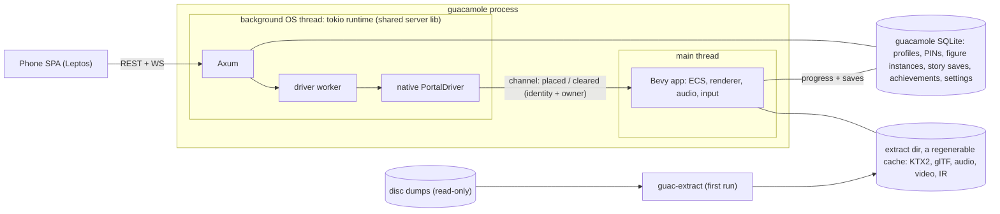

# Guacamole design

Status: DESIGN, started 2026-10-17 and revised the same day for chotchki's second round of decisions.
This file owns the Guacamole track (`openspec/config.yaml` points here). Open changes:
`openspec/changes/aa-guacamole-shell/`, `ab-giants-extract-and-intros/` and `ac-giants-decode-gate/`; the
later rungs of the ladder are lines in the Guacamole section of `openspec/backlog.md`. Until G1 the
product (CLAUDE.md, SPEC.md, `docs/dev/*`) is owned where it always was, and it's frozen: the controller
installed on the HTPC keeps playing the games and chotchki doesn't have to touch it until Guacamole is
ready.

## What Guacamole is

A from-scratch Rust/Bevy reimplementation of the PS3 Skylanders games WITH the original gameplay,
Skylanders Giants (BLUS30968) first, so the art can be upscaled and relit on the HTPC. Users supply their
own disc dumps, `guac-extract` pulls the assets out at install time and nothing read from a disc ever
ships or lands in this repo. The phone stays the portal, and a figure is just an identity out of the
disc's own roster, so nobody dumps a toy and nothing reads a `.sky`. It runs as a second binary,
`guacamole`, beside the product launcher until it can play a whole game.

The bar is parity: what the original game observably does, as seen through the patched RPCS3 (the
oracle), at the original logic tick, EXCEPT the deliberate departures listed below. A Faithful render mode
matches the original look first and an Enhanced toggle layers modern lighting and upscaled textures on
top. Faithful comes first because the oracle can check it and can't check Enhanced (and an upscaled game
that plays wrong isn't the goal).

The why is chotchki's: exploring what's even possible and bringing joy to his kids. There's no time or
cost pressure and the scale is not up for re-argument. What the motivation DOES set is ordering: every
rung of the ladder ends in something the kids can see on the TV, early and often, ahead of
plumbing-only phases.

Out of scope: the product's eframe launcher and patched-RPCS3 window management (left alone until G1), a
USB/HID portal (never), anything online and reading a `.sky` file in any form.

## Decisions

All chotchki's, all 2026-10-17. Quotes are his words (spelling fixed). The second batch came later that
day and wins wherever the two touched. What it superseded (a one-way `.sky` import, sky-parser in the
Guacamole path, stats read from `.sky`, finding dumps through RPCS3's `games.yml`, the product's wizard as
a prerequisite, importing RPCS3 saves, trophies cut, PvP undecided) is gone from this doc, not kept beside
it. A proposal that needs one reversed says so and asks, it doesn't relitigate quietly.

First batch:

- Option C, a full native rewrite with original-gameplay parity, chosen knowingly over the smaller
  options. Declined as the main track: a native sandbox on extracted assets with non-faithful gameplay
  (A), original logic in a hidden RPCS3 driving a Bevy renderer (B), an RPCS3 texture-replacement/post-FX
  patch and static recompilation. Those survive only as supporting tools (texture dumps to check the
  extractor, the patched RPCS3 as the oracle).
- Codename Guacamole, in his words: Engine codename "Guacamole". Binary `guacamole`, crates `guac-*`
  (`guac-formats` pure fuzzed parsers, `guac-ir` versioned serde IR, `guac-extract` the CLI, `guac-server`
  the shared server lib). Never "Skylanders..." in a crate or binary name.
- Giants first: "I'm fine with doing Giants first especially since it will probably be easier to do the
  later games too." Scoring is in Why Giants first.
- Two binaries for the transition: "I'm fine with keeping the existing window management structure (or
  even delivering two different binaries if that makes it easier)." The product binary's behavior and
  window management stay as they are until G1; `guacamole` is a separate Bevy app embedding the same
  server. How much of the product's SOURCE moves for that is Open question 8.
- One app at the end: "there's no need for the multiple windows if I own the whole thing." G1 makes
  `guacamole` the only thing this repo builds and ships; G2 retires the oracle.
- Planning is pure OpenSpec in this repo: "I recommend we nuke the hooks for this repo and just go pure
  openspec." The plan-bridge hooks and state are gone, PLAN.md's open phases became
  `openspec/changes/<id>-<slug>/` with their ids kept, PLAN_ARCHIVE.md is frozen.
- Wiki data is temporary: "those were scraped out of a fandom wiki and I'd argue that once we are parsing
  the game assets directly they are not needed (and neither is the reconstructed lookup tables since
  we'll be owning all that data)." `guacamole` stops reading it once the disc roster lands; the files go
  at G1 with the product code that still reads them (Figures).
- The phone is the portal. No USB/HID portal driver, ever.
- Target hardware: "The HTPC has a 2080 Ti GPU." The HTPC (Windows, Steam Big Picture, 86" 4K TV, the
  kids' machine) is the performance and feature floor; the M3 Max Mac is the dev box.
- Tooling: the rea MCP isn't used (measured, see RE toolchain). Ghidra plus RPCS3's own tools.
- Hard rule: no game bytes in the repo, ever (last section).
- Method: observe in the oracle, write the behavior down in our own words as an OpenSpec spec, implement
  from the spec, run the original script data instead of rewriting it.

Second batch:

- Figures get a FULL reset. Figure crypto was already moot ("once we own the engine none of that matters
  anymore"), and then: "On the figure crypto point, I'm fine with a full reset. The web UI already allows
  figure editing but it's buggy due to the complexity of the sky format. Bypassing it entirely saves us a
  lot of reverse engineering, also people don't have to dump all their figures (we would drop the ACR122
  support too)." Guacamole never reads a `.sky`, so there's no import, no figure crypto and no firmware
  pack or figure dumps to collect. A figure is an identity (toy type + variant) from the disc's own
  roster and its progression starts fresh in Guacamole's own store.
- Per-profile figure instances stay: "I still want to keep the separation by user of figure instances
  like we do today." One instance per profile per figure. No per-kid shelf though: "every character on
  the disc is basically what's already seen since my kids had such a vast collection", so the phone shows
  the whole disc roster.
- The ACR122 reader leaves the product "as soon as it's convenient", as its own product-track removal
  (`crates/nfc-reader`, `scanned/<uid>.sky`, `FigureScanned`), not tied to G1. `crates/sky-parser` stays
  only as long as the product binary does.
- Persistence and setup: "what has to be persisted on disk for saves/progression should be way easier /
  simpler no files to copy around. the setup screens get way easier too." One SQLite database holds
  everything worth keeping, the extract dir is a regenerable cache and setup is pointing Guacamole at the
  disc dumps. Story saves start fresh too, no import of RPCS3 saves.
- Story saves belong to profiles: "Tying story progression to a kid's profile would be a great quality of
  life improvement, right now they fight over whose slot is whose. I would say the profile that starts
  the game uses its slot." One save per profile per game, no slot picker. Co-op rules are in Deliberate
  departures.
- Online out, trophies in as achievements: "anything online should be dropped, I think we could bring in
  the trophies / achievements to the save profile."
- Local PvP is in: "keep local PvP, the kids love couch battles it's part of the core game(s)". It's part
  of parity for every game, and the first couch battle is its own rung right after the first fight.
- Controllers: prompts match the physical pad in use, and on Steam Input: "we should be able to tell Steam
  to pass through the native game controls, other games do it". The hardware checks behind that: "I'd
  say this is all non-urgent testing" (Controllers).
- The product is frozen: "I have a fully functioning portal controller on the HTPC and do not have to do
  anything to it until this is ready." G1 makes `guacamole` the only thing this repo builds and ships, and
  the controller already installed on the HTPC keeps playing the other five games until Guacamole covers
  them.
- No time estimates: "I disregard any/all time estimates in the face of AI development ... any/all
  estimates are completely hallucinated" and "I will accept estimates when they are based on evidence ...
  take the agile approach and try/iterate/measure. For this project none of that matters I'll decide based
  on our progress what I want to do." This doc sequences by conditions and evidence and carries no hour,
  week or year figures.

## Deliberate departures from the original

Parity means matching the original EXCEPT this list. Each item is chotchki's call (Decisions); the oracle
checks everything else.

- No toy and no portal hardware. The phone is the portal and offers every character on the disc, where
  the original needs the physical figure on a USB portal.
- Figure progression lives in Guacamole's store, keyed by profile + figure, never on a toy or in a `.sky`.
  Two kids with the SAME figure each have their own instance (today's working-copy rule, minus the file).
  Nothing flows back to the original games or to RPCS3.
- The phone can edit a figure's progress (level and gold, plus reset to fresh), which the original never
  offered. It edits rows in the store, not a file.
- Story saves belong to profiles: one save per profile per game and no slot picker. The profile that
  starts the game plays on its own save.
- Trophies become per-profile achievements stored with the profile instead of PSN trophies. Names and
  icons come from the disc's `PS3_GAME/TROPDIR` if its container reads (unverified); if not, we define our
  own from the unlock conditions the oracle shows. Who earns one in co-op is Open question 4.
- Online is gone: DemonWare, PSN and anything else networked beyond the LAN link to the phone. The
  DemonWare evidence comes from SSA's EBOOT (103 matching strings, `cellHttp` and `sceNp` imports);
  Giants' online surface isn't measured, and the cut covers whatever is there.
- Button prompts show the label printed on the pad in the player's hands, not the PS3's glyphs
  (Controllers).
- The Enhanced renderer is an opt-in toggle over the Faithful default (Renderer).
- Rendering runs above the original frame rate by interpolating between logic ticks; the logic stays at
  the original tick (Renderer).

Co-op, spelled out:

- The host is the profile whose phone started the game. Its story save loads and only that save advances;
  the second player plays along on the host's story and their own save for that game doesn't move.
- Figure progress (XP, gold, upgrades) goes to the profile that placed the figure, today's ownership rule
  (`placed_by` on each loaded slot), so both kids' characters advance.
- In PvP no story save is in play; whatever figure progress a battle awards (the oracle will say) follows
  the same placed-by rule.

Not a departure: local PvP (Battle Mode, `pvp_maincontrol.arc` in Giants) is part of parity for every
game.

## Architecture

### Two binaries until G1

Verdict: the product binary (`crates/server`'s `skylander-portal-controller`: eframe launcher, patched
RPCS3, P7/P8 window management) stays frozen in behavior and window management, and `guacamole` is a
separate Bevy app that embeds the SAME server in-process. How `guacamole` reaches the HTPC without
touching the installed controller is Open question 2.

- Bevy owns the main thread (winit wants it, macOS insists). Axum, the phone SPA, SQLite and the driver
  worker run on a tokio multi-thread runtime on a background OS thread, the same split the product uses
  with eframe on main today (`crates/server/src/main.rs:309-645`).
- The native PortalDriver backs the existing driver worker. A load carries the figure's identity (the
  server's figure ids already are the tag form `<toy type>-<variant>`, `0007d6-0000`) and the profile that
  placed it, and the driver sends both over a channel that a Bevy system drains each frame; `clear(slot)`
  sends the removal. No file is involved: the trait's `load(slot, path)` takes a `.sky` path today, the
  native arm skips the working-copy fork (`working_copies::resolve_load_path`) and how the trait carries
  identity instead is AA's call. Of the trait's RPCS3-shaped methods (`crates/rpcs3-control/src/lib.rs:23`),
  `open_dialog` is required and becomes a no-op, and the IPC-only ones (`ipc_socket_path`, `emu_state`,
  `game_window_handle`, `game_surface`, `window_set`, `reconnect`) keep the trait's "not applicable"
  defaults, as `MockPortalDriver` (`crates/rpcs3-control/src/mock.rs:92`) does. Trimming the trait waits
  for G1, when its RPCS3 implementations leave.
- The portal protocol doesn't change (REST commands return 202, WS carries the snapshot then
  `SlotChanged`). The visible differences: the figure list is the disc roster (AA's interim catalogue
  until it lands), the game list offers what `guacamole` can play from the dumps it was pointed at
  (Giants), a figure's details and edits read and write Guacamole's store (from AG; before that every
  figure is fresh) and the grown-ups toggles that rewrite the product's RPCS3 and window settings answer
  "unavailable".
- One binary at a time. Both bind the same HTTP port and advertise the same mDNS name, so the QR and the
  PWA bookmark work with either. The second one to start sees the port taken and says so on the TV
  instead of fighting. Steam Big Picture gets two non-Steam shortcuts, with Steam Input off on
  `guacamole`'s (Controllers).
- Data lives in one SQLite plus the extract dir (Persistence and setup; which file is Open question 1).
  No working copies, no scanned figures and no RPCS3 config, and the extract dir sits outside the tree in
  dev (the hard rule says why).

Known friction for AA. "Stays as it is" means the product's behavior and window management, NOT its
source, and the source moves more than a little:

- The bootstrap that builds the tokio thread, the driver worker and the watchdogs lives in `main.rs`
  (947 lines), not the lib, and the lib (`crates/server/src/lib.rs`) exports the eframe modules beside
  the server ones. AA moves the non-UI modules into a new `crates/guac-server` that both binaries link,
  lifts the bootstrap into one `boot()` call there and gives every RPCS3-keyed branch an explicit
  native arm. No behavior change for the product, and the product's e2e suite plus the HTPC live smoke
  prove it. Narrower alternative if chotchki reads "untouched" literally: `guacamole` links the existing
  `skylander-server` lib as it is (eframe compiled in, never run) and only `boot()` and the native arms
  land in it (Open question 8).
- The product's first-launch wizard (eframe, `crates/server/src/wizard.rs`) isn't a prerequisite and
  isn't ported. Guacamole's setup is one question (Persistence and setup).

### G1: one app

At G1 (`guacamole` plays one game end to end) `guacamole` becomes the only thing this repo builds and
ships. The product binary leaves, and with it everything RPCS3 in what ships: `rpcs3-patches/` P1-P8 as a
product series, `rpcs3-control`'s product drivers (IPC and UIA), the nested-app bundling and signing, the
Win32 `SetWindowPos` tiling, the macOS CALayerHost embed (`crates/server/src/compositor.rs`),
`crates/sky-parser` and the wiki data the product's phone UI still reads. (`crates/nfc-reader` is gone
before then, on the product track.) The TV launcher surface (the QR badge, `BadgeRig` in
`crates/server/src/badge.rs`) is rebuilt as Bevy meshes and materials before then.

It leaves what SHIPS, not the repo. The RPCS3 submodule plus a dev-only patch series stay as the oracle,
built on dev machines and never shipped, until G2 (parity) retires them.

Nothing is lost on the HTPC. G1 stops BUILDING the product, it doesn't uninstall it: the controller
already installed there is frozen and keeps playing Spyro's Adventure, Swap Force, Trap Team,
SuperChargers and Imaginators until Guacamole covers them.

## Persistence and setup

Verdict: one SQLite database holds everything worth keeping, and nothing else on disk is precious.
Backing up the family's progress is copying one file.

- In it: profiles and PINs, per-profile figure instances (Figures), per-profile story saves (one per
  profile per game), achievements and settings.
- Not in it, and not needed anywhere: `.sky` working copies, `scanned/`, RPCS3 savedata, PS3 firmware or
  RPCS3's config. No files to copy around.
- The extract dir is a regenerable CACHE. Delete it and `guac-extract` rebuilds it from the dumps (its
  manifest already forces a rebuild on an extractor or IR version bump), so nothing in it gets backed up.
  The local Enhanced pack is the same kind of cache.
- Story saves start fresh, like figures. The kids' RPCS3 Giants saves aren't imported.
- Setup asks one thing: where the disc dumps are. No RPCS3 path, no PS3 firmware, no figure pack and no
  `games.yml` scan. Guacamole identifies each dump itself (`PARAM.SFO` plus the extractor's identity key,
  The extractor) and offers the games it can play. Release gets a first-run screen on the TV for it and
  dev reads it from `.env.dev`; AA is the first change that needs it, since its HTPC run is a release
  build.
- Which SQLite file is still open (Open question 1), and the frozen controller is why it matters. Today's
  profiles live in the product's `db.sqlite`, and the controller installed on the HTPC opens it through
  `sqlx::migrate!` at its defaults (`crates/server/src/profiles.rs:556`), which refuses a database
  carrying a migration the binary doesn't know. The first Guacamole table in that file (AG's figure store
  at the latest) would stop the controller the kids still use for the other five games from starting.
  Until it's settled nothing Guacamole adds goes in there: AA shares the controller's profiles and PINs
  through the schema both binaries already carry (no migration, so a kid's PIN works in either app) and
  keeps its few settings in a file of its own (AA design decision 6). Recommendation: `guacamole` gets
  its own database under its own data root before its first table, AG's at the latest.

## The six games

Three engine families. The surprise is Spyro's Adventure: the PS3 build is XPEC's port on their own
engine, not Toys for Bob's Alchemy. Measured by reading the discs (archive and IGZ headers, magic bytes,
PARAM.SFO), not taken from the wiki.

| Game | Engine | Container | Logic | Meshes | Physics / SPU | Audio | Video |
|---|---|---|---|---|---|---|---|
| Spyro's Adventure BLUS30779 | XPEC "Lux" port | loose `.lxb/.str/.apk/.lsa/.fnt` | Lua 5.1 (138 plaintext files) + native + `.lxb` trigger graphs | `.str`, encoding unknown | no Havok; SPURS jobs of unknown purpose | Wwise | Bink 1 |
| Giants BLUS30968 | Alchemy + TfbTool | IGA v0x08 (LE header, LZMA), IGZ v6 | native + tfbScript op graphs | `igPS3EdgeGeometry` | Havok 2011.2, probably on PPU; 20 SPU images, all FMOD | FSB5 MPEG | Bink 1 `.mov` |
| Trap Team BLUS31442 | Alchemy + TfbTool | IGA 0x0B LE, IGZ v8 | native + tfbScript | Edge | Havok 2013.1; FMOD on SPU | FSB5 | Bink 2 |
| Swap Force BLUS31076 | Alchemy + VV Laboratory | IGA 0x0A BE `.pak` (zlib), IGZ v7 | VVL (VV's .NET-like IL) | Edge | Havok 2012.1 + `.hkb` behavior graphs; 33 SPU images incl. Havok | FSB5 | Bink 2 (+ a few Bink 1) |
| SuperChargers BLUS31545 | Alchemy + VV Laboratory | IGA 0x0B BE `.pak` (LZMA), IGZ v9 | VVL | Edge | Havok 2014.1; 31 SPU images | FSB5 | Bink 2 |
| Imaginators BLUS31600 | Alchemy + VV Laboratory | IGA 0x0B BE `.pak` (LZMA), IGZ v9 | VVL | Edge | Havok 2014.1; 31 SPU images | FSB5 | Bink 2 |

### Giants in detail

- Disc: 964 files, 18 GiB. 294 `.arc` (11.2 GiB) and 599 `.bld` (3.7 GiB), all IGA; 61 `.mov`.
- IGA v0x08: a 0x34-byte header that is LITTLE-endian even on PS3, 12-byte file records
  `{offset, size, blockWord}`. `blockWord` 0xFFFFFFFF means stored, otherwise the top nibble is the codec
  (2 = LZMA) and data comes in 0x8000-byte chunks, each a u16 compressed size + 5 bytes of LZMA props +
  raw LZMA1. `.arc` entries are stored, `.bld` entries are LZMA. A ~150-line reader opened every archive
  on all five Alchemy discs (16,310 of 16,310, 0 errors) and 522 random compressed entries decompressed to
  exactly their declared size. Cross-checked against [igArchiveLib](https://github.com/LG-RZ/igArchiveLib)
  and [igArchiveExtractor](https://github.com/NefariousTechSupport/igArchiveExtractor).
- Inner content: 85,310 entries, 17.56 GiB decompressed, of which 9.8 GiB is duplicate by name (every
  level and character bundle is self-contained). 79,509 FSB5 voice lines, 599 `level.bld` (one IGZ each),
  1,542 texture IGZ, 3,660 language packs.
- IGZ v6: magic `IGZ\x01` + a big-endian version, section descriptors from 0x10, section 0 holds the
  fixups. v6 numbers its fixups (0 TMET type names, 1 TSTR, 2 EXID, 3 EXNM, 5 RVTB, 0xA TMHN, 0xC MTSZ,
  0xE RSTR; 6, 7, 8, 0xB, 0xF and 0x10 unknown) where v7+ uses 4CC tags. TMET names the igObject types but
  the files do NOT carry field layouts; those live in the EBOOT's reflection registry, and that's the
  hardest unknown in the decode gate. External refs are FNV-1a32 hashes (namespace `metaimages` =
  0x843CD0C2, brute-forced).
- `igImage2` textures: `dxt5_big_ps3`, `dxt5_tile_big_ps3`, `dxt1_tile_big_ps3`, `dxt1_big_ps3` and a
  few `l8_tile_big_ps3`. DXT maps 1:1 onto BC1/BC3; what `_tile` means on PS3 is unknown.
- Meshes: `igPS3EdgeGeometry` (+ `Segment`, `igEdgeGeometryAttr`), Sony's Edge format, decompressed on
  SPU at runtime. Public references: the v6 Edge path in
  [NoesisPlugins](https://github.com/NefariousTechSupport/NoesisPlugins) `fmt_alchemy_igz.py` (attribute
  unpack, skinning bone maps), chrrox's Edge index decompression (credited in
  [SkydraHeavy](https://github.com/spyrosadventure/SkydraHeavy)) and igCauldron's `EdgeStuff.cs`, which
  targets the later IGA and is untested on v6.
- Havok `hk_2011.2.0-r1` packfiles ride inside `level.bld` as blobs (271 in one arena file).
  [Kovah](https://github.com/NefariousTechSupport/Kovah) has 2011.2 class metadata dumped from Giants on
  Wii; [HavokLib](https://github.com/PredatorCZ/HavokLib) reads spline-compressed animation in that
  version range. None of Giants' 20 SPU images is Havok (all FMOD), so Havok PROBABLY runs on the PPU
  and physics parity needs no SPU decompilation. Not proven: the EBOOT imports `cellSpursJq` (12
  functions), so non-ELF SPURS jobs could exist, and nobody knows yet where Edge decompression and
  skinning run (AC's first capture answers that part).
- tfbScript: character behavior (attacks, upgrades, projectiles) is serialized as op graphs inside IGZ
  (`ScriptSet`, `OpCodeList`, `OpUseMacro`, `OpMacroInterface`, `OpMacroParameter`, `OpCheckValue`,
  `OpDefineMacro`, `OpFlowMacro`, `OpFlowBuiltInBehavior`, `RHSValueStack`). The structure is documented
  for the Wii build by "Skylanders Giants in Spyro's Adventure (Wii)", a public tools-only project that
  ports the eight Giants into Wii SSA (its URL wasn't recorded, Open question 5). What it documents: a
  script is an `OpCodeList` whose ops carry a control word counting the ops in their block; op objects are
  SHARED across positions (one `OpFlowBuiltInBehavior` serves 326 positions in Tree Rex's script); a
  macro call is `OpUseMacro` → `OpMacroInterface` → one `OpMacroParameter` per argument → `OpFlowMacro`;
  expressions are binary nodes (+ - * /); comparisons are codes 0-5; an else is an `OpAbstractFlow` jump;
  engine members are named by FNV-1a hashes. PS3 offsets are unverified. The VM is the documented half;
  the native built-ins and engine members behind it aren't, and they're where the reverse engineering is.
- Audio: FSB5 v1, one sample per bank, MPEG, 44.1 kHz for 97% of them. There are no FMOD event files on
  disc, so triggering lives in engine objects (`tfbSoundDataInfo`) and script macros ("Sound - VO
  Request").
- Video: 61 Bink 1 `.mov` at 1280×720: 48 per-character intros named by character (`eruptor.mov`), one
  per playable character; 11 FMV (`fmv01`-`fmv12`, no `fmv05`); 2 logos. Ten carry 13 audio tracks
  (per-language voice), the rest carry one. FFmpeg decodes Bink 1 (probed on a Giants file).
- EBOOT: an encrypted SELF, 5.65 MiB of `.text` (~1.48M PPU instructions), 277 imports from 22 libraries.
  Stripped, but RTTI typeinfo strings, 115 `*MetaField` reflection names and engine API names
  (`igPlatformVisualContext::drawEdgeGeometry`) survive.
- Figure → asset: character archives are keyed by DECIMAL toy-type id, `character/009_eruptor.arc` ↔
  toy type 9, with variant suffixes (`_legendary`, `_alt`, `_dark`, `_red`). A placed figure resolves to
  its archive by filename, except where a toy type has no archive of its own number (Dark Spyro, toy 28,
  rides `016_spyro_dark`). `character/` holds 227 files: 68 character `.arc`/`.bld` pairs, the card-game
  archives and a few UI and puzzle bundles.
- Roster: 48 playable characters by the intro count (one intro each), plus variants. Giants also plays
  SSA-era figures (origin-game-and-later rule, `crates/core/src/compat.rs:48`). The disc's roster is the
  catalogue the phone offers (Figures).

### What carries past Giants

- Into Trap Team, nearly everything: 147 of 175 sampled Giants IGZ type names also appear in Trap Team,
  79 of them script or `tfb*` types. IGA moves to 0x0B (a u64 name-table offset), IGZ to v8 (4CC
  fixups), Havok to 2013.1 and the tfbScript VM carries. A Trap Team reflection schema (metaobjects) is
  public in [ig-workshop-tests](https://github.com/spyrosadventure/ig-workshop-tests), dumped from TT 1.1.0
  (our disc is 1.00). Bink 2 is new.
- Into Swap Force, SuperChargers and Imaginators: the container, IGZ, `igImage2`, Edge and Havok-reader
  layers only (30, 25 and 18 shared type names). Their logic is VVL, a different VM (igCauldron's
  `VvlToDll` documents VV's non-standard opcodes). [igCauldron](https://github.com/NefariousTechSupport/igRewrite8)
  ships full SC 1.6.x and Imaginators 1.1.0 schemas (8,390 metaobjects for Imaginators), again later
  builds than our 1.00 discs.
- Spyro's Adventure (PS3): nothing at the format level, XPEC's Lux shares no formats with Alchemy. The
  Bevy runtime, the extractor framework, the oracle and the method carry. (TfB's own SSA is the Wii
  Alchemy build with IGZ v5 and tfbScript; it isn't on the shelf.)
- Bink 2, for every later game: FFmpeg can't decode it (probed: "Bink 2 video is not implemented");
  [NihAV](https://nihav.org) and [librempeg](https://github.com/librempeg/librempeg) have decoders, NihAV's
  author says with imperfect reconstruction (no in-loop deblock). That's every later game's M0 and its
  cutscenes.

## Why Giants first

Scored on chotchki's own criterion, risk and leverage, then confirmed by him (quote in Decisions).

| Lens | Spyro's Adventure (PS3, XPEC) | Giants | Winner |
|---|---|---|---|
| Oracle readiness | never registered in RPCS3 on the Mac (not in `games.yml`, no cache, no savedata); compat "Ingame" | in `games.yml`, PPU AOT cache, 155 FP / 62 VP shader cache, savedata; compat "Playable"; ~60 fps SPU-LLVM on the M3 Max; the product drives it on the HTPC | Giants |
| Mesh and animation decode | `.str`: no public decoder, not plain float32 | public references for v6 Edge and Havok 2011.2 | Giants |
| Logic as data | over 95% native C++; Lua is per-actor glue (~7.6k code lines, 65% of it hub story) | attacks and upgrades are tfbScript data a VM can run | Giants |
| SPU code | SPURS jobs of unknown purpose (solver/dynamics strings) | every SPU image is FMOD (job-queue imports leave non-ELF jobs unruled-out) | Giants |
| Carry-over | none | strong into Trap Team, readers into the VV games | Giants |
| Closed middleware | none in gameplay | Havok-tuned physics feel, FMOD | SSA |
| Field names | self-describing `.lxb` (CRC32 name tables) | reflection needed | SSA |
| Roster | 32 | 48 | SSA |

Giants wins the three lenses that can sink the project (oracle, decode, logic as data) plus carry-over.
SSA's wins are real, but none of them can sink it the way a missing oracle can. For the kids it's also the
better game one: it plays their SSA-era figures too, ships 48 intros (M0 needs only IGA and Bink 1, both
already read) and already runs here.

What flips it: AC's decoded hero doesn't match its RSX capture. Then AC proposes Trap Team (same TfbTool
island, reflection schema already public) at the price of Bink 2 for its M0, and chotchki decides. What
the kids play most is unknown, and it matters less now that the phone offers the whole roster: it would
reorder which figures and levels get attention first, not the game. The only signal is on the HTPC,
where `figure_usage` holds a last-used time per (profile, figure) with no counts (the Mac's table is
empty, it's a dev box) and the product's own figure stats carry playtime. Looking at those is one-off
research on the product's data; nothing from it reaches Guacamole.

## Method

The spec sits between what the oracle shows and what we build, and the original script data runs as
shipped instead of being rewritten.

1. Observe in the oracle: run the original in the patched RPCS3 and capture what it does (input → state
   traces, RSX frames, portal traffic, script events). The decompiler is a reading aid for a mechanism
   the oracle already showed, never a source of code.
2. Write the behavior down in our own words as an OpenSpec spec, through a change's delta into
   `openspec/specs/<capability>/spec.md`: SHALL/WHEN/THEN about what the game observably does, never
   internal names (`openspec/config.yaml`'s specs rule).
3. Implement from the spec. Tests come from the spec (unit, integration) and from the oracle
   (tolerance-based comparisons, generated locally, never committed).
4. Run the original script data instead of rewriting it: a tfbScript VM over the user's IGZ. Fixes ship
   as our own code in the VM or its built-ins, never as edits to the script data.

Why it's shaped this way:

- The spec is the arbiter when the oracle and Guacamole disagree. It says which side is wrong and it's
  reviewable without Ghidra open. A transliteration of PPU code would drag SPU, Edge and RSX
  assumptions into a Bevy engine and leave nothing to review.
- Running the script data means 48 characters' moves come from one VM plus its built-ins, so a bug fixed
  in a built-in is fixed for every character. Rewriting each moveset by hand is 48 chances to drift.
- Shaders follow the same path: the shading model goes into a spec as equations, gets written fresh in
  WESL and is checked with [FLIP](https://github.com/NVlabs/flip) against RSX captures. Ported microcode
  (with the PS3's shader patching baked in) can't grow an Enhanced mode.
- The nearest prior shape is [OpenMW](https://openmw.org) (the original data and scripts on a
  from-scratch engine), not [OpenGOAL](https://opengoal.dev) (decompiles and recompiles the original code)
  or [Unleashed Recompiled](https://github.com/hedge-dev/UnleashedRecomp) (static recompilation).

## RE toolchain

| Job | Tool | Notes |
|---|---|---|
| Decrypt the EBOOT | `rpcs3 --decrypt <copy>` (`vendor/rpcs3/rpcs3/rpcs3.cpp:392,835`) | Writes NEXT TO its input (`EBOOT.BIN` → `EBOOT.elf`), so only ever on a copy outside both the disc tree and the repo. RPCS3 has keys for all six EBOOTs. |
| Static analysis | [Ghidra](https://github.com/NationalSecurityAgency/ghidra) 12.1.x + [clienthax/Ps3GhidraScripts](https://github.com/clienthax/Ps3GhidraScripts) | Language `PowerPC:BE:64:A2ALT-32addr`. The scripts name imports from NIDs and set the TOC (r2), which matters because the compiler builds addresses as `addis rX,r2,hi; addic` with no literal pointers, so there are no xrefs without it. Its README asks for r2 in `<unaffected>` in `ppc_64_32.cspec`; some Cell vector ops break decompilation. Not installed yet (`brew install --cask ghidra`; JDK 21 is there). |
| SPU code | [aerosoul94/GhidraSPU](https://github.com/aerosoul94/GhidraSPU) | Only if SPU code matters. Giants' SPU images are all FMOD, so probably never for game one. |
| Live debugging | RPCS3's GDB stub | Default `127.0.0.1:2345` (`vendor/rpcs3/rpcs3/Emu/system_config.h:379`). PPU only, Z0 software breakpoints only and breakpoints need the PPU interpreter (LLVM refuses them). Whether it's instantiated by default is medium confidence; the RPCS3 log says. |
| Runtime state | Guest memory dump (`vendor/rpcs3/rpcs3/rpcs3qt/guest_memory_dumper.cpp`) | A sparse 4 GB file where offset = guest address, plus SPU local stores and a JSON manifest. The offline input for hunting the reflection registry. |
| Frame ground truth | RSX capture (`.rrc.gz`) | Taken with the game window's RSX-capture shortcut into `<rpcs3 config>/captures/` (`vendor/rpcs3/rpcs3/Emu/RSX/RSXThread.cpp:3401`); `--rsx-capture <path>` REPLAYS one, it doesn't take one. Real vertex, index and texture bytes for one frame plus the register state. RPCS3's own serialization (magic `RRC`, version 6), no public spec. |
| SPU programs | SPU ELF dumper (`vendor/rpcs3/rpcs3/rpcs3qt/elf_memory_dumping_dialog.cpp`) | Carves SPU programs out of local store into ELF. |
| Which files load when | RPCS3 `sys_fs` logging | Opens are logged by default; reads need the trace level. |
| Glue | small Rust or Python scripts | Read inputs from a path, write outputs outside the tree. |

Why not the rea MCP: measured, it can't see the code. It rejects the encrypted SELF ("unsupported binary
format"), rejects the decrypted ELF (its ELF gate knows `EM_PPC` = 20, not `EM_PPC64` = 21) and forcing
ELF32 fails in every provider. Its arm64 path only sees RPCS3's PPU AOT cache objects, which are
block-granular LLVM translations bound to RPCS3's `ppu_thread` ABI (less readable than Ghidra on the
ELF), and the dev Mac had no rea provider installed for them anyway. Drive Ghidra directly (headless plus
scripts or a Ghidra MCP server).

## The oracle

What exists: the product's patched RPCS3 (P1 portal control over AF_UNIX, P4 portal-traffic events, P6
`BUTTON_PRESS`), the Rust IPC client in `crates/rpcs3-control/src/ipc/` and `tools/playthrough`'s
scripted beats. Giants runs on both machines.

What it lacks:

- P6 is digital only, drives port 0 only (`rpcs3-patches/0006-P6-*.patch:65,76`) and holds each press with
  a wall-clock `sleep_for` (`:122`). No analog sticks, no frame lock, no second pad, so it can't drive
  walking, combat, couch battles or co-op.
- P4 reports `PE cmd=write` with no block id or payload (`rpcs3-patches/0004-P4-*.patch:107`). That's
  fine: figure-side ground truth (XP and gold awarded, upgrades bought) comes from the game's own state
  through memory peeks (MEMSNAP, later P9) or what it shows on screen, never from diffing a `.sky`, which
  would drag the format the full reset skips back in. The oracle still needs a `.sky` to put a figure on
  its emulated portal; that's the dev's own pack, dev-only like the rest of RPCS3.
- Determinism is unmeasured. RPCS3 is EXPECTED to diverge run to run (threaded PPU and SPU, LLVM,
  wall-clock timers); nobody has measured by how much.
- P9 (a per-frame state stream: camera, instances, poses, RNG, entity transforms) doesn't exist and can't
  until the Giants struct layouts are reverse engineered. It comes after that RE, not before.

AE builds the foundation before anything gets called a regression test:

1. Measure divergence: same savestate, same input, 10 runs, on the Mac and the HTPC.
2. A dev-only input patch in its own env-gated series, never in a product binary: frame-locked analog
   sticks, two pads, press-at-frame-N, an RNG peek and seed verb.
3. Tolerance-based comparisons: trajectory envelopes, event-sequence equality (spawns, hits, pickups,
   script events), damage, XP and gold totals, FLIP thresholds on frames. Frame-exact diffs are not the
   plan.
4. More dev verbs as the rungs need them: FSTRACE (asset loads with the guest return address), MEMSNAP
   (bulk peek), RSXCAP (scripted capture).

Pin policy: the oracle rides the pin the product last shipped (`accfecd2d`, the v1.10.0 prerelease).
With the product frozen, a bump is chotchki's call, not a cadence. After G1 the pin moves only for OS
breakage, and it retires at G2.

## The extractor

Three crates. `guac-formats` holds pure parsers over byte slices (IGA, IGZ, `igImage2`, Edge, Havok
packfiles, FSB5, Bink headers), fuzzed. `guac-ir` holds the versioned serde IR for game-logic data (RON in
dev for diffing, postcard shipped). `guac-extract` is the CLI, and the library the app calls on first
run.

- Input is plaintext `PS3_GAME/USRDIR` from the dump the user pointed setup at, plus `PS3_GAME/TROPDIR`
  for achievement names and icons if its container turns out readable. Never the EBOOT: the field layouts
  RE recovers live in `guac-formats` as code, so an install needs no decryption and no firmware. A title
  update (`dev_hdd0/game/<TITLE_ID>/USRDIR` in RPCS3's layout) only layers on if the parity target
  includes one (Open question 6).
- Identity key: `(TITLE_ID, disc APP_VER, installed-update APP_VER, plaintext-USRDIR manifest hash)`.
  All six discs here are APP_VER 01.00 (Trap Team's PARAM.SFO VERSION says 01.01); only Swap Force has an
  installed update, and it replaces only the EBOOT. An unknown dump gets its own error code and a report,
  not a guess.
- "Only the EBOOT is encrypted" rests on magic sniffing (`SCE\0`, `NPD\0`). AB adds an entropy scan over
  USRDIR.
- Output: one extract dir per identity with a manifest (extractor version, IR version, identity, source
  hashes). The engine refuses a stale manifest and offers to re-extract. An IR version bump forces
  re-extraction, which is why a proposal must say whether it changes the layout or the IR version. The
  extract dir is a cache, never a save (Persistence and setup).
- Commodity assets transcode to formats Bevy loads natively. Textures → KTX2 carrying the original BC
  blocks (untile and endian fix only, no re-encode). Meshes, skeletons and animations → glTF `.glb`, with
  engine semantics in the IR. FSB5 MPEG → MP3 (a remux, not a byte copy). Bink 1 → ffmpeg → AV1 or VP9
  with the locale's voice track. Logic data (scenes, collision, tfbScript graphs, tuning, localization) →
  IR. Content-hash dedupe (Giants is more than half duplicate bytes by name).
- The extractor needs an ffmpeg it can call (bundled or found on PATH); AB decides.
- Nothing in the repo: unit tests use synthetic byte fixtures built in code, and tests that need a disc
  are `#[ignore]`d and read the dump path from `.env.dev`.

Local-only upscale pipeline (Enhanced). A first-run "generate my pack" step on the user's machine; the
output never ships and, like the extract dir, is a cache. Texture roles route by the suffix in each
texture's authoring path (Giants uses suffixes like `_diffuse`, `_normal`, `_specular` and `_ao`, plus
per-character rim/matcap textures like `armorrim`). The chain: a 1x de-BC1 pass, a GAN upscale on albedo
only (Real-ESRGAN class, compact models by default), normals through a vector path (decode, denoise,
guided upsample, renormalize; never a colour GAN), spec/AO/masks by guided upsampling against the new
albedo, mips regenerated in linear light, then BC7 colour, BC5 normals and BC4 masks. Tileables get wrap
padding, atlases get island dilation (that needs mesh UVs, so it follows AC), flipbooks go cell by cell.
Giants is roughly 1.1-1.2 Gtexel unique (13,275 unique texture paths, mostly 128-512 px, full mip
chains); how long a full pass takes gets measured when the pipeline runs.

## Renderer

Faithful first, Enhanced as a toggle.

Faithful. Giants' material look is painted diffuse (lighting and AO baked in by the artists), tangent
normals, specular colour and per-character rim/matcap lookups, the same model SSA uses. Giants' render
pipeline itself isn't characterized yet. Trap Team's is (a data-driven `tfbRenderer.igx` with a G-buffer,
tiled deferred lights, CSM, AO, bloom, DoF, motion blur, FXAA and LUTs) and Giants is probably kin, but
that's unverified. The shading model goes through the method above (spec, WESL, FLIP against RSX
captures; RPCS3 already holds 155 fragment and 62 vertex programs for Giants). Gamma-space vs linear
output is unknown; an RSX capture's surface formats answer it.

Enhanced keeps the stylized model as the look and modernizes the light transport around it:
higher-resolution CSM with PCSS or contact shadows, GTAO, TAA or DLSS, tuned bloom and DoF, an HDR
tonemap matched to the original grade, the upscaled pack. No wholesale PBR conversion and no de-lighting
the albedo; that's re-art-direction, not a remaster. The toggle keeps both material sets resident per
entity (or one `ExtendedMaterial` with a mode uniform) and swaps the camera's post components. Halo CE
Anniversary and Unleashed Recompiled are the precedents: accuracy by default, enhancements opt-in.

Frame rate: logic runs in `FixedUpdate` at the original tick and rendering interpolates transforms
between ticks, so 60 fps+ doesn't touch game logic. Adventure co-op is one shared camera with leashed
players, so parity needs no split screen.

The floor is the HTPC:

- RTX 2080 Ti (Turing, 11 GB) is DLSS-capable, so the default plan for the 86" 4K TV is ~1440p internal
  with DLSS up to 4K. Bevy's DLSS integration is Vulkan-only on Windows, so the HTPC runs Bevy's Vulkan
  backend.
- First-generation RT cores make ray tracing an optional toggle at most, never a target. Bevy's RT GI
  (Solari) also only takes `StandardMaterial`, can't render skinned meshes and doesn't light from
  point or spot lights yet, so it doesn't fit the faithful material model in any case.
- Bevy 0.20 has no HDR display output; the TV's HDR waits on Bevy.
- Not measured: a 4K frame with CSM, SSAO, TAA and bloom on the 2080 Ti. AD measures it.

The M3 Max is for development, not for looking good. It has no temporal upscaler besides TAA (no DLSS,
FSR or MetalFX in Bevy), pipeline compilation is synchronous on macOS (so both material sets get
pre-warmed at level load) and there's an open macOS rendering-corruption bug to watch
([bevy #25595](https://github.com/bevyengine/bevy/issues/25595)).

Bevy is 0.20.0, pinned per milestone. Upgrades land at milestone boundaries as their own change, because
every 0.x release breaks API (0.20's switch to WESL broke every custom shader written for 0.19).

## Controllers

Verdict: Guacamole reads the real pad, maps by position and shows the label printed at that position on
the pad in the player's hands.

- chotchki's pads are 8BitDo Ultimate 2s in both variants, PC and Switch. Same four face positions,
  different labels: the PC variant prints Xbox-style (A at the bottom, B on the right) and the Switch
  variant Nintendo-style (B at the bottom, A on the right). That's from the published layouts, checked
  against the pads in hand with the hardware checks below.
- Mapping is positional, because the original's controls are positional. Bevy already names face buttons
  by position (`GamepadButton::South`, `East`, `West`, `North`), so the game binds positions and only the
  prompt glyphs change per pad. Never the PS3's glyphs.
- Steam Input passthrough is the decision: Steam Input off on the `guacamole` shortcut, so Guacamole sees
  the real device instead of Steam's virtual pad. Telling the variants apart is probably SDL3-class
  identification, vendor and product id against a gamepad database (SDL3 picks a pad's face labels that
  way). Bevy's `Gamepad` does carry the vendor and product id its gilrs backend reports; whether that's
  enough to tell the two 8BitDo variants apart on Windows is unverified, and if it isn't, the fallback is
  a glyph-set choice in settings.
- What the Home button does in Guacamole is open (Open question 3).
- Hardware checks, a backlog item and not a gate for any rung ("all non-urgent testing"):
  - With Steam Input off, does each variant show up with an identity Guacamole can map to the right
    glyphs? The Switch variant is the shakier one: if it presents as a Switch Pro-class pad, Windows has
    no XInput path for it and only a HID-level driver reads it (SDL's HIDAPI is the reference).
  - Does Home reach Guacamole, or does Steam keep it for its overlay?
  - Can the per-shortcut Steam Input setting be applied automatically, or is it a one-time step by hand?
- AF's input spec carries the prompt rule, since walking a level is the first rung with a pad in hand.

## Figures

Verdict: a figure is an identity, toy type + variant, out of the disc's own roster, and its progress
lives in Guacamole's store per profile. Guacamole never reads a `.sky`.

- Identity: the phone picks a figure by id, and the server's figure ids already are the tag identity
  (`<toy type>-<variant>`; `ToyTypeId` and `TagVariant` at `crates/core/src/figure.rs:24,50`). In Giants
  the toy type names the character archive directly (Giants in detail).
- Catalogue: the disc roster, all of it, with no per-kid filter. Names, elements and portraits come from
  the disc (where each lives in Giants' data is for AC and AD to find), and the roster lands with the
  first decoded models in AD. It doubles as the compatibility list: Giants offers what Giants has
  characters for, which replaces today's origin-game-and-later heuristic (`crates/core/src/compat.rs:48`).
- AA's catalogue is interim: the wiki data already in the repo (`data/figures.json`, keyed by the same
  toy type + variant, plus `data/images/` portraits), cut to the figures Giants plays. No `.sky` and no
  firmware pack. `guacamole` stops reading it once the disc roster lands, and the files themselves
  (`data/images/`, `data/figures.json`, `data/figures.manual.json`, `data/rekey-log.json`,
  `data/vehicle_terrain.json`, `data/games/*.png`, `tools/wiki-scrape`) go at G1 with the product code
  that still reads them.
- Portraits, a recommendation: the game's own UI portrait textures if Giants ships them (`igImage2`, which
  AC decodes anyway, and it's the original art), rendered from the extracted model as the fallback.
  Either way the Giants disc only covers the figures Giants plays; Swap Force through Imaginators figures
  arrive with their own discs.
- Instances: one per profile per figure, keyed by profile + figure identity and shared across games, the
  way today's working copies are (`working/<profile_id>/<figure_id>.sky`, minus the file). A figure a
  profile has never placed starts fresh on its first placement. The store's columns grow with the rungs:
  XP and gold at AG, upgrades and path at AJ, the rest (hats, nicknames, hero points ...) when a rung needs
  them.
- Phone editing: the editor the phone already has (level and gold, plus reset to fresh) is buggy today
  because `crates/server/src/sky_edit.rs` has to decrypt, edit and re-encrypt a `.sky`. Under Guacamole it
  edits rows in the store instead, from AG, and reset to fresh deletes the instance.
- Ownership: the "profile that placed it" rule stays, so two phones keep working and co-op progress lands
  on the right kid (Deliberate departures).
- No scanned figures. The ACR122 reader leaves the product on its own track.
- The AA card shows identity only (name, element, portrait). Level, XP and gold join it once the store
  exists (AG); before that every figure is fresh, so there's nothing to show.

## Milestone ladder

Every rung ends in something the kids can see except AC (the decode gate) and AE (the oracle
foundation), which the rungs after them stand on. A rung starts when the ones it stands on have landed;
there are no dates. Ids past AC are provisional: `openspec/config.yaml` allocates the next id when a
change is proposed, so a product change proposed first takes the next letter (Open question 7). The
milestone names (M0-M9, G1, G2) are the stable handles.

| Rung | Where | What the kids see | What it proves |
|---|---|---|---|
| AA | `aa-guacamole-shell` | place a figure on the phone, the TV shows its card (name, element, portrait), in `guacamole` | the embedded server, the native driver over a channel, Guacamole's one-question setup, the interim catalogue with no `.sky` and no firmware pack, one binary at a time |
| AB, M0 | `ab-giants-extract-and-intros` | place a figure, its original intro video plays | `guac-extract` skeleton (identity, IGA, manifest, Bink 1 transcode, entropy scan); Bevy video playback is a spike. The 48 intros are named by character, not toy type; the voice-over folder in each character archive bridges most of them and AB maps the rest. A figure without one keeps its AA card |
| AC | `ac-giants-decode-gate`, in parallel with AA and AB | nothing yet (a dev viewer) | IGZ v6, `igImage2`, Edge and a Havok 2011.2 skeleton plus one clip, matched against an RSX capture. Starts once AB's IGA reader has landed. If the decoded hero doesn't match the capture, AC proposes Trap Team and chotchki decides |
| AD, M1 | backlog | their figure as an animated, textured turntable on the TV | the first 3D; the HTPC performance floor measured; the disc roster replaces the interim catalogue |
| AE | backlog | nothing | the oracle foundation: divergence measured, frame-locked two-pad input, tolerance metrics. Lands before any gameplay comparison |
| AF, M2 | backlog | walk one level | level scene, collision, character controller, camera, feel checked against the oracle; the input spec, with prompts that match the physical pad |
| AG, M3 | backlog | first fight: one enemy, XP and gold earned and kept on the kid's profile | combat basics; the per-profile figure-progression store, with the phone's figure editor on it |
| AH, M4 | backlog | first couch battle: one Giants PvP arena, two pads, two phones | a second pad and a second profile's figure in play; the PvP rules as the oracle shows them |
| AI, M5 | backlog | the level comes alive | the tfbScript VM and its built-ins running the original scripts |
| AJ, M6 | backlog | upgrades and the upgrade screen | upgrades and path kept in the store, movesets from script data |
| AK, M7 | backlog | co-op, two pads and two figures in the adventure | the second player on the host's story, the shared camera, each kid's figure progress on their own profile |
| AL, M8 | backlog | chapter one | a run of levels with story and cutscenes; profile-owned story saves (the host's, no slot picker); achievements |
| AM, M9 = G1 | backlog | the whole game | `guacamole` becomes the only thing this repo builds and ships; the launcher surface lives in Bevy; the installed controller keeps the other five games |
| AN, G2 | backlog | parity | the oracle retires |

## Risks

Ranked by how much each could move the plan, each with the experiment that answers it.

| Risk | Why it matters | Experiment | Where |
|---|---|---|---|
| IGZ v6 field layouts aren't in the files | no public Giants metaobject dump (ig-workshop's Giants data has enums and fields only; AlchemyMetadataDumper doesn't list Giants PS3 and is a PRX built with Sony's SDK) | find the igMetaObject registry in one guest-memory dump of Giants, cross-referenced with the RTTI and `*MetaField` strings in Ghidra | AC |
| Edge geometry on v6 | every mesh is Edge-compressed for SPU | decode one character mesh, compare to the vertex buffer in an RSX capture | AC |
| Havok 2011.2 animation | likely compressed clips; skeletons feed everything after M1 | one skeleton and one clip, posed against a capture | AC |
| RPCS3 run-to-run divergence | decides whether the oracle can be a test at all, and how loose the tolerances get | 10 replays from one savestate on each machine, diff positions and RNG | AE |
| Guacamole tables in the frozen controller's `db.sqlite` | the installed controller's migrator refuses a migration it doesn't know, so it stops starting and the kids lose the other five games | settle Open question 1 before the first Guacamole migration | AA, AG at the latest |
| How much of Giants is script data | sizes the VM vs the native built-ins | a read-only census of `OpFlowBuiltInBehavior` and engine-import names across `character/*.bld`, confirming the Wii offsets on PS3 | any time before AI (backlog) |
| Bevy video playback | M0 depends on it, Bevy has no video player | decode one transcoded intro into a texture on the Mac and the HTPC | AB |
| Embedding the server in a Bevy app | the bootstrap is eframe-shaped today | `guacamole` boots the server from the lib with the native driver; the product's e2e lanes stay unchanged | AA |
| HTPC performance floor | 4K on a 2080 Ti with the Enhanced stack | a Bevy scene with CSM, SSAO, TAA and bloom at 4K, GPU timings from `RenderDiagnosticsPlugin`, DLSS on Vulkan | AD |
| Feel parity (camera, controller, collision, Havok-tuned physics) | the long tail, never retired | not a spike: measured continuously by the oracle from AF on | AF onward |
| Reading the real pads with Steam Input off | wrong prompts, or a Switch-variant pad Windows can't read without Steam | read both variants' ids in a Bevy app on the HTPC with Steam Input off for its shortcut | backlog (non-urgent) |
| Trophy data on the disc | achievements without the original names and icons | open `PS3_GAME/TROPDIR` on the Giants dump and see whether its container reads | before AL |
| Encrypted data outside the EBOOT | the extractor assumes plaintext USRDIR | an entropy scan over USRDIR | AB |
| Bevy churn | every 0.x release breaks API | pin per milestone, upgrade at boundaries as its own change | ongoing |

## No game bytes in the repo

HARD rule, no exceptions: no extracted assets or scripts, no decrypted EBOOTs, no decompiler or
disassembler output (Ghidra projects included), no RPCS3 memory dumps, no RSX captures, no keys.

- They live outside the tree: research scratch, the local Ghidra project and the user's own extract
  dir. In dev the extract dir ALSO points outside the working tree (a path in `.env.dev`), because a
  gitignored `./dev-data/` is one `git add -f` away from a leak.
- The repo holds our code, our specs in our own words, synthetic test fixtures and links to public work.
- Disc dumps are read-only. Nothing writes into them (`rpcs3 --decrypt` writes next to its input, so it
  only ever sees a copy).
- Enforced by construction once AB lands (AB.1): a `cargo test` that fails when any tracked file
  (`git ls-files`) starts with a game magic (`IGA\x1a`, `IGZ\x01`, `BIKi`, `KB2`, `FSB5`, `SCE\0`,
  `RRC`, `\0PSF`). Two of the rule's items don't start with one: RPCS3 writes RSX captures gzipped
  (`.rrc.gz`, `RRC` only after inflating), and a decrypted EBOOT is a plain big-endian PPC64 ELF. So a
  gzip file is checked again after inflating its first bytes, and a 64-bit big-endian ELF with machine 21
  fails too. `.githooks/pre-push` and the Windows CI lane both run `cargo test --workspace`, so
  `--no-verify` doesn't get past it. A guest memory dump has no magic at all; only the outside-the-tree
  rule above keeps it out.

## Measuring progress

No time or effort estimates (Decisions): each rung reports what it measured (layers decoded, oracle
deltas, what ran on which machine) and chotchki decides what comes next from that.

## Open questions

1. Which SQLite file: `guacamole`'s own database under its own data root (recommended, Persistence and
   setup), or the product's `db.sqlite`, which can't take a Guacamole migration while the frozen
   controller reads it? If its own, does it copy the product's profiles (names, colours, PINs) over once,
   or do the kids set theirs up again?
2. Getting `guacamole` onto the HTPC before G1. A `v*` tag whose MSI carries it beside the product would
   also replace the frozen controller on install. A tag that ships `guacamole` alone, a separate artifact
   or a hand-copied build?
3. What does the pad's Home button do in Guacamole?
4. Achievements in co-op. One tied to the story follows the host's save and one tied to a figure follows
   its owner, by the co-op rules; for the rest (counters both kids feed), does each profile earn it, or
   only the host?
5. The tfbScript Wii project ("Skylanders Giants in Spyro's Adventure (Wii)"): its URL wasn't recorded.
   Does chotchki have it? Otherwise it gets found again before AI leans on it.
6. Parity target build: the 1.00 disc, or a title update if the HTPC has one installed (none on the Mac)?
   An update would also need setup to know where it lives.
7. Ladder ids: reserve AD-AN for the Guacamole rungs, or let them float as `openspec/config.yaml`
   allocates them (this doc assumes they float)?
8. "Product untouched until G1": AA as written keeps the product's behavior and window management but
   moves its server core into `crates/guac-server` (17 modules, the migrations and the bootstrap). OK, or
   the narrower read where `guacamole` links today's `skylander-server` lib with eframe compiled in and
   only a `boot()` call plus the native arms land in the product's source? With the product frozen and
   no `.sky` in Guacamole, four of those 17 modules (`nfc`, `sky_edit`, `sky_stats`, `working_copies`)
   would move only to be product-only code in a shared crate.
